# 费曼学习平台（Feynman Learning Platform）实训报告

> 项目名称：费曼学习平台　　项目代号：`feynman-platform`
> 项目类型：全栈 Web 应用（B/S 架构 + PWA + Electron 桌面端三形态）
> 开发周期：2026 年 9 月 — 2026 年 11 月（课程实训周期，约 8 周）
> 姓名：＿＿＿＿＿　学号：＿＿＿＿＿　班级：＿＿＿＿＿　指导教师：＿＿＿＿＿

本报告共十章，依次覆盖可行性分析、需求与技术环境、用例与用例描述、界面设计、类设计与关联、功能模型与状态模型、数据库与 ER 模型、测试及结果、心得体会、致谢，文末附关键源代码。报告中的所有接口路径、字段名、算法常量、文件行数均来自项目实际代码，未作虚构；涉及未实现或未验证的内容在正文中明确标注。

---

## 目 录

一、系统可行性分析报告
二、系统需求及技术环境
三、用例及用例描述
四、界面设计及说明
五、类设计及关联
六、关键内容的功能模型和状态模型及描述
七、数据库及 ER 模型
八、测试及结果
九、实验心得体会
十、致谢
附件：关键源代码

---

# 一、系统可行性分析报告

## 1.1 编写目的

本章从软件项目管理的角度论证“费曼学习平台”是否值得做、能不能做、怎么做才可控。报告对象是课程评审教师与后续可能的二次开发者。可行性结论将直接决定项目是否进入需求分析与设计阶段，因此本章需要回答三个问题：学习中的问题是否真实存在、技术方案能否支撑解决这些问题、在有限的实训周期内能否交付一个可演示的完整流程。

## 1.2 项目背景与问题定义

### 1.2.1 背景

费曼学习法（Feynman Technique）的核心主张是“用输出倒逼输入”：如果你不能把一个概念简单地讲清楚，说明你还没有真正理解它。它在学生群体中被广泛推荐，但在实际执行中存在三个常见困难。

第一，自我评估不可靠。学习者自己讲一遍之后，往往判断不出哪里讲错、哪里讲浅，不理解的部分通常正好藏在自认为已经理解的地方。第二，复习时机凭感觉。多数人在“感觉要忘了”的时候才复习，而不是在记忆曲线的合适节点复习，时间大量消耗在已经掌握的内容上。第三，难以坚持。该方法缺少即时反馈，投入与收益之间的时间差过长，难以形成持续的执行动力。

### 1.2.2 问题定义

把上述三点转成软件问题，即：如何把一套依赖自律和直觉的学习方法，改造成有客观评分、有复习调度、有持续反馈的系统。

对应的产品化拆解是：写下知识点（可记录）→ 讲给别人听（可录音、可转写）→ AI 评分（可量化、可定位到维度）→ 间隔复习（可调度）→ 沉淀成知识图谱（可关联）→ 激励（XP / 等级 / 连续天数 / 成就）。这条主线包含项目的全部功能，也是后续需求分析与用例设计的出发点。

### 1.2.3 干系人分析

| 干系人 | 关注点 | 影响度 | 应对策略 |
| --- | --- | --- | --- |
| 使用者（学生本人） | 是否能坚持下来、评分是否可信 | 高 | 五维评分而非单一总分；今日计划降低决策成本 |
| 评审教师 | 工作量是否饱满、是否有工程深度、是否可演示 | 高 | 三条验收链路 + Swagger 文档 + 完整说明书 |
| 课程组 | 是否符合实训大纲要求的十个章节 | 中 | 报告按大纲逐章对齐，用例/类/ER/状态图齐备 |
| 第三方云服务商（LLM / ASR / 数据库） | 配额、限流、模型退役 | 中 | 多供应商自动降级链，任一家失效不影响整体可用性 |
| 后续二次开发者 | 代码是否可读、接口是否有文档 | 中 | routes/services/models 分层 + Swagger + 项目说明文档 |

## 1.3 可行性研究

### 1.3.1 技术可行性

结论：技术可行，但风险集中在外部 AI 服务的不确定性上，需要在架构层面做容错设计。

逐项核对如下。

| 技术要求 | 拟用方案 | 团队（个人）掌握程度 | 风险评估 |
| --- | --- | --- | --- |
| 前端框架 | React 19 + Vite 8 + React Router 7 | 已具备课程基础，实际完成 33 个 `.jsx` 文件、8704 行 | 低 |
| 后端框架 | Node.js（CommonJS）+ Express 5 | 掌握，44 个 `.js` 文件、5543 行 | 低 |
| 数据库 | MongoDB Atlas + Mongoose 9 | 掌握，7 个模型、复合索引已设计 | 低 |
| 认证鉴权 | JWT + bcryptjs | 掌握，中间件 35 行 | 低 |
| Markdown 编辑与渲染 | `@uiw/react-md-editor` + `react-markdown` | 直接复用社区库 | 低 |
| 图表与可视化 | ECharts 6（力导向图、雷达图、柱线图）、Three.js + `d3-force-3d` | 3D 部分学习成本最高 | 中 |
| 语音识别 | 百度智能云 ASR + `fluent-ffmpeg` 转码 | 需处理音频格式与 60 秒上限 | 中 |
| 大模型能力 | 千帆 / DeepSeek / SiliconFlow / OpenRouter 四家降级 | 单次调用简单，难在输出不稳定 | 高 |
| 向量检索与 RAG | `vectra` 本地文件索引 + `BAAI/bge-m3`（1024 维）+ `@langchain/textsplitters` | 需理解分块、embedding、余弦召回 | 中 |
| 多形态交付 | 同一份前端 → Web / PWA / Electron | `vite-plugin-pwa`、`electron-builder` 均有成熟文档 | 低 |

技术上的关键判断有三点。

其一，系统不需要自研模型，智能能力全部通过 HTTP 调用公共 API 获得，技术上没有不可逾越的障碍，主要难点是模型输出不受约束：可能不按要求返回 JSON、可能超时、可能因密钥失效返回 401。对此项目采用分层容错，而不是简单重试。供应商层面使用降级链（`services/aiService.js` 的 `callLLMText` 依次尝试四家，任一成功即返回），格式级别用正则容错解析（`extractJson` 先匹配 ` ```json ` 代码块，再退化为贪婪匹配 `\{[\s\S]*\}`），业务层面使用规则补充（追问失败时返回本地 `fallbackProbe` 的三个预设问题，保证演示时流程不中断）。

其二，SM-2 间隔复习算法、表达体检、今日计划排程这三部分只涉及算法和规则，不依赖外部服务，可以离线开发和离线测试，进度风险较小。其中 `studyPlanService.js` 被设计为纯函数模块（输入“全部知识点 + 今日日志”，输出计划对象，不发请求、不读库），代码注释明确标注“纯函数，便于单测”。

其三，三种前端形态共用同一份代码，实现成本很低：Electron 主进程 `electron.cjs` 在生产环境只是加载 `dist/index.html`，Vite 的 `base` 随 `ELECTRON_BUILD` 环境变量在 `'./'` 与 `'/'` 之间切换（否则 `file://` 协议下资源全部 404 白屏）。

### 1.3.2 经济可行性

本项目为课程实训性质，不产生直接经济收益，成本主要是个人学习时间投入与少量云服务费用。

开发与人力成本估算（按课程实训口径，非商业报价）：

| 阶段 | 主要工作 | 预估投入 | 实际投入 |
| --- | --- | --- | --- |
| 可行性分析与需求 | 学习方法调研、功能清单、技术选型 | 2 人日 | 约 2 人日 |
| 系统设计 | 数据模型、API 契约、核心算法选型 | 4 人日 | 约 5 人日 |
| 后端实现 | 7 模型 / 11 组路由 / 11 个服务 | 12 人日 | 约 14 人日 |
| 前端实现 | 18 个页面 / 组件库 / 设计体系 | 15 人日 | 约 18 人日 |
| AI 能力联调 | 降级链、RAG、五维归一、ASR | 6 人日 | 约 9 人日 |
| 测试与修复 | 冒烟脚本、界面实测 | 4 人日 | 约 5 人日 |
| 文档与报告 | 项目说明文档、README、本报告 | 3 人日 | 约 3 人日 |
| 合计 | | 46 人日 | 约 56 人日 |

超出预估的部分几乎全部用在“AI 输出不稳定”上，与 1.3.1 的技术预判一致：超支来自前期已经识别的技术风险，而不是需求变更，说明项目的风险估计方向是正确的。

运行成本：MongoDB Atlas 免费 M0 集群（0 元）、四家 LLM 供应商的新人免费额度与低价按量计费（实训期实测支出远低于一次打车）、百度语音识别免费额度 5 万次（本项目日均调用量远低于该量级）、域名与服务器在未上线公网阶段为 0 元。总体运行成本可视为零。

效益分析：效益体现在能力收获而非财务回报，见第九章。从产品角度看，其价值在于把“凭感觉复习”改为“按遗忘曲线复习”所能节约的时间。SM-2 的目标是用较少的复习次数维持记忆，在相同的记忆保持率下，复习总时长理论上可以明显缩短。

### 1.3.3 操作（社会）可行性

系统面向单个学习者，操作流程沿用既有的学习习惯：记笔记使用 Markdown，复习使用“先看问题再翻答案”的卡片形式，测验使用选择题与简答题。新增的交互只有“按住麦克风讲一遍”，而这个动作本身就是费曼学习法要求的步骤，系统将其电子化。

界面采用黏土（clay）风格，即大圆角、柔和内阴影、糖果色，用于降低学习工具带来的压力感，符合在校学生这类目标用户的审美偏好。移动端通过底部 5 个 Tab 与抽屉式侧栏适配，PWA 可以安装到手机桌面，不依赖电脑也能完成复习与测验这两类高频操作。

系统不涉及任何他人数据，不产生社交压力，不存在推广阻力。

### 1.3.4 法律与伦理可行性

全部代码自主编写或按 MIT 等许可使用开源依赖，未使用受版权保护的素材；界面插图为程序生成后经 `scripts/make-icons.mjs`、`scripts/crop-clay.ps1` 处理的自有资产。学习笔记内容归用户本人所有，系统提供数据导出（JSON 与 Markdown 两种格式）。

需要注意两点。其一，笔记内容会通过 HTTPS 发送给第三方大模型服务商，属于数据出域。项目已将“密钥与索引不入库、可一键删除数据”写入工程约定，如果今后正式对外服务，还必须在隐私政策中明示。其二，AI 评分不具备教学权威性，界面文案统一使用“教练评语”“参考要点”，不使用“标准答案”，以免对用户造成误导。

### 1.3.5 进度可行性

实训周期约 8 周，按周排布的里程碑如下（Mermaid 甘特图，可渲染为进度表）：

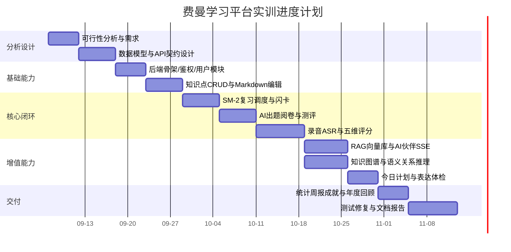

关键路径是“知识点 CRUD → 复习调度 → AI 测评 → 语音复述评分”这条主链，RAG、图谱、今日计划属于可延后的增值能力。实际执行中，增值能力全部完成，但主链上的“复述评分”比计划晚了约 3 天，原因是 ASR 要求特定音频格式而浏览器录出的是 WebM，必须引入 ffmpeg 转码链路，这一项在需求阶段被低估。

## 1.4 风险登记册

| 编号 | 风险 | 概率 | 影响 | 应对措施 | 实际结果 |
| --- | --- | --- | --- | --- | --- |
| R1 | 单一 LLM 供应商密钥失效/限流导致功能整体不可用 | 高 | 高 | 四家供应商降级链，`order` 可配置 | 已规避，任一家挂只多一次往返 |
| R2 | 模型不按要求输出 JSON | 高 | 中 | 正则双层提取 + 解析失败降级到下一家 + 友好提示 | 已规避，未出现前端崩溃 |
| R3 | 千帆 `ernie-5.1` 默认深度思考导致耗时翻倍 | 中 | 中 | 供应商配置显式传 `thinking:{type:'disabled'}` | 已解决：同一出题任务从 18.7s / 2.4 倍 token 降到 7.6s |
| R4 | 模型名退役返回 401，被误判为密钥失效 | 中 | 中 | 文档记录排查顺序：先核对模型名再查密钥 | 已发生一次，按文档 5 分钟定位 |
| R5 | 浏览器录音格式不被 ASR 接受 | 高 | 高 | `fluent-ffmpeg` + `@ffmpeg-installer/ffmpeg` 转码 | 已解决，但引入“不能用 alpine 镜像”的部署约束 |
| R6 | 复杂 AI 请求超过前端全局 15 秒超时 | 高 | 中 | AI 伙伴改 SSE 流式绕开 axios；其余接口单点调大 timeout | 部分未解决，见第十二章不足项 |
| R7 | vectra 每次写操作重写索引文件，批量录入会相互覆盖 | 中 | 高 | 服务内部串行队列排队写入 | 已规避 |
| R8 | 向量库脏数据导致搜索展示旧版本内容 | 中 | 低 | 校验向量块前 40 字必须存在于当前正文，否则回退正文截取 | 已规避 |
| R9 | 实训时间不足，功能铺得太开 | 高 | 中 | 按关键路径排期，增值能力后置；砍掉公式渲染与协作功能 | 已按计划收口 |
| R10 | 修改后端代码忘记重启进程，404 被误判为模型故障 | 高 | 低 | 文档给出 `curl.exe -i` 验证法：401 说明路由已加载，404 说明还在跑旧进程 | 已规避，并形成排查手册 |

## 1.5 结论

技术上有成熟生态支撑，最高风险项（外部 AI 服务不稳定）已在架构层面通过降级链与规则容错加以处理；经济上运行成本接近零；操作上沿用既有学习习惯；进度上关键路径明确，超支原因可以解释。

综合结论：项目可行，建议进入开发。后续的实际结果支持这一结论：系统交付了从录入、复述、测评、复习到图谱与激励的完整流程，18 个页面、11 组 REST 路由、7 个数据模型全部可用，Web / PWA / Electron 三种形态共用同一份前端代码。

---

# 二、系统需求及技术环境

## 2.1 系统目标与范围

总目标：实现一个单人使用、可自部署的费曼学习法数字化平台，让“讲清楚”这件事变得可录音、可评分、可复习、可追溯。

范围内：知识点笔记管理、语音复述与 AI 评分、AI 出题与阅卷、SM-2 间隔复习、闪卡、苏格拉底式 AI 陪练、基于个人笔记的 RAG 问答、知识图谱与语义关系推理、知识宇宙 3D 可视化、学习统计与周报年报、XP/等级/连续天数/成就/每日任务激励体系、多用户数据隔离与 JWT 鉴权、数据导出与导入。

范围外（明确不做）：多人协作与社交功能、教师端与班级管理、移动端原生 App、自研模型、离线可用（PWA 仅缓存静态资源）、自动持续部署。

## 2.2 用户角色定义

| 角色 | 描述 | 权限范围 | 用例数 |
| --- | --- | --- | --- |
| 游客（未登录） | 尚未注册或已退出的访问者 | 仅可访问 `/login`、`/register`；其余路由被 `ProtectedRoute` 重定向到登录页 | 2 |
| 学习者（注册用户） | 系统唯一业务角色，既是内容生产者也是消费者 | 只能读写 `user` 字段等于自己 id 的数据；拥有 XP、连续天数、成就等个人成长档案 | 14 |

系统刻意不做角色分级（无管理员后台、无教师端），这是范围控制的结果，也让数据隔离逻辑可以统一为“所有业务查询以 `user` 为第一过滤条件”这一条规则。

## 2.3 功能需求

功能需求共 21 项，编号供后续用例与测试章节引用。

| 编号 | 功能 | 需求描述 | 优先级 | 实现状态 |
| --- | --- | --- | --- | --- |
| FR-01 | 注册与登录 | 用户名/邮箱/密码注册，邮箱与用户名唯一；登录返回 JWT；密码以 bcrypt 存储且永不回传 | 必须 | 已完成 |
| FR-02 | 知识点管理 | Markdown 正文（支持表格、代码块）+ 分类 + 标签（≤8 个，去重）+ 摘要 + 收藏；支持搜索、多维筛选与 5 种排序 | 必须 | 已完成 |
| FR-03 | 知识点删除 | 删除库记录的同时清理对应向量索引块 | 必须 | 已完成 |
| FR-04 | AI 提炼 | 对正文生成摘要、要点与标签，一键回填表单 | 期望 | 已完成 |
| FR-05 | 语音复述 | 浏览器录音（上限 60 秒，达上限自动停止）→ ffmpeg 转码 → 百度 ASR 转写 | 必须 | 已完成 |
| FR-06 | 五维评分 | 输出总分 + 准确性/完整性/逻辑结构/表达流畅/深度延伸五维分 + 评语 + 优点 + 待改进 + 润色稿 | 必须 | 已完成 |
| FR-07 | 表达体检 | 基于规则计算语速、口头禅、句子长度、讲解结构四项并加权成表达分，不调用模型 | 期望 | 已完成 |
| FR-08 | 弱点驱动追问 | 依据上一轮 weaknesses 生成针对最弱一点的追问，学生补答后再评分，最多 5 轮 | 期望 | 已完成（不落库） |
| FR-09 | AI 出题与阅卷 | 按难度（基础/中等/进阶）与题型（单选/多选/判断/简答）出题，简答与多选由 AI 阅卷，每题结果写入答题记录 | 必须 | 已完成 |
| FR-10 | 错题本 | 汇总 `isCorrect=false` 的记录，可按知识点筛选、重练、删除 | 必须 | 已完成 |
| FR-11 | 间隔复习 | 今日到期队列（≤50 条）+ SM-2 四档评分驱动重排 + 掌握度联动 | 必须 | 已完成 |
| FR-12 | 闪卡 | AI 从知识点生成 3-10 张问答卡，按 `nextReviewAt` 到期复习，三档评分 | 期望 | 已完成 |
| FR-13 | AI 陪练 | 苏格拉底式一问一答，语音或文字作答，可用浏览器 TTS 朗读问题 | 期望 | 已完成 |
| FR-14 | AI 伙伴（RAG） | 基于用户自己笔记检索问答，SSE 逐字流式输出，回答带引用来源 | 期望 | 已完成 |
| FR-15 | 语义搜索 | Ctrl+K 全局搜索，向量召回与关键词召回混合排序，返回片段、高亮区间与命中来源 | 期望 | 已完成 |
| FR-16 | 知识图谱 | 力导向图 + 规则边（正文含其他标题）+ AI 语义边（前置/延伸/混淆/应用）+ 分阶段推荐学习路径 | 期望 | 已完成 |
| FR-17 | 知识宇宙 | Three.js 3D 星球可视化，支持分类聚焦、按周生长回放、点击拾取信息卡 | 可选 | 已完成 |
| FR-18 | 今日学习计划 | 四档优先级排程 + 番茄分桶 + 由日志回填完成度 + 全屏倒计时 | 期望 | 已完成（不落库） |
| FR-19 | 统计与报表 | 12 周学习热力图、周报、年报、Canvas 分享卡片与年度长图导出 | 期望 | 已完成 |
| FR-20 | 激励体系 | XP、等级、连续天数与最长连续、10 枚成就徽章、3 条每日任务 | 必须 | 已完成 |
| FR-21 | 个人中心 | 昵称、头像（8 款预设）、每日学习目标（1-30）、改密、数据导出与导入 | 期望 | 已完成 |

## 2.4 非功能需求

性能
- 常规 CRUD 接口在本地环境下应在 200ms 内返回（向量写入异步化，不阻塞响应）。
- AI 相关接口因依赖外部服务，响应时间由供应商决定；已实测关闭深度思考后单次出题从 18.7 秒降至 7.6 秒。
- 前端首屏只加载登录页所需代码，其余 16 个业务页面全部路由级懒加载，ECharts、Three.js、MD 编辑器按需下载。

安全性
- 密码使用 bcryptjs 哈希存储，接口返回统一走 `toSafeJSON()` 白名单，不含 `password` 字段。
- 所有非公开接口必须携带 JWT；`Bearer <token>` 与裸 token 两种写法均支持。
- 多用户隔离：业务查询一律带 `user` 条件；越权访问返回 401；向量元数据存 `userId`，检索按用户过滤，再用 `KnowledgePoint.find({_id:{$in}, user})` 二次校验。
- 密钥只存在于 `feynman-platform-backend/.env`，该文件被 `.gitignore` 忽略，仓库仅提供 `.env.example` 占位符；代码全部通过 `process.env.*` 读取，无硬编码。
- 搜索关键词入正则前先转义特殊字符（`replace(/[.*+?^${}()|[\]\\]/g, '\\$&')`），避免正则注入。
- 生产环境错误响应脱敏：`createResponse` 在 `NODE_ENV=production` 时把 `error` 字段替换为 `Internal Server Error`。

可靠性与容错
- 四家 LLM 供应商自动降级，未配置密钥的供应商直接跳过并在错误信息中记录原因。
- 追问、追问评分等能力在模型全不可用时返回本地默认结果，保证界面流程不中断。
- MongoDB 为唯一权威数据源，向量库只是检索副本；向量写入失败不影响知识点本身可用。

可用性
- 全局 Ctrl/Cmd+K 唤起搜索面板，↑↓ 选择、Enter 直达复述页。
- 所有破坏性操作（删除知识点、删除会话、移除错题、导入数据）走统一的 `ConfirmDialog` 二次确认。
- 加载态用骨架屏（`Skeleton` / `SkeletonList`），错误态用 `ErrorBoundary` 与 `EmptyState`，异常提示用 Toast（同一消息 6 秒内去重）。
- 未登录访问受保护路由自动跳转登录页，而非报错。

兼容性
- 桌面 Chrome / Edge 为主，需支持麦克风权限；移动端通过底部 Tab 与抽屉侧栏适配，可 PWA 安装。
- Electron 45 桌面端打包产物在 `release/`，`files` 只含 `dist` 与 `electron.cjs`。

可维护性
- 后端按 `models / routes / controllers / services / middleware / utils / config` 分层；前端按 `pages / components / layouts / context / hooks / api / styles / assets` 分层。
- 接口文档：`项目说明文档.md` 第八章逐条列出 55 个端点；Swagger UI 已挂载在 `/api-docs`，但因路由缺少 `@openapi` 块注释，当前生成的 spec 为空（详见 2.5 与第八章）。
- 样式令牌集中在 `tokens.css`，业务样式分为 `pages-core.css` 与 `pages-extra.css`。
- 静态检查：前端使用 oxlint（`react/rules-of-hooks` 为 error 级）；后端未配置任何 linter，也无 `devDependencies`。

## 2.5 接口需求

系统对外有两类接口：浏览器 → 后端的 REST API（40 余个端点，详见第六章与项目说明文档第八章），以及后端 → 第三方云服务的调用。后者构成系统的运行依赖，必须逐项确认。

| 外部依赖 | 用途 | 协议 | 失败影响与处理方式 |
| --- | --- | --- | --- |
| MongoDB Atlas | 唯一权威数据存储 | `mongodb+srv://` | 致命；未放行出口 IP 时表现为 `MongooseServerSelectionError` 卡住 |
| 千帆 `ernie-5.1` | LLM 首选 | HTTPS，OpenAI 兼容 | 降级到 DeepSeek |
| DeepSeek `deepseek-chat` | LLM 次选 | HTTPS | 降级到 SiliconFlow |
| SiliconFlow `DeepSeek-V3` | LLM 备用 | HTTPS | 降级到 OpenRouter |
| OpenRouter `deepseek-chat` | LLM 最后一层备用 | HTTPS | 全部失败则抛“所有 AI 服务暂不可用” |
| SiliconFlow `BAAI/bge-m3` | Embedding（1024 维） | HTTPS | 向量与语义搜索不可用，关键词搜索仍可用 |
| 百度智能云 ASR | 语音转写 | `baidu-aip-sdk` | 提示改用文字输入模式 |
| Google Fonts | ZCOOL KuaiLe / Nunito / Baloo 2 字体 | CSS CDN | 回退系统字体，不影响功能 |

内部接口约定：`utils/responseHelper.js` 定义了统一响应结构 `{ success, data, message, timestamp }`（失败时追加 `error`），并由 `index.js` 的 404 处理与 `middleware/errorHandler.js` 实际使用。但需要如实指出：55 个业务端点目前全部返回裸对象或裸 `{ msg }`，并没有走这套工厂函数（`createResponse/sendXxx` 在全仓库仅出现于 3 处：404 处理、错误中间件，以及一个未被引用的 `controllers/userController.js`）。前端因此是按 `error.response.data.msg` 读取错误信息的。这是文档与实现的一处偏差，已列入第八章的缺陷清单与第九章的改进项。

同理，Swagger 也已挂载（`app.use('/api-docs', serve, setup)`），但 `swagger.js` 只配置了 `apis: ['./src/routes/*.js']` 去扫描 `/** @openapi */` 块注释，而 11 个路由文件里的 `@openapi` 注解数量为 0（只有 `// @route` 形式的单行注释，`swagger-jsdoc` 不解析）。实测用项目原配置生成 spec，结果为 `paths: 0, tags: 0`，页面能打开，但接口列表为空。当前唯一的权威接口文档是 `项目说明文档.md` 第八章那张 55 条端点表。

## 2.6 数据需求

系统需要持久化六类数据：用户账号与成长档案、知识点（含复习状态与行为统计）、学习行为流水、答题记录、闪卡、AI 会话。另有两类数据刻意不落库：知识图谱的语义关系推理结果（按用户缓存在进程内存，12 小时过期）和今日学习计划（每次请求现算）。这一取舍让系统无需维护额外的计划表与关系表，代价是重启后端需重新推理、历史某天的计划无法回看。详见第七章。

## 2.7 技术环境

### 2.7.1 开发与运行环境（本机实测）

| 项目 | 版本/规格 | 说明 |
| --- | --- | --- |
| 操作系统 | Windows 11（x64） | 开发机 |
| Node.js | v22.20.0 | 项目要求 Node 22+ |
| npm | 10.9.3 | 依赖管理 |
| 代码编辑器 | Qoder / VS Code 系 | 配合 AI 辅助编码 |
| 版本控制 | Git，主分支 `main` | 首次提交 `66df141` |
| 浏览器 | Chrome / Edge（需支持 `MediaRecorder`） | 录音依赖 |
| Shell | Git Bash + Windows PowerShell 5.1 | 冒烟脚本用 PowerShell，故脚本文件保持纯 ASCII |

### 2.7.2 后端技术栈（版本取自 `feynman-platform-backend/package.json`）

| 类别 | 选型 | 版本 |
| --- | --- | --- |
| 运行时 | Node.js（CommonJS） | 22.x |
| Web 框架 | Express | ^5.2.1 |
| ODM | Mongoose | ^9.10.0 |
| 数据库 | MongoDB Atlas（M0 免费集群） | — |
| 认证 | jsonwebtoken / bcryptjs | ^9.0.3 / ^3.0.3 |
| HTTP 客户端 | axios | ^1.20.0 |
| 向量检索 | vectra（本地文件索引） | ^0.15.0 |
| 文本切分 | @langchain/textsplitters（随 langchain ^1.5.18） | — |
| LangChain 生态 | @langchain/core ^1.2.18、@langchain/community ^1.1.28、@langchain/openai ^1.6.2、@langchain/baidu-qianfan ^1.0.3 | — |
| 语音识别 | baidu-aip-sdk | ^4.16.16 |
| 音频处理 | fluent-ffmpeg ^2.1.3 + @ffmpeg-installer/ffmpeg ^1.1.0 | — |
| 文件上传 | multer | ^2.4.0 |
| 跨域与配置 | cors ^2.8.6、dotenv ^17.4.2 | — |
| 接口文档 | swagger-jsdoc ^6.3.0 + swagger-ui-express ^5.0.1 | — |

后端入口 `index.js` 仅 46 行，职责清楚：`cors()` → `express.json()` → 挂载 `/api-docs` → 挂载 11 组路由 → `mongoose.connect(process.env.MONGO_URI)` → 404 处理 → 全局错误处理（顺序有讲究，注释明确写了“必须在 errorHandler 之前注册”）→ `app.listen(port)`。

### 2.7.3 前端技术栈（版本取自 `feynman-platform-frontend/package.json`）

| 类别 | 选型 | 版本 |
| --- | --- | --- |
| 框架 | React / React DOM | ^19.2.8 |
| 路由 | react-router-dom | ^7.18.4 |
| 构建 | Vite + @vitejs/plugin-react | ^8.3.0 / ^6.1.1 |
| 样式 | 原生 CSS 分层 + 设计令牌，无 CSS 框架 | — |
| Markdown | @uiw/react-md-editor ^4.1.2、react-markdown ^10.1.0、remark-gfm ^4.0.1 | — |
| 图表 | echarts ^6.1.0 + echarts-for-react ^3.0.6 | — |
| 3D | three ^0.186.1 + d3-force-3d ^3.0.6 | — |
| 录音 | react-media-recorder ^1.7.2 | — |
| 网络 | axios（全局 15 秒超时） | ^1.20.0 |
| 安全 | dompurify | ^3.4.15 |
| 静态检查 | oxlint（104 条规则） | ^1.81.0 |
| 桌面端 | Electron ^45.1.0 + electron-builder ^26.18.0 | — |
| PWA | vite-plugin-pwa | ^2.0.0 |
| 辅助 | concurrently / cross-env / wait-on | — |

> 依赖中已安装 `rehype-katex`、`remark-math`、`mermaid`、`react-katex`，但渲染管线尚未接入（当前只启用 `remark-gfm`），因此笔记中的公式与流程图暂不能渲染，属于依赖已安装、功能尚未接入的遗留项。

字体通过 Google Fonts 在 `index.html` 引入：标题 `ZCOOL KuaiLe`、正文 `Nunito`、数字 `Baloo 2`，对应令牌 `--font-display`、`--font-body`、`--font-number`。PWA manifest 配置 `display: standalone`、`theme_color: #FFF8F0`、三张图标（192/512/maskable-512），Service Worker 用 Workbox 缓存 `**/*.{js,css,html,ico,png,svg}`。

### 2.7.4 环境变量清单

后端启动需要以下环境变量（只列变量名，不列值；实际值保存在本机 `.env` 中，不进入仓库、不进入本报告）：

| 变量名 | 必填 | 用途 |
| --- | --- | --- |
| `MONGO_URI` | 是 | MongoDB Atlas 连接串 |
| `JWT_SECRET` | 是 | JWT 签名密钥 |
| `SILICONFLOW_API_KEY` | 是 | Embedding（bge-m3）与 LLM 备用 |
| `QIANFAN_API_KEY` | 建议 | LLM 首选（`bce-v3/...` 格式） |
| `DEEPSEEK_API_KEY` | 建议 | LLM 次选 |
| `OPENROUTER_API_KEY` | 可选 | LLM 最后一层备用 |
| `BAIDU_APP_ID` / `BAIDU_API_KEY` / `BAIDU_SECRET_KEY` | 语音功能需要 | 百度智能云 ASR |
| `PORT` | 可选 | 后端端口，默认 3000 |
| `EMBEDDING_MODEL` / `EMBEDDING_API_URL` | 可选 | 覆盖默认 embedding 模型与地址 |
| `NODE_ENV` | 可选 | `production` 时错误响应脱敏 |

前端有一个 `VITE_API_BASE`（生产构建时注入 `/api`，本地开发缺省回退 `http://localhost:3000/api`）。

### 2.7.5 系统部署拓扑

本地开发形态（当前实际使用）：

```
浏览器 (React 19 / Vite :5173)
   │  axios（JSON REST，15s 超时）   │  fetch + ReadableStream（SSE 流式）
   ▼                                  ▼
Express 5 (:3000) ── JWT 中间件 ── 路由层
   ├── controllers ── services ── models ── MongoDB Atlas（公网）
   │                    ├── aiService        → 千帆/DeepSeek/SiliconFlow/OpenRouter
   │                    ├── vectorStore      → vectra 本地索引（vector_data/）
   │                    ├── ragService       → 检索 + 拼上下文 + 生成
   │                    ├── reviewScheduler  → SM-2
   │                    ├── studyPlanService → 今日计划排程
   │                    ├── feynmanCoach     → 五维归一 + 追问
   │                    ├── deliveryService  → 表达体检（纯规则）
   │                    ├── graphReasoning   → 语义关系 + 路径排序
   │                    ├── studyLogService  → 日志/XP/连续天数/成就联动
   │                    └── achievementService → 成就判定
   └── 百度 ASR（语音转文字，经 ffmpeg 转码）
```

公网部署形态（方案已完整设计，尚未实际执行）：Nginx 容器托管 `dist` 静态资源并把 `/api` 反代到 Express 容器，`vector_data` 挂数据卷，MongoDB 继续用 Atlas 并放行服务器出口 IP；3000 端口只在 Docker 内网暴露。该方案的 8 条前置约束与故障排查表见项目说明文档第十四章。

## 2.8 项目规模统计（实测）

| 统计项 | 数量 |
| --- | --- |
| 后端 JavaScript 文件 | 44 个（含 `index.js`、`scripts/`） |
| 后端代码行数 | 5,543 行 |
| 后端 Mongoose 模型 | 7 个 |
| 后端 REST 路由文件 | 11 组，逐条枚举共 55 个端点（与第六章、`项目说明文档.md` 第八章一致） |
| 后端服务模块 | `src/services/` 10 个（纯算法 3：`reviewScheduler`/`deliveryService`/`studyPlanService`；外部调用 4：`aiService`/`ragService`/`vectorStoreService`/`graphReasoningService`；联动 3：`studyLogService`/`achievementService`/`feynmanCoachService`） |
| 后端工具与示例 | `src/utils/` 7 个（4 个厂商调用示例 + `multi-llm-manager` + `responseHelper` + `swagger`） |
| 前端 `.jsx` 文件 | 33 个，8,704 行 |
| 前端 `.js` 文件 | 4 个，161 行 |
| 前端 `.css` 文件 | 8 个，4,674 行 |
| 前端业务页面 | 18 个（含登录/注册/404） |
| 前端构建/桌面端脚本 | 2 个（`vite.config.js`、`electron.cjs`）→ 前端源文件合计 39 个 |
| 自绘黏土插画资产 | `src/assets/clay/` 26 个 `.png`（`act-*` 7、`badge-*` 10、`nav-*` 7、`scene-*` 2），另有 `hero.png`，共 27 个 |
| 代码总量（不含依赖与文档） | 19,082 行（= 后端 5,543 + 前端 `.jsx` 8,704 + `.js` 161 + `.css` 4,674；`vite.config.js` 与 `electron.cjs` 另计 111 行未纳入） |
| 项目文档 | 2 份（`README.md` 简要 + `项目说明文档.md` 完整说明书，约 47KB） |

## 2.9 本地运行步骤

```bash
# 1) 后端
cd feynman-platform-backend
cp .env.example .env      # 填入 MONGO_URI / JWT_SECRET / SILICONFLOW_API_KEY
npm install
node index.js             # → http://localhost:3000 ，接口文档 /api-docs

# 2) 前端（另开终端）
cd feynman-platform-frontend
npm install
npm run dev               # → http://localhost:5173
```

首次使用或更换 embedding 模型后需执行 `node scripts/reindex-vectors.js`，把历史知识点补进向量库，否则 AI 伙伴与语义搜索检索不到旧笔记。其他命令：`npm run build`（生产构建）、`npm run lint`（oxlint）、`npm run electron:build`（桌面安装包，产物在 `release/`）。

一条重要经验：修改路由或控制器后必须重启后端（`node index.js` 不带热重载）。忘记重启的典型表现是页面功能“失败”，但实际是 Express 返回 404，而 404 响应体没有 `msg` 字段，前端只弹通用文案，极易误判为模型故障。用 `curl.exe -i http://localhost:3000/api/graph/reason` 可直接判定：401 表示路由已加载（只是没带 token），404 表示还在跑旧进程。

## 2.10 本章的两处“文档与实现偏差”声明

本章前面的需求表是按“设计意图”写的，为了让后续章节（尤其第五章技术债、第八章缺陷登记）有可追溯的基准，此处先诚实记录两处已核实的偏差：

其一，统一响应格式没有落实。`src/utils/responseHelper.js` 提供了 `createResponse()` 与 7 个发送快捷方法，约定所有响应形如 `{ success, data, message, timestamp, error? }`。但全仓库实际只有 3 处引用它，55 个业务端点里绝大多数仍是手写 `res.json(数据)` 与 `res.status(4xx|5xx).json({ msg: '…' })` 两种裸格式。前端因此只能按“裸数组 / 裸对象 + `msg`”来消费，`success` 字段形同虚设。

其二，Swagger 文档没有实际内容。`index.js` 挂载了 `/api-docs`，但 `swagger` 配置对象的 `paths` 与 `tags` 都是空集合，能打开页面，看不到任何接口定义。本报告第三、第五章的接口清单来自对 `src/routes/*.js` 的逐文件枚举，而非来自 `/api-docs`。

这两点不影响功能可用，但影响“按文档对接”的可行性，属于典型的第一类技术债（承诺过但未回收），在 5.6 节与第八章缺陷登记中分别记为 D-07 与 DOC-02。

---

# 三、用例及用例描述

## 3.1 系统功能框图

系统按“一条主流程 + 两类支撑”组织功能模块。主流程是学习动作本身（录入 → 复述 → 测评 → 复习），两类支撑分别是沉淀与洞察（图谱、宇宙、统计、报表）和激励与个性化（XP、成就、今日计划、个人中心）。全局搜索作为跨模块入口独立存在。

```mermaid
graph TD
    ROOT["费曼学习平台"]

    ROOT --> M1["① 账号与安全"]
    ROOT --> M2["② 知识点库"]
    ROOT --> M3["③ 费曼复述"]
    ROOT --> M4["④ 测评与错题"]
    ROOT --> M5["⑤ 间隔复习"]
    ROOT --> M6["⑥ AI 智能能力"]
    ROOT --> M7["⑦ 知识沉淀与可视化"]
    ROOT --> M8["⑧ 激励与成长"]
    ROOT --> M9["⑨ 个性化设置与数据"]

    M1 --> M1a["注册 / 登录 / JWT 鉴权"]
    M1 --> M1b["游客受限访问保护"]

    M2 --> M2a["Markdown 录入与实时预览"]
    M2 --> M2b["分类 / 标签 / 收藏"]
    M2 --> M2c["多维筛选与 5 种排序"]
    M2 --> M2d["删除并清理向量索引"]

    M3 --> M3a["浏览器录音（60 秒上限）"]
    M3 --> M3b["语音转写（百度 ASR）"]
    M3 --> M3c["五维评分 + 雷达图"]
    M3 --> M3d["表达体检（语速/口头禅/句长/结构）"]
    M3 --> M3e["弱点驱动追问"]

    M4 --> M4a["AI 按难度出题"]
    M4 --> M4b["AI 阅卷与讲解"]
    M4 --> M4c["错题归档 / 重练 / 移除"]

    M5 --> M5a["SM-2 到期队列"]
    M5 --> M5b["翻转卡 + 四档评分"]
    M5 --> M5c["闪卡生成与复习"]

    M6 --> M6a["AI 伙伴 RAG 问答（SSE 流式）"]
    M6 --> M6b["苏格拉底式 AI 陪练"]
    M6 --> M6c["语义搜索 Ctrl+K"]
    M6 --> M6d["AI 提炼摘要与标签"]

    M7 --> M7a["知识图谱（规则边 + AI 语义边）"]
    M7 --> M7b["推荐学习路径（拓扑排序）"]
    M7 --> M7c["知识宇宙 3D 星球"]
    M7 --> M7d["统计 / 周报 / 年度回顾长图"]

    M8 --> M8a["XP / 等级 / 连续天数"]
    M8 --> M8b["10 枚成就徽章"]
    M8 --> M8c["3 条每日任务"]
    M8 --> M8d["今日学习计划 + 番茄钟"]

    M9 --> M9a["昵称 / 头像 / 每日目标"]
    M9 --> M9b["修改密码"]
    M9 --> M9c["数据导出（JSON/Markdown）与导入"]
```

## 3.2 用例图

系统只有两个参与者（Actor）：学习者（主参与者，唯一业务角色）和外部 AI 服务（次参与者，代表 LLM 供应商、百度 ASR、向量检索这三类系统依赖）。所有用例都在系统边界之内，通过“包含（include）”与“扩展（extend）”关系连接。

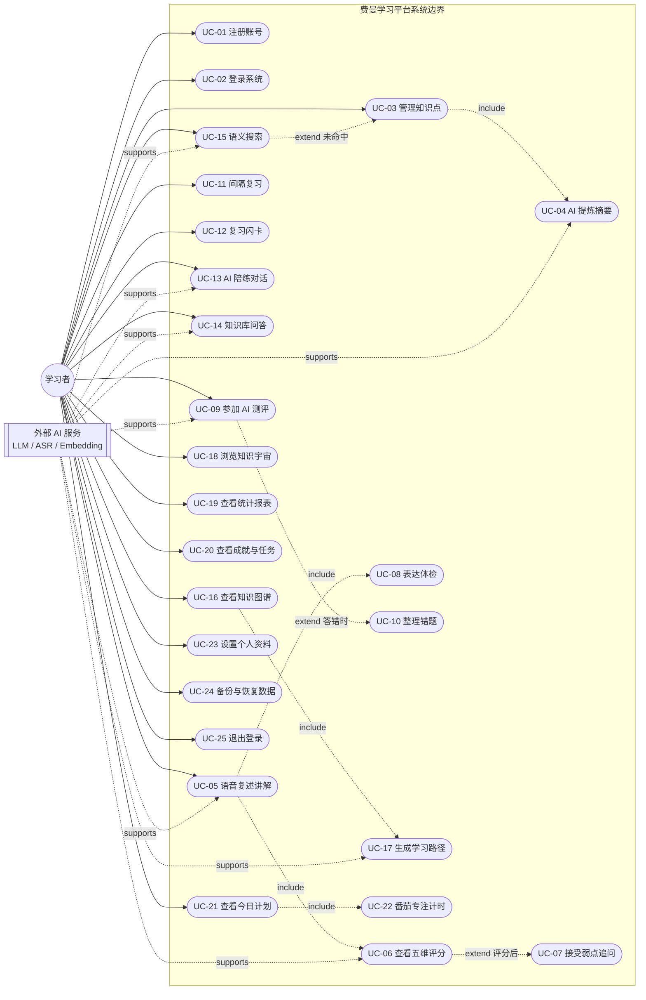

图中“表达体检”虽然与“五维评分”同属复述结果，但它不调用模型，因此在图中单独成节点以便说明两种不同的实现路径。

## 3.3 用例清单

| 编号 | 用例名称 | 主要参与者 | 优先级 | 对应页面/接口 |
| --- | --- | --- | --- | --- |
| UC-01 | 注册账号 | 学习者 | 高 | `/register` · `POST /api/users/register` |
| UC-02 | 登录系统 | 学习者 | 高 | `/login` · `POST /api/users/login` |
| UC-03 | 管理知识点（新建/编辑/删除/收藏） | 学习者 | 高 | `/kp/new`、`/kp/edit/:id` · `POST/PUT/DELETE /api/knowledge-points` |
| UC-04 | AI 提炼摘要与标签 | 学习者 | 中 | 编辑页弹窗 · `POST /api/ai/summarize` |
| UC-05 | 语音复述讲解 | 学习者 | 高 | `/feynman/:id` · `POST /api/audio/transcribe` |
| UC-06 | 查看五维评分结果 | 学习者 | 高 | `/feynman/:id` · `POST /api/ai/evaluate` |
| UC-07 | 接受弱点驱动追问 | 学习者 | 中 | `/feynman/:id` · `POST /api/ai/probe`、`/api/ai/probe-grade` |
| UC-08 | 表达能力体检 | 学习者 | 中 | `/feynman/:id` · `POST /api/ai/delivery` |
| UC-09 | 参加 AI 测评 | 学习者 | 高 | `/quiz/:id` · `POST /api/ai/generate-question`、`/grade-answer` |
| UC-10 | 整理错题 | 学习者 | 中 | `/mistakes` · `GET/DELETE /api/quiz-attempts` |
| UC-11 | 间隔复习（SM-2） | 学习者 | 高 | `/review` · `GET /api/knowledge-points/review/due`、`POST /:id/review` |
| UC-12 | 复习闪卡 | 学习者 | 中 | `/cards` · `POST /api/ai/flashcards`、`POST /api/flashcards/:id/review` |
| UC-13 | AI 苏格拉底式陪练 | 学习者 | 中 | `/practice` · `POST /api/ai/practice-start`、`/practice-reply` |
| UC-14 | 基于个人笔记的知识库问答 | 学习者 | 中 | `/agent` · `POST /api/chat/conversations/:id/messages/stream`（SSE） |
| UC-15 | 全局语义搜索 | 学习者 | 中 | `Ctrl+K` 面板 · `GET /api/search` |
| UC-16 | 查看知识图谱 | 学习者 | 中 | `/graph` · `GET /api/graph/knowledge-map` |
| UC-17 | 生成语义关系与学习路径 | 学习者 | 中 | `/graph` · `GET/POST /api/graph/reason` |
| UC-18 | 浏览知识宇宙 | 学习者 | 低 | `/universe` · `POST /api/dashboard/explore` |
| UC-19 | 查看统计、周报与年度回顾 | 学习者 | 中 | `/stats`、`/report` · `GET /api/dashboard/heatmap`、`/weekly-report`、`/annual-report` |
| UC-20 | 查看成就徽章与每日任务 | 学习者 | 中 | `/achievements` · `GET /api/achievements`、`POST /api/achievements/check` |
| UC-21 | 查看今日学习计划 | 学习者 | 高 | 首页 `TodayPlanCard` · `GET /api/dashboard/plan` |
| UC-22 | 番茄专注计时 | 学习者 | 中 | 首页番茄浮层（纯前端） |
| UC-23 | 设置个人资料 | 学习者 | 中 | `/profile` · `GET/PUT /api/users/me` |
| UC-24 | 数据备份与恢复 | 学习者 | 低 | `/profile` · `GET /api/users/backup`、`POST /api/users/restore` |
| UC-25 | 退出登录 | 学习者 | 高 | 顶栏菜单 / 个人中心 |

## 3.4 重点用例描述

以下对 8 个核心用例给出完整用例规约（Use Case Specification），其余用例在 3.5 以精简表格给出。

### UC-03 管理知识点

| 项 | 内容 |
| --- | --- |
| 用例编号 | UC-03 |
| 用例名称 | 管理知识点（新建 / 编辑 / 删除 / 收藏） |
| 参与者 | 学习者（主）；向量库服务（次，异步） |
| 前置条件 | 用户已登录，`localStorage` 中存在有效 token；进入 `/kp/new`（新建）或 `/kp/edit/:id`（编辑） |
| 后置条件 | MongoDB 中 `knowledgepoints` 集合新增或更新一条记录；向量库同步；写入一条 `create` 学习日志并发放 10 XP；知识点掌握度按默认值 0 起算、复习到期时间为 24 小时后 |
| 触发时机 | 用户点击侧栏“新建知识点”、顶栏 CTA 按钮，或从首页卡片点“编辑” |

基本流（新建）

1. 用户在标题输入框输入标题（`maxLength=100`，后端再次 `trim().slice(0,120)`）。
2. 用户在 `@uiw/react-md-editor` 中编写 Markdown 正文，编辑器设为 `preview="edit"`，右栏“实时预览”用 `ReactMarkdown + remarkGfm` 同步渲染表格与代码块。
3. 用户选择分类：点击 8 个预设分类 chip 之一，或在自定义输入框回车（截断至 20 字）。
4. 用户添加标签：回车或逗号分隔触发，前端去重且最多 8 个（后端 `normalizeTags` 再兜一次），可点 × 移除。
5. （可选）用户在摘要框手写摘要，最多 200 字。
6. 用户点击“创建并复述”。表单进入 `saving` 态、按钮显示 spinner 并禁用。
7. 系统发送 `POST /api/knowledge-points`，鉴权中间件解析出 `req.user.id`。
8. 系统校验标题非空，否则返回 400 `标题不能为空`。
9. 系统保存知识点，异步调用 `addKnowledgePointToStore(kp)` 做切分与向量化（不阻塞响应）。
10. 系统调用 `logStudy({type:'create', minutes:5})`，写日志、加 XP、更新连续天数、触发成就判定。
11. 系统返回 `{...kp, reward}`；前端跳转到 `/feynman/:id`，直接进入复述环节。

基本流（编辑）：页面挂载时 `GET /api/knowledge-points/:id` 回填表单；保存走 `PUT /api/knowledge-points/:id`；后端只接受白名单字段 `title / content / category / tags / summary / favorite / status / reviewList / mastery`，其余字段忽略；若 `content` 发生变化则重建向量（先删旧块再批量写入）；成功后跳回首页。

备选流

- A1（AI 提炼）：在第 5 步点击“AI 提炼”打开弹窗 → `POST /api/ai/summarize {content}` → 返回 `summary / keyPoints / tags` → 用户点“应用”一键回填三个字段。弹窗内独立维护 `aiLoading / aiResult` 状态。
- A2（收藏切换）：在首页卡片点 ★，前端乐观更新立即改变图标，`PUT /api/knowledge-points/:id {favorite}` 失败时回滚并提示。
- A3（删除）：点删除按钮 → `ConfirmDialog` 二次确认 → `DELETE /api/knowledge-points/:id` → 后端删库记录并 `removeKnowledgePointFromStore(kp._id)` 清理向量块 → 前端从列表移除。

异常流

| 条件 | 系统响应 |
| --- | --- |
| 标题为空或只有空格 | 返回 400，前端 Toast 显示 `msg` |
| 编辑不存在的 id | 后端返回 404 `知识点不存在` |
| 访问他人知识点 | 后端比对 `kp.user` 与 `req.user.id`，返回 401 `无权访问该知识点` |
| token 缺失或过期 | 鉴权中间件返回 401，axios 拦截器清理本地态并派发登录失效事件，`ProtectedRoute` 跳登录页 |
| 向量写入失败 | 仅记录服务端日志，知识点本身仍完整可用（MongoDB 是权威数据源）；代价是这条笔记暂时检索不到 |

业务规则：标签最多 8 个且去重；分类默认“未分类”；标题上限 120 字；`mastery` 强制约束在 0-100；新建后 `review.dueAt` 默认 = 创建时间 + 24 小时。

---

### UC-05 / UC-06 / UC-07 / UC-08 语音复述与评分（系统核心用例）

这四个用例在界面上是一个连续流程，因此合并描述。这是整个平台技术含量最高、也最能体现“费曼”特色的用例。

| 项 | 内容 |
| --- | --- |
| 用例编号 | UC-05（复述）→ UC-06（评分）→ UC-08（体检）→ UC-07（追问） |
| 用例名称 | 语音复述讲解并获得五维评分、表达体检与弱点追问 |
| 参与者 | 学习者（主）；百度 ASR、LLM 供应商、ffmpeg（次） |
| 前置条件 | 已登录；目标知识点存在且有 `content` 正文（无正文时页面显示空态引导“去补充内容”） |
| 后置条件 | 知识点 `mastery` 按 `round(旧值×0.6 + 分数×0.4)` 更新；`stats.feynmanCount +1`；`stats.lastScore` 记录本轮分数；`status` 依掌握度重算（≥80 → `mastered`）；写入一条 `feynman` 学习日志，获得 20 XP + `round(score/5)` 奖励；可能解锁成就 |

基本流

1. 用户从首页或图谱点某知识点的“复述”，进入 `/feynman/:id`，`stage = idle`。
2. 页面加载知识点正文（`GET /api/knowledge-points/:id`，失败则 `replace` 跳首页）。
3. 用户在“语音 / 文字”两种模式的分段控件中选择语音（`mode = 'voice'`）。
4. 用户点击麦克风按钮，系统申请麦克风权限（权限申请期间按钮态显示“正在请求麦克风权限…”），`stage = recording`，16 条波形动画开始跳动，`elapsed` 计时器每秒 +1。
5. 用户对着一段概念讲解；到达 60 秒时系统自动停止录音（对应百度 ASR 单次识别上限）。
6. 用户也可提前再次点击按钮停止，`stage = transcribing`。
7. 系统把录音 blob 包成 `FormData`（字段名 `audio`，文件名 `feynman.webm`），以 `multipart/form-data`、60 秒超时 `POST /api/audio/transcribe`。
8. 后端用 ffmpeg 把 WebM 转码为 ASR 要求的格式，调用百度 ASR 得到转写文本，返回 `{result}`。
9. 前端把转写文本存入 `transcript`，进入 `evaluate()`，`stage = evaluating`。
10. 系统并行发起两个请求（关键设计：两者互不阻塞）：
    - `POST /api/ai/delivery {text, durationSeconds}`（20 秒超时）→ 表达体检，纯规则计算，UC-08；
    - `POST /api/ai/evaluate {originalContent, transcribedText, knowledgePoint, knowledgePointId, durationSeconds, provider:'auto'}`（90 秒超时）→ 五维评分，UC-06。
11. 评分请求内部走多供应商降级链，模型返回 `{polishedText, evaluation, strengths[], weaknesses[], score}`，后端 `normalizeDimensions()` 归一为五维后返回。
12. 后端更新掌握度与统计（`afterFeynman`）、写日志、发 XP、判定成就，返回 `reward`。
13. `stage = done`，页面依次渲染：总分环（≥80 绿色 / ≥60 蓝色 / 其余珊瑚色）、评语标题（≥85 / ≥70 / 其他三档文案）、五维雷达图、表达体检卡、优点与待改进双面板、“你的原话”转写卡、AI 润色稿。
14. 系统 Toast 提示获得经验值；若累计轮数 > 1，额外渲染逐轮分数折线图。
15. 若评价结果带 `followUp.question`，页面自动展开追问区，进入 UC-07；否则用户可点“让教练追问”手动触发。

UC-07 弱点追问子流程

1. 系统 `POST /api/ai/probe`，请求体携带 `knowledgePoint / originalContent / transcript / weaknesses / round / history`（历史问题最近 4 条，用于提示模型“不要重复”）。
2. 模型按轮次施加不同压力（第 1 轮问具体、第 2 轮给反例问边界、第 3 轮问迁移应用），返回 `{question, focus, hint, reference}`，前端把 `question` 与 `focus/hint` 渲染为追问卡。
3. 用户在文本框补答，点“提交补答”→ `POST /api/ai/probe-grade` → 返回 `{score, verdict, filled, stillMissing}`，页面显示“补上了什么 / 还缺什么”。
4. 用户选择“再来一问”（轮次 +1，回到步骤 1）或“先到这里”（`resetProbe`）。
5. 轮次上限 5 轮。追问与补答不落库，轮次由前端维护，定位为一次会话内的动作。

备选流

- A1（文字模式）：用户选择“文字”，在 TextArea 输入讲解稿点“提交给 AI 教练”，系统以 `max(30, 字数/4)` 估算时长秒数后走同一评分流程（跳过录音与转写两步）。这是语音不可用时的降级路径。
- A2（多轮复述）：评分完成后点“再讲一次”，`stage` 回 `idle`，本轮 `{round, score, dimensions}` 被压入 `rounds` 数组，供折线图对比。
- A3（换一种检验方式）：点“换个方式检验”跳转 `/quiz/:id` 进入测评用例。

异常流

| 条件 | 系统响应 |
| --- | --- |
| 麦克风权限被拒 / 设备不可用 | Toast“无法访问麦克风，可切换成文字输入”，`stage` 回 `idle`，用户可改用 A1 |
| 转写结果为空 | Toast 警告并回 `idle`，不进入评分 |
| 转写接口失败 | 错误 Toast + 提示可改用文字输入，`stage` 回 `idle` |
| 所有 LLM 供应商失败 | 后端抛出“所有 AI 服务暂不可用（各供应商原因）”，前端显示友好错误，已录内容不丢（`transcript` 仍在） |
| 模型未给某维度分 | 后端用总分 + 典型偏移补全（`FALLBACK_OFFSET`），标记 `dimensionsEstimated=true`，前端提示“部分维度由综合分推算” |
| 推算维度均值与总分偏差 > 18 | 整体平移校正，保证雷达图轮廓不塌成一个点（模型明确给的分不动） |
| 追问模型全部失败 | 返回本地 `fallbackProbe()` 的三个预设问题之一，演示现场不中断 |
| 体检请求竞态（用户连续快速复述） | 用 `deliverySeq` 序号丢弃过期响应 |
| 组件在请求返回前卸载 | effect 清理函数用 `alive` 标志阻止卸载后 setState |

业务规则：录音硬上限 60 秒；表达体检权重固定为语速 0.25 / 口头禅 0.20 / 句子长度 0.20 / 讲解结构 0.35；五维顺序由后端 `DIMENSIONS` 常量固定，前端不再排序。

---

### UC-09 参加 AI 测评

| 项 | 内容 |
| --- | --- |
| 用例编号 | UC-09 |
| 用例名称 | 参加 AI 生成的随堂测评 |
| 参与者 | 学习者（主）；LLM 供应商（次） |
| 前置条件 | 已登录；知识点有正文内容；从 `/feynman/:id`、图谱、知识宇宙或首页点“测评”进入 `/quiz/:id` |
| 后置条件 | 每题写入一条 `quizattempts` 记录；答对则 `stats.correctCount +1`、`mastery +5`；答错则 `mastery -8` 且 `reviewList = true`（进复习队列）；写入 `quiz` 日志获 8 XP |

基本流

1. 页面进入 `phase = 'loading'`，`GET /api/knowledge-points/:id` 取知识点；正文为空则置 `phase = 'nocontent'` 并引导先补充内容。
2. 系统按固定序列出题，一轮 5 题：难度序列 `['基础','基础','中等','中等','进阶']`，题型序列 `['单选','简答','单选','单选','简答']`。
3. 对每题调用 `POST /api/ai/generate-question {knowledgePointContent, difficulty, type}`（60 秒超时），得到题干、选项（单选）、参考答案与要点。
4. `phase = 'answering'`，顶部渲染 5 个进度圆点（已答对 ✓ / 已答错 ✕ / 当前题高亮）。
5. 单选题：用户点选选项，系统即时本地判对（比对 `answer`），`POST /api/quiz-attempts` 静默上报。
6. 简答题：用户输入后点“提交”→ `POST /api/ai/grade-answer {question, answerKeyPoints, studentAnswer}` → `phase = 'grading'` → 返回 `{isCorrect, explanation, score}` → `phase = 'feedback'`。
7. 反馈区显示判定结果、AI 讲解与参考答案；用户点“下一题”重复 5-7，或点“查看本轮结果”。
8. 全部完成后 `phase = 'done'`，显示大准确率环 + 三档评语 + 本轮错题回顾列表。
9. 准确率 ≥ 80% 时触发全屏彩带动画（`burstConfetti({count:70})`）作为正反馈。
10. 用户选择“返回首页 / 再来一轮 / 去错题本 / 回去再讲一遍”。

异常流：出题接口失败 → `phase = 'error'`，提供重试；单题失败不阻塞整轮（跳过并继续）。阅卷失败时后端有基于答案长度的默认判定。

业务规则：`isCorrect` 由后端判定后随记录一起落库，错题本直接查 `isCorrect=false`，避免前端二次标记造成不一致。

---

### UC-11 间隔复习（SM-2）

| 项 | 内容 |
| --- | --- |
| 用例编号 | UC-11 |
| 用例名称 | 按 SM-2 算法复习今日到期的知识点 |
| 参与者 | 学习者（主） |
| 前置条件 | 已登录；复习队列非空（`review.dueAt` 已过，或旧数据创建满 1 天） |
| 后置条件 | 该知识点 `review` 子文档被 SM-2 重算（`repetitions / intervalDays / easeFactor / dueAt / lastReviewedAt / lastGrade`）；`stats.reviewCount +1`；`mastery` 按评分档位增减；`reviewList = (grade < 3)`；写入 `review` 日志获 5 XP |

基本流

1. 用户点侧栏“今日复习”（带红色 due 徽章）进入 `/review`，系统 `GET /api/knowledge-points/review/due` 取最多 50 条到期项，按 `review.dueAt` 升序。
2. 页面顶部显示“剩余 N 条 / 已完成 M 条”与进度条；当前卡片显示标题、分类、标签、摘要，并提示“点一下卡片看内容”。
3. 用户先在脑中回忆，再点卡片翻面（`flipped`），背面渲染正文 Markdown（截 1600 字）。
4. 用户按下真实记忆强度点四档按钮之一：忘记了(1) / 有点难(3) / 记得(4) / 很简单(5)。
5. 系统 `POST /api/knowledge-points/:id/review {grade}`。
6. 后端 `scheduleReview(kp.review, grade)` 计算下一次到期时间，`applyMastery()` 更新掌握度与状态，保存后 `logStudy({type:'review', minutes:2, meta:{grade}})`。
7. 前端把该条出队、`doneCount +1`，并显示提示“下次复习 X 天后 · 掌握度 N”。
8. 队列清空后显示完成态。

备选流：从首页今日计划点“到期复习”任务，同样跳到 `/review`。

异常流：`grade` 不在 `{1,3,4,5}` 内返回 400；越权返回 401；提交失败保留在队列中不丢失（失败时不移除卡片）。

业务规则（SM-2 具体实现，见 `reviewScheduler.js`）

```
EF' = EF + (0.1 - (5-q) × (0.08 + (5-q) × 0.02))     // 下限 1.3，保留两位小数
q < 3   → repetitions = 0，interval = 1 天（明天再来）
q ≥ 3   → repetitions + 1；第 1 次 1 天，第 2 次 6 天，之后 round(interval × EF')
interval 上限 180 天，下限 1 天
dueAt = 当前时间 + interval × 24h
掌握度增量：q<3 → -8 ；q=3 → +3 ；q=4 → +6 ；q=5 → +10
```

---

### UC-14 基于个人笔记的知识库问答（RAG，SSE 流式）

| 项 | 内容 |
| --- | --- |
| 用例编号 | UC-14 |
| 用例名称 | 与基于自己笔记作答的 AI 伙伴对话 |
| 参与者 | 学习者（主）；向量库、Embedding 服务、LLM 供应商（次） |
| 前置条件 | 已登录；至少有一条知识点且已写入向量库（未执行 `reindex-vectors.js` 时旧笔记检索不到） |
| 后置条件 | 会话与消息落库到 `chatconversations`；写入 `chat` 日志获 2 XP |

基本流

1. 用户进入 `/agent`，左侧会话列表 `GET /api/chat/conversations`（含消息数与预览）；点“新建会话”`POST /api/chat/conversations`。
2. 空态显示 4 条引导问题供一键发送。
3. 用户输入问题，Enter 发送（Shift+Enter 换行）。
4. 前端先本地追加一条 `streaming: true` 的 assistant 占位消息，显示打字三点指示器。
5. 不走 axios，改用 `fetch(baseURL + '/chat/conversations/:id/messages/stream')` 手工带 `Authorization` 头并读 `ReadableStream`，目的是绕开 axios 全局 15 秒超时（代码里有明确注释说明）。
6. 后端检索链路：问题 → bge-m3 生成 1024 维查询向量 → vectra 按 `userId` 过滤取 top-k 余弦相似块 → 回查 MongoDB 拿标题 → 拼成“--- 片段 n（来自笔记《标题》）---”上下文 → LLM 流式生成。
7. SSE 事件逐行解析：`{"type":"delta","text":"增量"}` 累加到消息内容；`{"type":"done","text","title","sources","reward"}` 落定全文、来源与经验值；`{"type":"error","msg","text"}` 记录失败原因并写容错文本，不中断会话。
8. 回答完成后气泡下方渲染“📎 来源”标签，点击跳对应笔记编辑页；会话标题若为默认值则据首问自动生成。
9. 用户可点“复制”把回答写入剪贴板，或点“重新生成”走 `retry/stream`（先弹掉尾部 assistant 再重新流式）。

异常流：会话不存在返回 404；向量库无结果时明确回答“在你的笔记里没有找到相关内容”，不勉强给答案；Embedding 服务不可用时降级为关键词上下文。

---

### UC-15 全局语义搜索

| 项 | 内容 |
| --- | --- |
| 用例编号 | UC-15 |
| 用例名称 | 用自然语言搜索自己写过的内容 |
| 参与者 | 学习者（主）；向量库、Embedding、MongoDB（次） |
| 前置条件 | 已登录；已在任意页面按 `Ctrl/Cmd + K`（快捷键在 `AppShell` 全局监听） |
| 后置条件 | 无数据变更；仅记录用户点了哪条并跳转 |

基本流

1. 用户按 `Ctrl+K` 或点顶栏伪搜索框，命令面板打开。
2. 输入框为空时，面板显示 4 个快捷入口：新建知识点、今日复习、知识宇宙、年度回顾。
3. 用户输入关键词，前端 `useDebounce(term, 260ms)` 后请求 `GET /api/search?q=&limit=8`。
4. 后端执行两路混合召回：
   - 向量路：bge-m3 编码 → vectra 取 top-(3k) → 相似度 < 0.45 直接丢弃 → 同一知识点只保留最高分块；
   - 关键词路：整句 + 分词后逐词正则匹配 `title / content / category / tags`（特殊字符已转义）。
5. 合并打分：关键词命中标题 0.85、命中标签 0.74、命中正文 0.62；向量分映射到 0.60-0.95 区间。若已有标题/标签级强命中，则丢弃“勉强过阀”的向量结果，避免前三位全是噪声。
6. 截取命中词周围片段并合并重叠高亮区间，返回 `results` 与 `mode`（`hybrid` / `keyword`）。
7. 前端用后端返回的 `ranges` 切片渲染高亮，不使用 `innerHTML`（规避 XSS）。
8. 每行显示来源标签（语义命中 / 关键词命中 / 可能相关）；↑↓ 循环选择，Enter 直达该知识点的复述页，行内“编辑”按钮跳编辑页。
9. 底栏显示检索模式、结果数与耗时。

异常流：一条都没命中时后端返回 `weak: true`，前端直接显示“没找到”而不是塞不相关结果；向量块的前 40 字若不在当前正文中（说明笔记已改版），回退用正文自身截取片段，防止展示旧内容。

---

### UC-16 / UC-17 知识图谱与学习路径

| 项 | 内容 |
| --- | --- |
| 用例编号 | UC-16（查看图谱）、UC-17（AI 关系推理） |
| 参与者 | 学习者（主）；LLM 供应商（次） |
| 前置条件 | 已登录且已有若干知识点；节点 < 2 时语义边为空属正常 |
| 后置条件 | UC-16 无变更；UC-17 把推理结果写入进程内存缓存（按 `userId`，12 小时过期），不写数据库 |

基本流（UC-16）

1. 进入 `/graph`，`Promise.allSettled([GET /api/graph/knowledge-map, GET /api/graph/reason])` 并行取“规则边图”与“已缓存的语义关系 + 学习路径”，二者互不阻塞。
2. 后端 `knowledge-map` 生成 `{nodes, links}`：规则边采用启发式判定：一条笔记正文里包含另一条的标题即建边。
3. 前端用 ECharts 力导向图渲染（`layout:'force'`，支持缩放漫游与拖拽节点），节点大小/颜色携带分类与掌握度，tooltip 显示边建立的原因。
4. 连线按 9 种类型套用 `LINK_STYLE` 样式表：5 种规则边（`reference / tag / category / day / auto`）+ 4 种 AI 语义边（`prerequisite` 绿实线最粗、`extends` 紫实线、`contrast` 红虚线、`applies` 蓝细线），图例带条数统计。
5. 同一对节点若同时存在规则边与语义边，`visibleLinks` 用语义边替换规则边，避免图上出现平行重复连线。
6. 用户点节点跳 `/kp/edit/:id`。

基本流（UC-17）

1. 用户点“AI 推理关系”，`POST /api/graph/reason {force:true}`（90 秒超时）强制重算；页面进入 `inferring` 态。
2. 后端提示词里只给“标题 + ≤70 字摘要”以控制 token，要求模型输出 `{source, target, type, reason, confidence}` 的 JSON 数组。
3. 代码侧做三重白名单校验：关系类型必须属于四种、置信度 < 0.55 丢弃、最多 18 条（宁少勿多，防止模型编造连线）；参与推理的知识点最多 30 个。
4. 学习路径：只取出现在 `prerequisite` 关系里的节点做拓扑排序得到层级，每层对应一个 `stage`；孤立节点不进路径，路径要能回答“下一步该学哪个”。
5. 结果按用户缓存，并用“知识点 id + updatedAt”签名校验：知识点未变化时 `GET /api/graph/reason` 直接返回缓存，不触发模型调用。
6. 页面下方渲染分阶段路径列表（阶段号 + 标题 + 掌握度），点击跳 `/feynman/:id` 去讲这一阶段的内容。

异常流：模型返回非法 JSON → 解析失败返回空关系并提示重试；缓存过期（12 小时或知识点有更新）→ `GET` 返回空，需重新点推理。演示注意事项：推理约需 10-20 秒，演示前应预先跑一次让缓存热着。

---

### UC-21 / UC-22 今日学习计划与番茄专注

| 项 | 内容 |
| --- | --- |
| 用例编号 | UC-21（今日计划）、UC-22（番茄计时） |
| 参与者 | 学习者（主） |
| 前置条件 | 已登录；进入首页 |
| 后置条件 | 无任何数据库写入（这是该用例的设计特点） |

基本流（UC-21）

1. 首页与 `GET /api/dashboard/overview`、`GET /api/dashboard/plan` 并行请求（用 `Promise.allSettled`，任一慢接口不拖垮整页）。
2. 后端 `buildTodayPlan({points, todayLogs, focus, rest, now})` 是纯函数：把知识点分成四档候选并按优先级取用，取用规则如下：

| 档位 | 判定条件 | 单条时长 | 上限 | 基础优先级 |
| --- | --- | --- | --- | --- |
| `due` 到期复习 | `review.dueAt` 已过（旧数据创建满 1 天即算） | 6 分钟 | 4 条 | 0.94 |
| `weak` 薄弱点 | `mastery < 60` 且已有练习记录或状态 `in_progress` | 8 分钟 | 2 条 | 0.74 |
| `fresh` 待复述 | `stats.feynmanCount = 0` 且 `mastery < 80` | 8 分钟 | 1 条 | 0.66 |
| `create` 新种子 | 今天还没有 `create` 日志 | 6 分钟 | 1 条 | 0.58 |

3. 排序细节：到期按“逾期天数降序 → 掌握度升序”，薄弱按掌握度升序，待复述按创建时间升序（先照顾老笔记）；逾期优先级还会微降（`0.94 - min(0.1, 逾期天数 × 0.01)`），避免一条积压任务长期霸占首位。
4. 番茄分桶 `buildPomodoros()`：顺序累加时长，装不下 `focus`（默认 25 分钟，可配 10-60）就开下一个番茄，休息默认 5 分钟（可配 3-20）；一天计划因此天然被切成 2-3 个番茄块。
5. 完成度不发写请求：直接用今日日志的 `reviewed / practiced / created` 计数当作“配额”点亮前几条，因此刷新页面、跨设备看到的进度一致。
6. 任务卡按 `type` 给出跳转链接：`review → /review`、`feynman → /feynman/:id`、`quiz → /quiz/:id`、`create → /kp/new`。
7. 顶部 `summary` 用一句话解释今天为什么要做这些（如“今天有 3 个到期复习、1 个薄弱点，已排入 5 项，预计 34 分钟能走完一轮”）。

基本流（UC-22）

1. 用户点“开始今天的番茄”，弹出全屏专注浮层 `FocusLayer`，`timer = {pods, index, phase:'focus', left, total, running}`。
2. `setInterval` 每秒递减 `left`，SVG 圆环用 `strokeDashoffset` 表现剩余比例，中央显示剩余秒数。
3. `advance()` 驱动状态流转：`focus → rest → 下一个 focus → … → done`；每次 phase 切换弹 Toast 提示“专注结束，休息 5 分钟”。
4. 按钮：关闭 / 跳过这段 / 暂停继续 / 提前结束 / 收工。
5. 倒计时纯前端计时，结束不写库，实际完成度仍由第 5 步的日志回填机制体现。

异常流：无知识点时 `summary` 显示“还没有知识点可以安排，先记录一个概念…”并引导跳 `/kp/new`；计划为空但今天有投入时显示“今天的安排已经清空，你投入了 N 分钟”。

## 3.5 其余用例的精简规约

| 编号 | 名称 | 前置条件 | 主流程要点 | 后置条件 / 异常 |
| --- | --- | --- | --- | --- |
| UC-01 | 注册账号 | 未登录 | 填 4 字段（用户名/邮箱/密码/确认密码），前端校验必填、密码 ≥6 位、两次一致 → `POST /api/users/register` → 直接返回 token 自动登录 | 用户名或邮箱重复返回错误并显示 `msg`；成功跳首页 |
| UC-02 | 登录系统 | 未登录 | 邮箱 + 密码 → `POST /api/users/login` → `login({token,user})` 写 localStorage | 401 显示“邮箱或密码错误”；已有 token 时页面直接 `<Navigate to="/">` |
| UC-04 | AI 提炼摘要 | 已登录、正文非空 | `POST /api/ai/summarize {content}` → 摘要 + 要点 + 标签 → 一键回填 | 失败仅 Toast，不影响手动填写 |
| UC-10 | 整理错题 | 已有答错记录 | `GET /api/quiz-attempts?correct=false` → 按知识点生成筛选 chip → 每条显示题干/我的答案/参考答案/讲解 | “重练”跳 `/quiz/:kpId`；“移除”需确认再 `DELETE` |
| UC-12 | 复习闪卡 | 已有闪卡 | 选知识点 → `POST /api/ai/flashcards {knowledgePointId, count:5}`（90s）→ 点卡翻面 → 三档评分（忘记1/模糊3/记得5）→ `POST /api/flashcards/:id/review` | 可切“只看到期”（`GET /flashcards?due=1`）；删除即时生效 |
| UC-13 | AI 陪练 | 已有知识点 | 选知识点 → `POST /api/ai/practice-start` 取开场问题并用浏览器 `speechSynthesis`（zh-CN）朗读 → 语音（上限 45 秒）或文字作答 → `POST /api/ai/practice-reply` → 得 `{score, feedback, nextQuestion}` 并继续朗读 | `phase`：idle/loading/asking/recording/transcribing/evaluating；TTS 不可用时静默降级 |
| UC-18 | 浏览知识宇宙 | 已有知识点 | Three.js 场景只建一次；黄金角球面分布布星球，星球大小 = 正文长度 + 掌握度；进入即 `POST /api/dashboard/explore` | 分类聚焦只改透明度不重建场景；按周生长回放每 650ms 点亮一周；raycaster 点击弹信息卡 |
| UC-19 | 统计与报表 | 有学习日志 | `/stats` 并发 4 接口，自绘 12 周热力图（7 天一列、0-4 档）+ 分类饼图 + 掌握度 5 桶柱图 + 近 7 天折线；`/report` 周报 + 原生 Canvas 720×1000 分享卡；年度回顾 1080×1920 长图 | “保存 PNG”用 `canvas.toDataURL` 下载，纯前端出图 |
| UC-20 | 成就与每日任务 | 已登录 | `GET /api/achievements` + `/daily-tasks` 并发；点“检查新徽章”`POST /api/achievements/check` | 有新解锁则放彩带（`count:110`）+ Toast + 重拉列表；`seenRef` 记录基线自动触发 |
| UC-23 | 设置个人资料 | 已登录 | 昵称（≤24 字）、8 款 emoji 头像、每日目标 chips `[1,2,3,5,8]` → `PUT /api/users/me` | 后端仅允许 `displayName/avatarKey/dailyGoal` 三字段；改密走 `PUT /api/users/password`，校验新密码 ≥6 位且两次一致 |
| UC-24 | 数据备份与恢复 | 已登录 | `GET /api/users/backup` 导出 JSON 或转 Markdown；选文件后 `POST /api/users/restore {knowledgePoints, flashcards}` | 导入只新增不覆盖，返回 skipped 数；执行前 `ConfirmDialog` 确认 |
| UC-25 | 退出登录 | 已登录 | 顶栏下拉菜单或个人中心“退出登录”→ 清 `token` 与 `user` → 跳 `/login` | 用 `window.location.href` 或客户端跳转；token 过期时由拦截器派发事件，`ProtectedRoute` 自动跳 |
| — | 访问不存在的页面 | — | 路由回退 `*` → `NotFoundPage` | 显示当前 `pathname`、回首页/返回上一页按钮与 3 个快捷链接 |

## 3.6 用例与需求追踪矩阵

| 需求编号 | 需求名称 | 覆盖用例 | 验证测试（第八章） |
| --- | --- | --- | --- |
| FR-01 | 注册与登录 | UC-01、UC-02 | TC-AUTH-01/02/03 |
| FR-02/03 | 知识点管理与删除 | UC-03 | TC-KP-01/02/03 |
| FR-04 | AI 提炼 | UC-04 | TC-AI-01/02（降级链见 TC-AI-05/06/07） |
| FR-05/06 | 语音复述与评分 | UC-05、UC-06 | TC-FEY-01/02/03 |
| FR-07 | 表达体检 | UC-08 | TC-DEL-01/02 |
| FR-08 | 弱点追问 | UC-07 | TC-FEY-04 |
| FR-09/10 | 测评与错题 | UC-09、UC-10 | TC-QUIZ-01/02 |
| FR-11 | 间隔复习 | UC-11 | TC-SM2-01/02/03 |
| FR-12 | 闪卡 | UC-12 | TC-FC-01 |
| FR-13 | AI 陪练 | UC-13 | TC-PRAC-01 |
| FR-14 | RAG 问答 | UC-14 | TC-RAG-01/02 |
| FR-15 | 语义搜索 | UC-15 | TC-SEARCH-01/02 |
| FR-16 | 图谱与路径 | UC-16、UC-17 | TC-GRAPH-01/02 |
| FR-17 | 知识宇宙 | UC-18 | TC-UNI-01 |
| FR-18 | 今日计划 | UC-21、UC-22 | TC-PLAN-01/02 |
| FR-19 | 统计报表 | UC-19 | TC-RPT-01 |
| FR-20 | 激励体系 | UC-20（+所有写入类用例） | TC-XP-01/02/03 |
| FR-21 | 个人中心与数据 | UC-23、UC-24 | TC-PROF-01/02 |
| 非功能：安全 | 数据隔离与鉴权 | 全部用例的鉴权前置 | TC-SEC-01/02/03 |

---

# 四、界面设计及说明

## 4.1 设计定位与视觉语言

产品名“费曼小课堂 · 讲明白才算学会”（取自 `index.html` 的 `<title>` 与 PWA manifest）。视觉风格选定为黏土（clay）风，理由很直接：这个产品的核心动作是“开口讲一遍”，对使用者心理压力的要求是“像在玩，不像在考试”。大圆角、柔和多层内阴影、糖果色点缀的黏土质感能把“被 AI 打分”这件事从评判感拉向练习感。

黏土效果的实现集中在 `tokens.css` 的一组阴影令牌上，其本质是三段式叠加：

```
--clay-shadow:
    0 6px 0 rgba(底色)          /* ① 底缘厚度，模拟黏土被压出的边 */
  + 0 18px 34px rgba(...)       /* ② 落地投影，产生浮起感 */
  + inset 0 2px 0 rgba(255,255,255,.95)   /* ③ 顶部内高光，模拟受光面 */
```

按下态切换到 `--clay-shadow-press`（内凹陷），按钮 hover 时 `translateY(-2px)`，卡片 hover 时轻微旋转 `-0.4deg`。柔和的观感来自动画曲线 `--ease-bounce: cubic-bezier(0.34, 1.56, 0.64, 1)`（回弹超出 1，因此有弹性）。页面背景是三层固定 `radial-gradient` 糖果渐变，侧栏用 `backdrop-filter: blur(18px) saturate(160%)` 做白瓷磨砂。

## 4.2 设计令牌（`src/styles/tokens.css`）

所有颜色、圆角、阴影、字体、尺寸都以 CSS 变量集中在 `:root`，业务样式不允许出现魔法数值。

| 类别 | 令牌 | 取值 | 用途 |
| --- | --- | --- | --- |
| 底色 | `--clay-bg` | `#fff8f0` | 页面背景基底 |
| 表面 | `--clay-surface` | `#fff` | 卡片表面 |
| 墨色 | `--clay-ink` / `-soft` / `-mute` | `#3d3a4b` 等三档 | 正文 / 次级 / 弱化文字 |
| 描边 | `--clay-line` / `-strong` | — | 分隔线、输入框边框 |
| 糖果色 | `coral / mint / sky / butter / lilac` | 每色三档（主色 / `deep` / `soft`） | 分类、状态、图表配色 |
| 语义色 | `--success` / `--error` / `--warning` | — | 判定结果、危险操作 |
| 渐变 | `--grad-coral / mint / sky / butter / lilac / cream` | — | Hero 卡、进度环 |
| 圆角 | `--radius-xl / lg / md / sm / pill` | `34 / 26 / 18 / 12 / 999px` | 卡片 / 弹窗 / 输入 / 小元素 / 按钮 |
| 阴影 | `--clay-shadow(-sm/-lg/-press/-inset)` | 三段式（见上） | 黏土立体感 |
| 字体 | `--font-display` `ZCOOL KuaiLe` | 标题 | 中文展示体，略带手写感 |
| 字体 | `--font-body` `Nunito` | 正文 | 圆润无衬线 |
| 字体 | `--font-number` `Baloo 2` | 数字 | 分数、XP、统计值 |
| 尺寸 | 侧栏 252 / 收起 96、顶栏 78、内容最大宽 1180 | — | 布局骨架 |
| 动效 | `--ease-bounce` | `cubic-bezier(.34,1.56,.64,1)` | 回弹过渡 |
| 兼容别名 | `--primary → coral` 等 | — | 旧类名映射，避免一次性重写 |

一处应当记录令牌漂移：`tokens.css` 里有两个 `:root` 块，第一个是设计令牌（`:4`），第二个是“语义色别名（兼容旧类名）”（`:80`）。第二个块里除了别名还重复定义了 `--radius: 16px`、`--radius-lg: 24px`、`--radius-sm: 12px`，因此实际生效的 `--radius-lg` 是 24px 而不是令牌表里的 26px（CSS 变量后者覆盖前者）。卡片、弹窗的圆角因此都取自别名块。兼容层的问题通常就出在这里：它本意只做颜色映射，却同时重定义了尺寸。修法是把别名块的尺寸删掉、只保留颜色别名，并把这类“同名重复定义”纳入样式层的 lint 检查。

分层样式结构（`src/index.css` 按序 `@import` 7 个文件，共 8 个 CSS、4674 行）：

| 文件 | 职责 |
| --- | --- |
| `tokens.css` | 设计令牌（变量源；尺寸有重复定义，见上方令牌漂移） |
| `base.css` | reset、body 渐变背景、h1-h4/p/a/button/code 排版 |
| `components.css` | 黏土组件库样式：卡片/按钮/输入/胶囊/进度环/头像/弹窗/Toast/骨架/空态/分段控件/命令面板等 18 段 |
| `layout.css` | 应用壳层：侧边栏、主区与顶栏、移动端底部导航、响应式断点 |
| `markdown.css` | `.markdown-body` 正文渲染与代码块样式 |
| `pages-core.css` | 通用布局工具类（`stack-*` / `row-*` / `grid-*`）、认证页、首页、今日计划、番茄浮层、知识点编辑、复述页、表达体检 |
| `pages-extra.css` | 测评、复习、闪卡、错题、陪练、图谱、宇宙、AI 聊天、统计、个人中心、成就、周报分享、年度长图、404 |

## 4.3 全局布局（`AppShell`）

除登录/注册外的所有页面共用一个外壳：左侧固定导航 + 顶栏 + 内容区；移动端折叠为抽屉式侧栏 + 底部 5 Tab。

```
┌──────────────────────────────────────────────────────────────────────┐
│ 费曼小课堂 │ 🔍 搜我的笔记…  [Ctrl K]        🔥 连续 7 天  Lv.4  👤▾ │ ← 顶栏 78px
├──────────┼───────────────────────────────────────────────────────────┤
│ ▸ 学习    │                                                           │
│  首页     │                                                           │
│  今日复习 ●│            <Outlet />  （内容区，max-width 1180）         │
│  闪卡     │                                                           │
│  语音陪练  │        ┌──────────────┬──────────────────────────┐        │
│ ▸ 探索    │        │  今日学习计划 │   知识点列表 / 图表 …      │        │
│  AI 伙伴  │        └──────────────┴──────────────────────────┘        │
│  知识图谱  │                                                           │
│  知识宇宙  │                                                           │
│ ▸ 成长    │                                                           │
│  学习统计  │                                                           │
│  成就徽章  │                                                           │
│  学习周报  │                                                           │
│ ┌────────┐│                                                           │
│ │＋新建知识││                                                          │
│ └────────┘│                                                           │
└──────────┴───────────────────────────────────────────────────────────┘
   252px（收起 96px，状态存 localStorage['shell-collapsed']）
```

顶栏控件说明：汉堡菜单（移动端开抽屉）；伪搜索框（不是真输入框，点击或回车即拉起命令面板），右侧挂着 `Ctrl K` 徽标；连续天数 `pill--streak` 与等级 `pill--level` 两枚徽章，数据由壳层挂载时统一请求 `GET /dashboard/overview` 提供（未登录时不发请求，避免登录页反复刷 401）；用户头像下拉菜单含“个人中心 / 我的成就 / 学习统计 / 退出登录”。

导航分组：三组共 11 项，分别是学习（首页、今日复习带到期红点、闪卡、语音陪练、错题本）、探索（AI 伙伴、知识图谱、知识宇宙）、成长（学习统计、成就徽章、学习周报）。另有 16 组页面标题映射 `PAGE_TITLES`（标题 + 副标题），`resolveTitle` 支持前缀匹配以便 `/feynman/:id` 这类动态路由也能取到正确标题。移动端底部 5 个 Tab，其中“新建”做成中间凸起的主按钮。

内容区包裹：`<Suspense fallback={<SkeletonList rows={3}/>}>` 承接懒加载，外层按 `pathname` 作 key 的 `<ErrorBoundary compact>`，换页即重置错误态，避免一个页面崩溃后整站白屏。

## 4.4 页面清单与设计说明

| 路由 | 页面 | 界面要点 | 设计意图 |
| --- | --- | --- | --- |
| `/login` | 登录 | 左艺术栏（3 个 blob + 黏土吉祥物 `scene-auth` + 大标题“讲一遍，才算真的学会”+ 4 条卖点）；右表单卡（邮箱、密码、错误提示、登录按钮 loading 态、去注册链接） | 首屏就把方法论讲清楚，登录页兼任产品说明书 |
| `/register` | 注册 | 同布局；4 字段 + 即时校验（必填、密码 ≥6 位、两次一致） | 与登录页视觉一致，减少学习成本 |
| `/` | 仪表盘（首页） | Hero 问候卡（按时段变文案 + 今日进度环 + 3 个主 CTA）→ 3 枚统计 tile → 今日计划卡 → 筛选工具栏（搜索 + 排序 + 分类 chips + 状态 chips + 只看收藏）→ 到期提醒条 → 知识点卡片列表 → 删除确认框 | “今天该做什么”优先于“我有什么”，计划卡放在统计之下、列表之上 |
| `/kp/new`、`/kp/edit/:id` | 知识点编辑器 | 左编辑（`@uiw/react-md-editor`，高 360）右实时预览双栏；标题/分类/标签/摘要字段区；顶部动作区（返回、AI 提炼、创建并复述 / 保存修改） | 写作与审阅同屏，避免切标签页；“创建并复述”把两个动作串成一个 |
| `/feynman/:id` | 费曼复述 | 模式分段控件（语音/文字）→ 大麦克风按钮 + 16 条波形动画 + 计时 pill → 结果区（总分环、五维雷达、表达体检卡、优点/待改进双栏、逐轮折线、原话与润色稿对照）→ 教练追问卡 | 单页承载“讲 → 评 → 补”，用状态机分阶段呈现，避免一次性堆满屏幕 |
| `/quiz/:id` | 随堂测评 | 顶部 5 个进度圆点（✓/✕/当前）→ 题干卡 → 单选按钮组或简答输入区 → 反馈区（判定 + 讲解 + 参考答案 + 要点）→ 结果页（准确率大环 + 三档评语 + 错题回顾 + 彩带） | 一屏一题，进度点让“还剩几题”一目了然 |
| `/review` | 间隔复习 | SM-2 翻转卡（正面标题/分类/标签/摘要 + “点一下卡片看内容”，背面 Markdown 正文，截 1600 字）→ 底部 4 档评分按钮 → 剩余/完成统计 + 进度条 | “先回忆再翻面”是主动回忆练习，卡片不可跳过正面 |
| `/cards` | 闪卡 | 顶部生成条（知识点下拉 + “用 AI 生成 5 张”+“只看到期”）→ 卡面翻转网格 → 背面 3 档评分 → 右上删除 | 卡面翻转状态用 `id→bool` 字典维护，多卡可同时翻而不互相干扰 |
| `/mistakes` | 错题本 | 知识点筛选 chips + 错题卡列表（题型 tag、知识点名、时间、题干、“你的答案 / 参考答案”双色 badge、讲解）+ 重练 / 移除 | 双色 badge 让“我错在哪”与“正确说法”并排可见 |
| `/practice` | 语音陪练 | 提问大字 + “再听一遍”TTS 按钮 + 录音按钮（停止态用 danger 色）+“已录 Ns”+ 本轮点评环 + 对话气泡回顾列表（assistant 走 Markdown） | 对话式布局符合“一问一答”的心理模型 |
| `/agent` | AI 伙伴 | 左右双栏：左侧会话列表（新建/重命名/删除）；右侧消息流 + 底部输入框（Enter 发送 / Shift+Enter 换行）；气泡下“📎 来源”标签、复制按钮、打字三点指示器 | 流式输出必须有“正在生成”的可见证据，否则用户会以为卡住 |
| `/graph` | 知识图谱 | ECharts 力导向图（可缩放漫游、节点可拖拽）+ 9 类连线样式与图例计数 + “AI 推理关系”按钮 + 右侧推荐学习路径分阶段列表 | 两种边的含义不同，因此线型必须能区分（语义边替换同对节点的规则边） |
| `/universe` | 知识宇宙 | Three.js 星系（420 颗糖果色星尘 + 中央发光球 + 星球按黄金角分布 + Canvas 文字标签）+ 左侧“星系档案”面板（总星球数/平均掌握/到期复习/闪卡数、星群分类 chips、待加强 Top8、连线图例）+ 时间轴生长回放（range 滑块 + 播放/暂停） | 把“知识存量”变成可看可转的空间隐喻；待加强列表点击可让相机聚焦到那颗星球 |
| `/stats` | 学习统计 | 连续天数 + 等级 XP 条 → 自绘 12 周热力图（按 7 天分列，`data-level` 0-4 档）+ 4 项微指标 → 分类饼图 → 掌握度 5 桶柱图 → 近 7 天动作折线 → 4 个汇总 tile | 热力图刻意不用 ECharts 而是自绘，为了精确控制格子尺寸与 GitHub 式阅读习惯 |
| `/achievements` | 成就 | 收集进度环 + Lv/XP 条 → 今日挑战卡（3 条任务，完成打 ✓）→ 徽章墙网格（未解锁置灰并显示进度条） | “未解锁 + 进度条”比单纯灰显更有推动感；解锁即放彩带 |
| `/report` | 学习周报 | 4 指标 + 每日投入柱图 + 动作构成饼图 + 需巩固知识点列表（带掌握度条与“去复述”）+ 原生 Canvas 720×1000 分享卡（渐变背景/气泡/4 指标砖/7 天打卡条）+“导出分享图”→ 内嵌年度回顾长图 | 分享卡让成果可外发；长图 1080×1920 适配手机竖屏 |
| `/profile` | 个人中心 | Hero（大头像 + Lv/XP 条 + streak pill）→ 基础资料卡（昵称、8 款头像、每日目标 chips）→ 账号安全卡（3 个密码框）→ 侧栏“我的数据”掌握环 + 4 计数、“数据备份”3 按钮、“账号”入口 | 把低频的账号操作与高频的数据备份分区，主区留给可编辑资料 |
| `*` | 404 | 单卡：`badge-planet` 图标 + 404 大字 + 显示当前 `pathname` + 回首页 / 返回上一页 + 3 个快捷链接 | 明确告诉用户“你刚才去的地址不存在”，并给三条出路 |

## 4.5 组件库（`src/components/ui/ClayKit.jsx`）

界面由 16 个黏土基础组件拼装，全部具名导出，无第三方 UI 框架依赖：

| 组件 | Props | 说明 |
| --- | --- | --- |
| `ClayCard` | `tone`(6 色)、`hover`、`flat`、`as`、`className` | 卡片容器，`as` 可切换语义标签 |
| `ClayButton` | `variant`、`size`、`block`、`iconOnly`、`loading`、`to`、`href`、`disabled` | 多态按钮：传 `to` 渲染 `RouterLink`，传 `href` 渲染 `<a>`；`loading` 时嵌 spinner 并自动禁用 |
| `Field` | `label`、`hint`、`htmlFor` | 表单字段壳，统一标签与提示文案位置 |
| `TextInput` / `TextArea` / `Select` | `label`、`hint` + 原生属性透传 | 无 `label/hint` 时直接渲染裸控件，兼容搜索框等场景 |
| `ClayChip` | `active`、`tone`、`count` | 可点胶囊，用于分类/标签/状态筛选 |
| `Segmented` | `options[{value,label}]`、`value`、`onChange` | 分段切换，用于排序与语音/文字模式 |
| `ProgressRing` | `value`、`size`、`thickness`、`color`、`label` | CSS 变量驱动的环形进度，掌握度与分数都用它 |
| `ProgressBar` | `value`、`tone` | 线性进度 |
| `IconTile` / `Avatar` | `src/emoji/size/round/plain`；`name/emoji/src/size` | 黏土图标底座与头像（首字母或 emoji） |
| `Skeleton` / `SkeletonList` | `width/height/radius`；`rows` | 骨架屏，懒加载与请求中占位 |
| `EmptyState` | `icon`、`title`、`desc`、`action` | 空态，必带一个“下一步动作”按钮 |
| `ClayModal` | `open`、`title`、`footer`、`onClose`、`width` | 遮罩弹窗；Esc 关闭、锁 body 滚动、点遮罩关闭 |
| `ConfirmDialog` | `title`、`description`、`confirmText`、`danger`、`loading`、`onConfirm/onCancel` | 基于 `ClayModal` 的二次确认，所有删除/导入都用它 |
| `PageHead` | `title`、`sub`、`icon`、`actions` | 页面标题行 + 右侧动作区 |
| `ToastProvider` / `useToast` | — | 全局提示，`success/error/warn/info`，队列最多保留最近 4 条，点击可提前关闭 |

配套：`AppIcon` 把 `assets/clay/*.png` 以 glob 方式按名称索引，缺图回退 `ICON_EMOJI` 表；`icons.jsx` 提供 42 个线性 SVG 图标；`Charts.jsx` 用 `CLAY_PALETTE` 8 色封装 `PieChart / BarChart / LineChart / RadarChart`（雷达图 `indicator.max = 100` 固定，保证五维可横向比较）；`ErrorBoundary` 类组件容错页提供“返回上一页 / 重试渲染 / 重新加载”；`ApiErrorBridge` 把 axios 拦截器派发的全局错误事件转成 Toast，同一消息 6 秒冷却去重。

## 4.6 关键界面线框与交互细节

复述页（状态机驱动的分区显示）

```
┌─ /feynman/:id ────────────────────────────────────────────┐
│ ‹ 返回   「SM-2 间隔复习算法」        掌握度 ◯ 62          │
│ ┌───────────────────────────────────────────────────────┐ │
│ │  语音复述  │  文字复述            ← Segmented 模式切换  │ │
│ │           🎤                          [00:37 / 60]     │ │
│ │  ▂▃▅▆▇▆▅▃▂▃▅▆▇  ← 16 条波形动画（仅 recording 显示）   │ │
│ └───────────────────────────────────────────────────────┘ │
│ ┌── 结果区（stage=done 才出现）──────────────────────────┐ │
│ │   ◯ 84        讲得挺清楚了，再收一收                   │ │
│ │        准确性 88                                        │ │
│ │      ╱    ╲     完整性 72      ┌─ 五维雷达图 ─┐         │ │
│ │    深度    完整   逻辑 65      │  按后端固定   │         │ │
│ │      ╲    ╱     流畅 79        │  顺序绘制     │         │ │
│ │        表达                     └──────────────┘         │ │
│ │ ┌─ 表达体检 DeliveryReport ─────────────────────┐        │ │
│ │ │ 语速 226 字/分 100 │ 口头禅 3 次 66 │ 句长 18 字 100 │   │ │
│ │ │ 讲解结构 3/4 段 78 │ 口头禅排行「就是×2、嗯×1」      │   │ │
│ │ │ 建议：用停顿代替口头禅；补一句「所以」把整段收住      │   │ │
│ │ └───────────────────────────────────────────────┘        │ │
│ │ ✓ 优点：举例具体   ✕ 待改进：没有讲清 EF 的下限          │ │
│ │ ┌─ 教练追问（第 2 轮）──────────────────────────┐        │ │
│ │ │ 有人举反例说它在间隔 200 天时不成立，你怎么回应？     │  │ │
│ │ │ 检验：边界条件 ｜ 提示：想想结论成立的前提            │  │ │
│ │ │ [________________ 补答 ________________]  [提交补答]  │  │ │
│ │ └─────────────────────────────────────────────┘         │ │
│ │ [再讲一次]  [换个方式检验]  [回到首页]                    │ │
│ └─────────────────────────────────────────────────────────┘ │
└─────────────────────────────────────────────────────────────┘
```

今日计划卡与番茄浮层

```
┌─ 今日学习计划 ────────────────────────────────── 42% ◯ ─┐
│ 今天有 3 个到期复习、1 个薄弱点，已排入 5 项，预计 34 分钟 │
│ 🍅 番茄 1（24 分钟）· 休息 5 分钟                         │
│  ① 到期复习 · SM-2 算法        已到期 3 天    [去完成]   │
│  ② 到期复习 · 反向传播          今天刚到期     [再看一遍]  │
│  ③ 费曼复述 · 闭包             掌握度只有 41   [去完成]   │
│ 🍅 番茄 2（10 分钟）                                     │
│  ④ 费曼复述 · HTTP 缓存         还没开口讲过    [去完成]  │
│  ⑤ 播新种子 · 留 6 分钟                    [去新建]      │
└──────────────────────────────────────────────────────────┘
        ↓ 点「开始今天的番茄」
   ┌──────── 全屏专注浮层（FocusLayer）────────┐
   │        ╭───────╮                          │
   │        │ 14:32 │  ← SVG 圆环 strokeDash   │
   │        ╰───────╯     offset 递减          │
   │   第 1 / 2 段 · 专注中                     │
   │   「SM-2 算法 等 3 项」                     │
   │  [关闭] [跳过这段] [暂停] [提前结束] [收工] │
   └───────────────────────────────────────────┘
```

命令面板（Ctrl+K）

```
┌──────────────── 搜索我的笔记… ────────────────┐
│  ▸ SM-2 间隔复习算法          语义命中  92%     │
│     …第 2 次 6 天，之后 <mark>间隔 × EF</mark>  │
│  复习老朋友                   关键词命中         │
│  表达体检                     可能相关           │
├───────────────────────────────────────────────┤
│ 语义+关键词 · 3 条 · 86 ms          ↑↓ 选择 ⏎ 复述│
└───────────────────────────────────────────────┘
```

高亮由后端返回的 `ranges` 数组切片渲染，不使用 `innerHTML`，既避免 XSS，也让“命中区间合并重叠”的逻辑留在后端可测。

## 4.7 交互反馈与状态规范

| 场景 | 规范 |
| --- | --- |
| 请求进行中 | 按钮进 `loading`（spinner + 禁用防重复提交）；列表/图表用 `SkeletonList`；懒加载页面用 `Suspense` 骨架 |
| 成功 | 短时 Toast（默认 2800ms）；有 XP 收益时文案带经验值；成就解锁与测评高分额外放彩带 |
| 业务失败 | 优先显示后端 `msg` 字段；表单类错误就地显示 `notice--error` |
| 网络失败 | 拦截器派发全局事件，`ApiErrorBridge` 转 Toast：“连不上服务，请确认后端已在 localhost:3000 启动” |
| 服务器错误 | ≥500 也走全局 Toast，带服务端 `msg` |
| 登录失效 | 仅当本次请求确实带了 token 且返回 401 才判定失效（避免把登录接口的密码错误误判）；清 token/user → 派发事件 → `ProtectedRoute` 客户端跳转（不用 `location.href`，以兼容 Electron 的 `file://`） |
| 数据为空 | `EmptyState` + 一个明确的下一步按钮，绝不留白屏 |
| 破坏性操作 | `ConfirmDialog` 二次确认，危险按钮用 `danger` variant |
| 长耗时 AI 调用 | 显式提高该请求超时（复述评价 90s、体检 20s、闪卡生成 90s、出题 60s、追问 60s、转写 60s），流式对话改走 SSE 完全绕开超时 |
| 高频输入 | `useDebounce` 降频：首页搜索 340ms，命令面板 260ms |

## 4.8 响应式与适配

桌面为主，移动端按“单手可完成复习”设计：侧栏折叠为抽屉（汉堡菜单），底部固定 5 个 Tab（首页、复习、中间凸起的“新建”、我的等），`layout.css` 末尾集中响应式断点。侧栏收起状态与登录态都持久化在 `localStorage`。PWA 通过 `display: standalone` 安装后无浏览器地址栏，`theme_color` 与页面底色一致以免割裂。Electron 端必须用相对 `base`（`'./'`）加载，否则 `file://` 下资源 404 白屏。这是三种形态里唯一需要改构建配置的差异。

字体依赖 Google Fonts CDN，弱网或国内环境下回退系统字体，不影响布局与功能。

---

# 五、类设计及关联

本章按“目录与分层 → 数据模型类 → 服务类 → 中间件与工具类 → 前端类 → 技术债”的顺序给出设计。所有类名、方法名、依赖边都是从源码逐个 grep 出来的，不是凭印象画的。

## 5.1 后端分层与代码分布

```
feynman-platform-backend/
├── index.js                    入口：CORS / JSON / Mongo 连接 / 路由挂载 / errorHandler
├── config/
│   └── achievements.js         成就元数据（10 条定义，纯数据，无逻辑）
├── middleware/
│   ├── auth.js                 JWT 鉴权
│   └── errorHandler.js         全局错误 → HTTP 状态码映射
├── models/                     7 个 Mongoose Schema
├── services/                   10 个领域服务（算法与外部调用）
├── controllers/                4 个控制器（仅服务 AI 相关端点）
├── routes/                     11 个路由文件，共 55 个端点
├── utils/                      4 个 LLM 厂商示例 + multi-llm-manager + responseHelper + swagger（共 7 个）
└── scripts/                    reindex-vectors.js / api-smoke.ps1 / seed-*.js
```

请求自外向内的固定顺序是 `index.js → routes → (controllers) → services → models → MongoDB`，横向支撑是 `middleware` 与 `utils`。

路由层的实际情况和教科书里的分层不一致：它并不是纯转发。11 个路由文件里只有两个是薄的，即 `routes/ai.js`（11 个端点里 10 个转给 controller，只有 `POST /ai/delivery` 在 handler 里直接调 `deliveryService.analyzeDelivery`）和 `routes/audio.js`（1 个端点转给 `baiduAiController`）。其余 9 个文件把查询构造、聚合统计、算法调用直接写在 handler 里，例如 `knowledgePoints.js` 的 `/facets` 在 handler 内 `find().select().lean()` 后用两个 `Map` 手工聚合分类与标签计数，`dashboard.js`、`search.js`、`graph.js` 同理。

这个分布有两面：好处是“一个端点的所有逻辑在一屏内可读”，改动半径小、不需要在多层间跳转，适合单人快速迭代；代价是路由文件承担了业务编排，`userController.js` 与 `routes/users.js` 之间曾经存在的重复逻辑就是这种模式的副产品，目前 `userController.js` 已成为无人引用的死代码（全仓库只有 `responseHelper` 被它 import，而它自己不被任何人 import）。第五章不把它写成“错误”，而是记入 5.6 技术债，因为它会误导后来者以为存在一套 controller 层约定。

## 5.2 数据模型类与关联关系

系统共 7 个持久化模型。其中 `Message`、`Review`、`Stats` 是内嵌子文档（不独立成集合），在类图上作为组合关系画出。

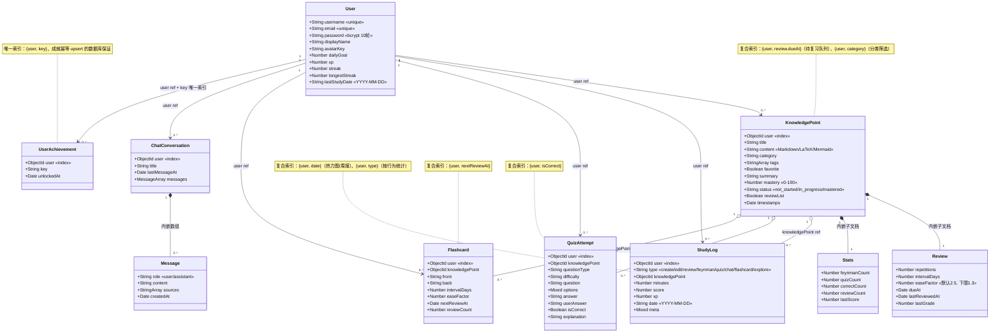

关联性质的区分。只有两处是真正的组合（`*--`）：`KnowledgePoint` 内嵌 `Review` 与 `Stats`，`ChatConversation` 内嵌 `messages` 数组。它们随父文档一起读写、无法独立寻址，因此 SM-2 状态与对话历史都天然带上了“按用户隔离、按知识点归属隔离”的性质。其余 `user` / `knowledgePoint` 都是 `ObjectId` ref（聚合或依赖），数据库层面没有任何外键约束。

删除知识点不级联，这是刻意设计。`DELETE /knowledge-points/:id` 只删 `KnowledgePoint` 集合并从向量库移除该 id，不删 `StudyLog`、`QuizAttempt`、`Flashcard` 里的引用。理由是历史行为是统计的事实来源：热力图、周报、等级、成就进度都要能回溯到“那天我做了一次复述”，级联删除会让激励体系的历史失真并可被反复删除利用。代价是所有读历史的地方都必须容忍 ref 缺失（前端展示时用默认文案，聚合时按 `type`/`date` 统计而非按 kp 是否存在过滤）。这条取舍需要说清楚：这里的选择是“行为日志不可变”，级联删除是有意不做的。

## 5.3 服务层类与调用关系

10 个服务类构成领域核心。按是否触碰数据库可明确分为两类，这个边界是有意维护的：

```mermaid
classDiagram
    class reviewScheduler {
        «纯函数»
        +scheduleReview(review, grade) Review
        +gradeToMasteryDelta(q) Number
        +dueFilter(userId) Object
        +DAY_MS
    }
    class deliveryService {
        «纯函数»
        +analyzeDelivery(text, durationSeconds) Report
        +FILLERS «22 项»
        +STRUCTURE «4 段»
    }
    class studyPlanService {
        «纯函数»
        +buildTodayPlan(points, todayLogs, focus, rest) Plan
        +buildPlanItems(ctx) ItemArray
        +buildPomodoros(items, focus, rest) BlockArray
        +dueInfo(kp, now) Info
        +shortTitle(title, max) String
    }
    class aiService {
        «外部调用»
        +callLLMText(messages, options) String
        +callLLMJson(messages, options) Object
        +callLLMStream(messages, options, onDelta) Void
        +extractJson(text) Object
        +PROVIDERS «4 家厂商»
    }
    class feynmanCoachService {
        «外部调用+归一化»
        +DIMENSIONS «五维»
        +DIMENSION_KEYS
        +normalizeDimensions(raw, score) DimArray
        +generateProbe(ctx) Question
        +gradeProbe(ctx) Grade
        -chatJSON(prompt, opts) Object
    }
    class studyLogService {
        «DB 编排»
        +logStudy(ctx) Reward
        +applyMastery(kp, delta) Void
        +afterFeynman(kpId, score) KP
        +afterQuiz(kpId, isCorrect) KP
        +getDailyTasks(userId) TaskArray
        +levelFromXp(xp) Number
        +levelProgress(xp) Progress
        +dateKey(date) String
        +XP_RULES
    }
    class achievementService {
        «DB 幂等»
        +collectProgress(userId) Map
        +checkAndUnlock(userId) UnlockedArray
        +listAchievements(userId) List
        +DEFINITIONS
    }
    class vectorStoreService {
        «本地向量库»
        +addKnowledgePointToStore(kp) Void
        +removeKnowledgePointFromStore(id) Void
        +similaritySearch(query, k) ResultArray
        +queryVectorStore(query, k, userId) ResultArray
        +getVectorStoreStats() Stats
        -withWriteLock(task) Promise
    }
    class ragService {
        «检索增强»
        +answerWithRAG(ctx) Answer
        +answerWithRAGStream(ctx, onDelta) Void
        -buildRagMessages(ctx) MessageArray
    }
    class graphReasoningService {
        «图推理+缓存»
        +RELATION_TYPES «4 种»
        +buildPrompt(points) String
        +parseRelations(text, points) EdgeArray
        +derivePath(points, relations) Path
        +signatureOf(points) String
        +reasonRelations(points) Result
        +readCache(userId, sig) Cache
        +writeCache(userId, sig, result) Void
        +MAX_POINTS
    }

    feynmanCoachService ..> aiService : 独立降级链（直连千帆）
    ragService ..> vectorStoreService : 召回
    ragService ..> aiService : 生成/流式
    graphReasoningService ..> aiService : 语义边
    studyLogService ..> achievementService : 每次记账后 checkAndUnlock
    studyLogService ..> reviewScheduler : gradeToMasteryDelta
```

三个值得说明的设计决定：

其一，把算法模块做成不 require 任何 model 的纯函数。`reviewScheduler`、`deliveryService`、`studyPlanService` 三个文件输入输出全是普通 JS 对象，不碰数据库、不碰网络、不读环境变量。SM-2 的间隔递推、表达体检的四维打分、今日计划的四档排序 + 番茄装箱，都是“给它数组，它给你数组”。这让核心算法可以被单独推理、单独验算（第六章的 EF 演算示例就是手工推的），也让同一套排序规则将来可以原样搬到前端做离线预览。代价是纯函数模块拿不到数据，必须由调用方（路由 handler）先 `find()` 再传进来。

其二，`feynmanCoachService` 刻意不走 `aiService` 的通用链。它 `require` 的是 `utils/qianfan-api-example`，自己实现了一条只含千帆的 `chatJSON`，与 `aiService.PROVIDERS` 的四家轮询并存。原因是追问（probe）和追问评分出现在复述的对话回合里，用户在等，尾部厂商（OpenRouter）的冷启动延迟会把交互拖垮；而五维归一化 `normalizeDimensions` 又必须能吃到“任意厂商返回任意字段名”的结果。这是同一种能力（调模型）被按延迟预算拆成两条链的实例，属于有意识的重复而非无意识的重复。

其三，`studyLogService.logStudy` 是全系统唯一的记账入口。创建、编辑、复习、复述、答题、对话、闪卡、探索宇宙八种行为都经过它，它同时完成三件事：写 `StudyLog`、累加 `User.xp` 与 `streak`、触发 `checkAndUnlock`。任何新行为只要接入 `logStudy` 就自动进入激励体系，这解释了为什么成就与热力图不需要各自的采集代码。

## 5.4 中间件与工具类

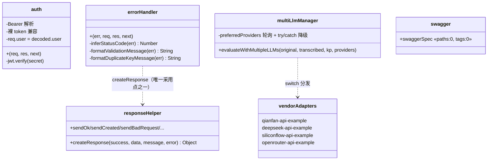

`auth` 的判定序列是：取 `Authorization` → 去掉 `Bearer ` 前缀（无前缀则整串当 token，兼容部分客户端）→ 空则 401 `No token, authorization denied` → `jwt.verify` 失败则 401 `Token is not valid` → 成功后 `req.user = decoded.user` 直接把 token 里的 `{id}` 挂上去。

这里有一个已确认的设计缺口：`auth` 不查库，因此不校验用户是否仍然存在。删除用户后，其 7 天有效期内签发的 token 依然能通过鉴权，后续查询只会拿到空结果。当前系统没有删除用户的端点，所以这个缺口不会被触发；但它意味着任何“用 `req.user.id` 直接写数据”的操作都没有存在性保障，若将来加入注销功能必须在 `auth` 或写操作前补一次 `User.findById`。

`errorHandler` 的状态码映射是一张显式表：

| 错误特征 | 推断状态码 | 对外文案 | 是否透出 `err.message` |
|---|---|---|---|
| `name === 'ValidationError'` | 400 | 逐字段拼接 | 是 |
| `CastError`（ObjectId 格式非法） | 400 | 原 message | 是 |
| `MongoError/MongoServerError` 且 `code` 为 11000/11001 | 409 | 重复键友好文案 | 是 |
| `err.type` 以 `entity.` 开头（body-parser） | 400 | 请求体格式错误 | 是 |
| 其余 | 500 | 服务器内部错误 | 否（`error` 置 `undefined`） |

另有两个细节：`res.headersSent` 为真时立刻 `next(err)` 交还 Express，避免二次写响应；非 `production` 环境下打印完整堆栈。文件顶部注释关于 Express 5 的说法是错误的：它声称 Express 5 中 async handler 抛出的异常不会自动转发到错误中间件，因此需要 controller 自己 try/catch。实际 Express 5 改成了自动捕获 rejected promise 并转发，这也是本项目的 55 个端点大量仍写着 `try/catch` 的历史原因（详见 D-06）。

## 5.5 前端结构与跨层耦合

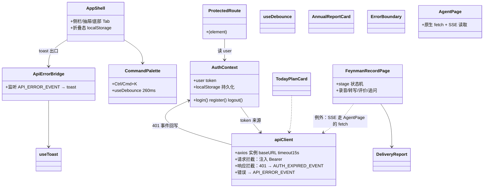

四条必须写清的耦合关系：

一，`AuthContext ↔ apiClient` 是一个流程。token 由 `AuthContext` 持有并在请求拦截器里注入；响应拦截器捕获 401 时不直接操作路由，而是 `dispatch` 自定义事件 `auth:expired`，由 `AuthContext` 监听后清空登录态并跳转。选择事件而不是在拦截器里 `window.location.href = '/login'`，是因为拦截器拿不到 React Router 的 history，硬跳会丢失路由 state。这条链上曾经出现过真实缺陷：本地开发时 401 被误判（响应体缺少预期字段导致分支走错），后来通过 `ApiErrorBridge` 把后端 `msg` 原样透到 toast 才定位到根因。

二，页面级超时例外。`apiClient` 统一 15s 超时，但所有长耗时 AI 调用都在页面内显式抬到 60–90s，唯独 `AgentPage` 的流式对话完全绕开 axios 用原生 `fetch`，原因是 axios 在浏览器端无法增量读取 SSE body。这里的取舍是为了保留流式能力而放弃一层统一性，代价是 `AgentPage` 要自己处理 token 注入与错误提示。

三，`FeynmanRecordPage ↔ feynmanCoachService` 的隐式契约。前端渲染五维雷达/进度条所依赖的维度名称与顺序，来自后端 `DIMENSIONS` 常量。后端改了维度 key 而前端没改，界面会静默显示空维度而不是报错。这类跨端常量耦合没有类型系统容错，只能靠第七章的接口约定和第八章的专项用例保证。

四，Electron 下的重定向差异。`file://` 协议下 `axios` 的 `baseURL` 相对路径不成立，因此构建时 `base` 切 `'./'`、登录后跳转必须走客户端路由而不是任何依赖 `window.origin` 的拼接。这是三种交付形态中唯一进入类设计的差异。

## 5.6 技术债登记册

以下 8 项都在源码中被逐条核实，按“是否影响用户”排序，供第八章缺陷登记与第九章反思引用。

| 编号 | 技术债 | 证据位置 | 影响 | 处置建议 |
|---|---|---|---|---|
| D-01 | 同一套“剥 json 代码围栏 → 贪心取对象 → `JSON.parse`”在 7 个文件、8 个位置重复实现 | `aiService.js:96`、`feynmanCoachService.js:112`、`baiduAiController.js:186/244`、`utils/{qianfan,deepseek,siliconflow,openrouter}-api-example.js` 各一份；另有 `graphReasoningService.js:87` 的数组版（贪心取中括号片段） | 修一个容错 bug 要改 8 处，对象版与数组版容错能力还不一致 | 收敛到 `utils/extractJson.js` 单一实现，支持对象/数组两种目标 |
| D-02 | 存在 3 条互不相同的 LLM 降级链 | `aiService.PROVIDERS`、`feynmanCoachService.chatJSON`、`multi-llm-manager` | 厂商顺序、超时、容错各自为政，故障排查要看三处 | 统一 provider registry，按延迟预算配置链 |
| D-03 | 部分厂商示例 `return {error:true}` 而非 `throw` | `siliconflow-api-example.js` / `openrouter-api-example.js` | `multi-llm-manager` 的 `try/catch` 捕不到，降级链在此中断，错误对象流向 `normalizeResult` 得 score 0，进而把掌握度覆盖为 `旧值×0.6`，用户进度被一次瞬时故障覆盖掉 | 改为 `throw`；`normalizeResult` 增加 `error` 字段短路；`afterFeynman` 在 score 为 0 且来源异常时跳过写入 |
| D-04 | `controllers/userController.js` 是死代码 | 全仓库无 import | 误导读者以为存在 controller 分层约定 | 删除，或把 `routes/users.js` 逻辑真正迁入并接通 |
| D-05 | `@langchain/textsplitters` 未在 `package.json` 声明却被 require | `vectorStoreService.js` 依赖它做 500/50 分块 | 干净环境 `npm ci` 后启动崩溃（目前靠传递依赖侥幸可用） | 显式加入 dependencies |
| D-06 | `errorHandler` 顶部关于 Express 5 async 转发的注释错误 | `middleware/errorHandler.js:5-9` | 后来者据此认为 try/catch 是必需的，复制粘贴更多冗余 try/catch | 更正注释，逐步移除不必要的 try/catch |
| D-07 | 统一响应格式与 Swagger 文档未落实 | `responseHelper` 仅 3 处引用；`swagger.js` 的 `paths/tags` 为空 | 前后端只能靠读代码对接口，第三/五章的接口清单无法从 `/api-docs` 生成 | 补 spec 或先移除 `/api-docs` 避免误导 |
| D-08 | 后端无 lint、`npm test` 是占位脚本 | 后端 `package.json`；前端只有 oxlint（32 warnings / 0 errors） | 风格与低级错误全靠人眼；回归无自动化保障 | 后端接入 eslint，把 `scripts/api-smoke.ps1` 加上退出码后挂 CI |

---

# 六、关键内容的功能模型和状态模型及描述

本章用功能模型（时序图 `sequenceDiagram`，回答“一次请求怎么穿过各个类”）和状态模型（状态图 `stateDiagram-v2`，回答“同一份数据在生命周期里能变成什么”）两类图替代传统流程图。选取的六处都是系统里真正有算法或并发语义的地方：语音复述评分链、RAG 流式对话、复述页状态机、掌握度生命周期、SM-2 复习调度、今日计划与番茄。

## 6.1 顶层功能模型：学习主流程

系统的 21 个功能需求串成一个流程，各处算法在这个环上都有明确的位置。

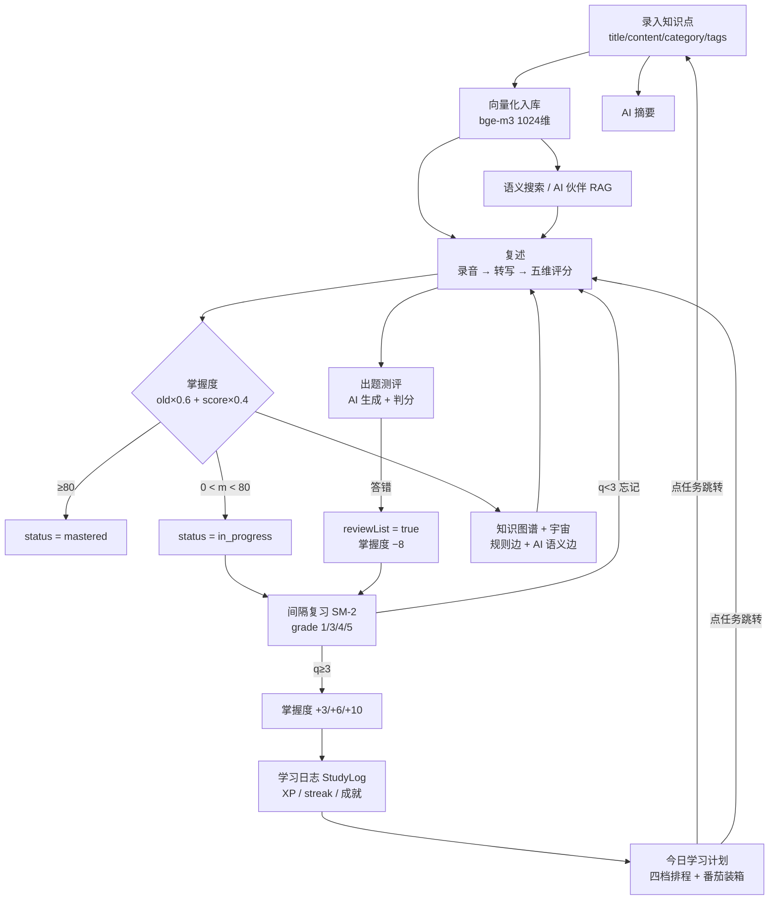

这个模型说明了两件事。第一，掌握度是唯一贯穿整个流程的状态量：复述用加权平均改写它，复习用增量修正它，答题用 ±5/−8 扰动它，排程和图谱都读它。第二，激励不是独立模块，而是流程的结果：`logStudy` 在每次状态迁移时写一条日志，等级、连续天数、成就、热力图全部由这些日志派生，没有任何一张“计数器表”需要同步维护。

## 6.2 功能模型：语音复述评分链

这是全系统穿越层次最深的一条链，前端一次点击背后是 2 次外部转写调用 + 1 次多厂商 LLM 调用 + 2 次数据库写。

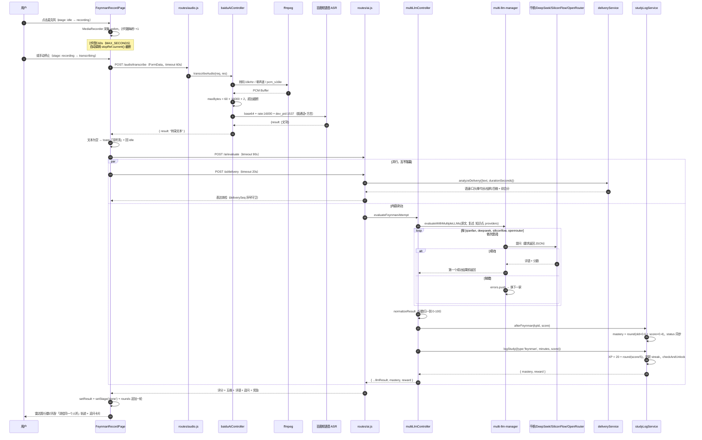

三点值得展开：

表达体检与内容评分并行执行，这是该界面响应速度的关键。`deliveryService` 是纯规则计算（语速 0.25 / 口头禅 0.20 / 句长 0.20 / 结构 0.35），一次调用只有毫秒级；如果串行等它，用户会白白多等一次往返。前端用 `deliverySeq` 自增序号做守卫：先 `setDelivery(null)` 清空，记下 `seq = ++deliverySeq.current`，回调里只有 `seq === deliverySeq.current` 才写入，这样连续两次复述时，慢的那次旧结果不会覆盖新结果。这是典型的异步竞态防护，代码只有三行，用来消除“显示了上一轮体检结果”这一类缺陷。

归一化层是多厂商架构成立的前提。千帆返回 `{overallScore: 8.5}`、DeepSeek 返回 `{score: 85}`、字段名与量纲都不统一。`normalizeResult` 先做 `result.score ?? (result.overallScore ? result.overallScore * 10 : 0)` 的量纲换算，`feynmanCoachService.normalizeDimensions` 再用 `SOURCE_FIELDS` 别名表逐维取值、缺失维度落到 `FALLBACK_OFFSET`，并在五维均值与总分偏差超过 18 分时做整体平移修正。有了这一层，换一家模型才是配置动作而不是改造动作。同时，这一层也放大了 D-03 缺陷的影响：`siliconflow/openrouter` 示例在失败时 `return {error:true}` 而不是 `throw`，降级链停在这里，`normalizeResult` 把错误对象读成 `score = 0`，接着 `afterFeynman` 用 `old×0.6 + 0×0.4` 覆盖掉用户的真实掌握度，一次瞬时网络抖动会让用户进度损失四成。功能模型上这条链属于“正常返回 200”，所以冒烟测试也检测不到它，只能靠专门的用例（见第八章 TC-AI-05）断言。

60 秒不是产品决策，是接口硬约束。百度短语音识别单次上限 60 秒，因此前端计时器到点直接调 `stopRef.current?.()` 停止录音，后端再按 `60 × 16000 × 2 = 1,920,000` 字节做二次截断。两处限制一前一后，前端负责体验（提示“超时会自动截断”），后端负责容错（防止被绕过）。

## 6.3 功能模型：RAG 流式对话

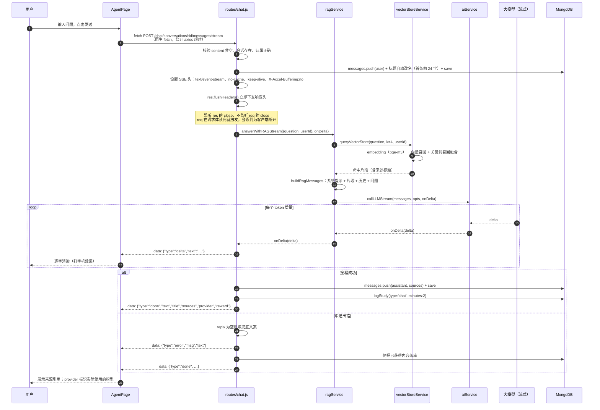

这个模型里有三个容易出错的地方，都已在代码注释中记录。其一，`X-Accel-Buffering: no` 必须显式设置，否则经过 Nginx 类代理时 SSE 会被缓冲成一次性返回，打字机效果变成一个很长的等待。其二，关闭检测要挂在 `res` 而不是 `req`：`req` 的 `close` 在请求体读完时就触发，若据此判定客户端断开，回答会被整段跳过。其三，错误也要先落库再发 `done`。用户看到的是半截答案加一句容错提示，但历史里留下了真实内容，刷新页面不会丢失，重新生成端点（`/retry/stream` 会先弹出尾部 assistant 消息再重放）也因此有正确的输入。

`started` 标志（在 `callLLMStream` 内）承担另一种语义：它记录“是否已经向客户端吐出过第一个字节”。已开始则不能改状态码、只能补一个 `error` 事件；未开始则可以干净地降级到下一家厂商。这是流式接口做容错时最关键的分界线。

## 6.4 状态模型：复述页的 stage 状态机

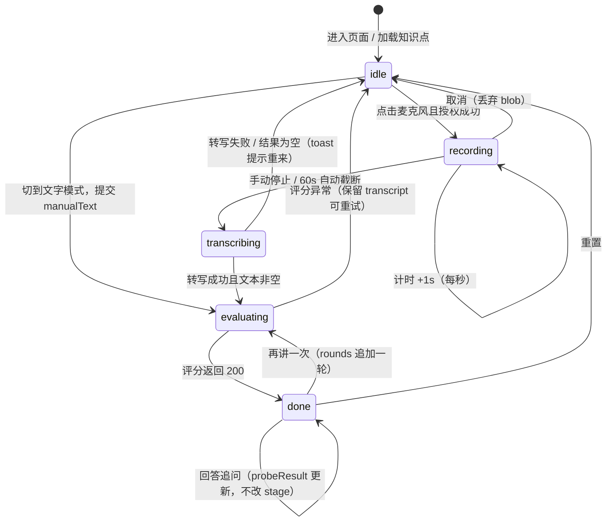

守卫条件与副作用：

| 状态 | 进入条件 | 被禁止的动作 | 说明 |
|---|---|---|---|
| `transcribing` / `evaluating` | — | 麦克风、提交、切模式 | 前端用 `busy = stage==='transcribing' \|\| stage==='evaluating'` 统一禁用，避免并发请求互相覆盖 |
| `recording` | `MediaRecorder` 已就绪 | 重复点击开始 | 计时器 effect 依赖 `stage`，离开 `recording` 自动 `clearInterval` |
| 60s 上限 | `elapsed ≥ MAX_SECONDS` | — | 由 `setElapsed` 的函数式更新内部调用 `stopRef.current()`，不依赖外部闭包变量 |
| 组件卸载 | `alive` / `deliverySeq` 守卫 | — | effect cleanup 置 `alive=false`，异步回调先检查再 setState，防止卸载后更新 |
| 追问轮次 | probe 相关状态独立于 stage | 不落库 | `rounds`、`probeRecords` 只存内存，刷新即清；演示时一轮会话内完成，服务端不建轮次表 |

这里最重要的设计判断是：`probe`（追问）不进入 `stage`。追问是“在 `done` 之上叠加的对话层”，如果把它做成 `asking`/`answering` 两个 stage，用户回答追问时就不能同时对同一个知识点再讲一遍，两个功能会互相锁死。用独立状态（`probe` / `probeAnswer` / `probeResult` / `probeBusy` / `probeRecords`）承载后，“讲完 → 被追问 → 回答 → 分叉或继续”可以自由组合。

## 6.5 状态模型：掌握度与学习状态生命周期

`KnowledgePoint.mastery`（0–100）与 `status`（三值）是全系统的核心状态。`status` 从不独立设置，它是 `mastery` 的纯函数派生：`mastery ≥ 80 → mastered`，`0 < mastery < 80 → in_progress`，`mastery == 0 → not_started`（由初始值保证）。

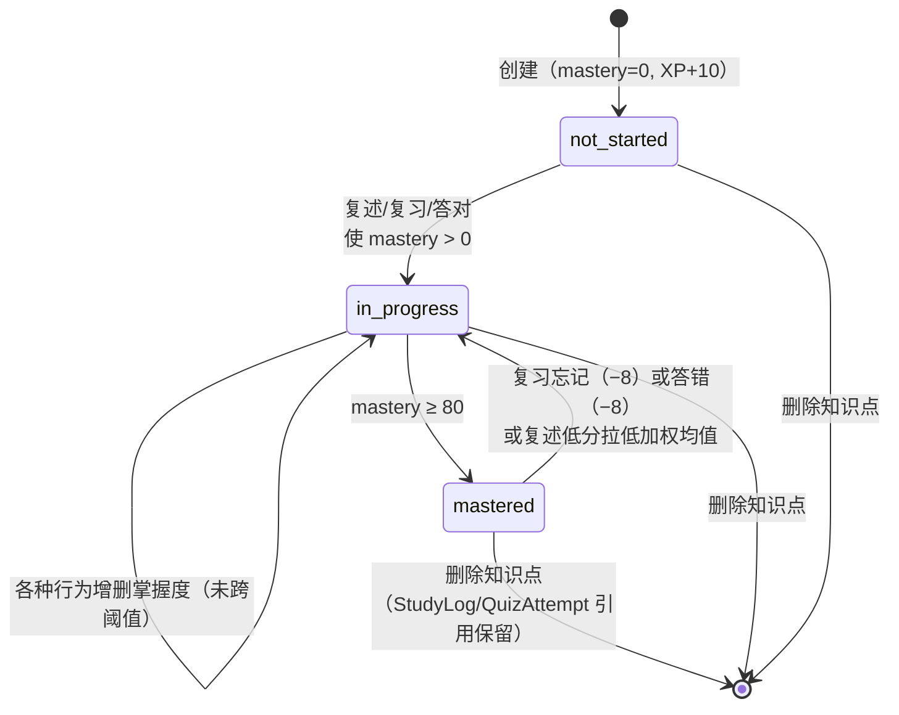

下表是从源码逐条核对的行为 → 状态迁移 → 奖励全量映射，也是第七章数据字典和第八章用例断言的基准：

| 触发行为 | 端点 | mastery 变化 | 其他字段 | `logStudy.type` | XP |
|---|---|---|---|---|---|
| 创建知识点 | `POST /knowledge-points` | 0（不变） | 立即入向量库 | `create` | 10 |
| 编辑内容 | `PUT /knowledge-points/:id` | 白名单可显式覆盖 | 内容变更则重新向量化 | （`edit` 规则定义为 2，但无任何调用点） | 0 |
| 间隔复习 grade=1 | `POST /…/:id/review` | −8 | SM-2 重置、`reviewList=true` | `review` | 5 |
| 间隔复习 grade=3 | 同上 | +3 | `reviewList=true`（grade<3 才置真，3 不置） | `review` | 5 |
| 间隔复习 grade=4 | 同上 | +6 | — | `review` | 5 |
| 间隔复习 grade=5 | 同上 | +10 | — | `review` | 5 |
| 费曼复述评分 | `POST /ai/evaluate` | `round(old×0.6 + score×0.4)` | `stats.feynmanCount+1`、`lastScore` | `feynman` | 20 + `round(score/5)` |
| 答题（判分后） | `POST /quiz-attempts` | 答对 +5 / 答错 −8 | `stats.quizCount+1`，答对再 `correctCount+1`，答错 `reviewList=true` | `quiz` | 显式传入：答对 8、答错 2 |
| 生成闪卡 | `POST /ai/flashcards` | 不变 | — | `flashcard` | 3 |
| 复习闪卡 | `POST /flashcards/:id/review` | 不变（卡有自己的 EF/interval） | `reviewCount+1`、`nextReviewAt` 推后 | `flashcard` | 3 |
| 与 AI 伙伴对话（非流式） | `POST /chat/…/messages` | 不变 | 写 `sources` 标题数组 | `chat` | 2 |
| 与 AI 伙伴对话（流式） | `POST /chat/…/messages/stream` | 不变 | SSE 结束后记账 | `chat` | 2 |
| 进入知识宇宙 | `POST /dashboard/explore` | 不变 | `meta.scene='universe'`（成就 `explorer` 计数源） | `explore` | 1 |
| 从备份恢复 | `POST /users/restore` | 随导入数据 | 去重跳过同标题同内容 | 不写 StudyLog | 直接 `$inc: 条数×2 + 闪卡数` |

有两处需要说明。答错也给 2 XP 是刻意的：如果只有答对才给分，用户会倾向于“不确定的题就不答”，而这类时刻最需要练习，所以奖励的是尝试本身而不是结果。恢复备份走 `$inc` 而不走 `logStudy`，好处是不污染成就与热力图（导入 100 条不应该算 100 次学习），代价是恢复行为在日志里完全不可见，无法审计。这是权衡之后的选择。

## 6.6 状态模型：SM-2 间隔复习调度

`KnowledgePoint.review` 是一个内嵌子文档，它的五个字段共同构成一台有限状态机。复习页只有四个按钮（忘记 / 有点难 / 记得 / 很简单，对应 grade 1 / 3 / 4 / 5），所有的调度智慧都发生在 `scheduleReview` 这 30 行纯函数里。

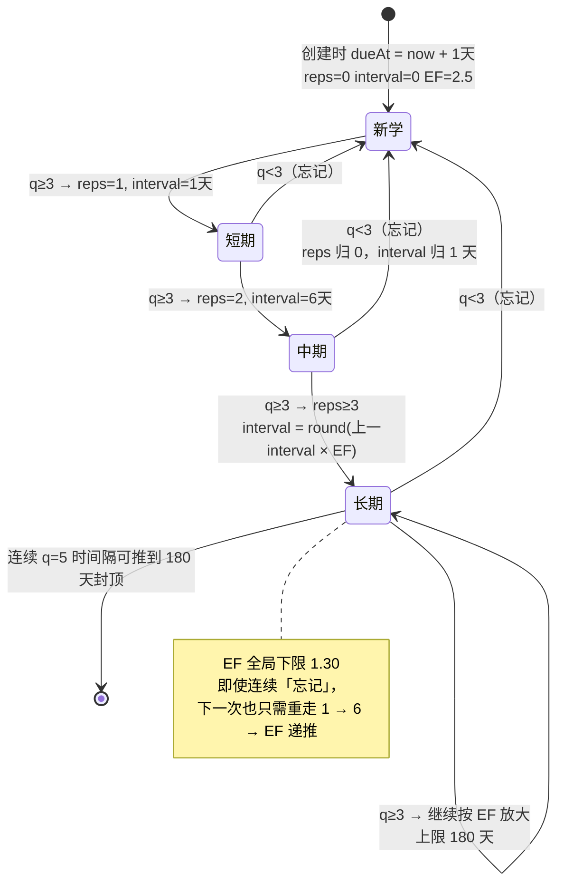

算法定义（与 `reviewScheduler.js` 逐行一致）：

```
EF'  = clamp( EF + (0.1 − (5−q)×(0.08 + (5−q)×0.02)), 1.3, +∞ )，保留 2 位小数
q < 3        → reps = 0, I = 1
q ≥ 3, reps'=1 → I = 1
q ≥ 3, reps'=2 → I = 6
q ≥ 3, reps'≥3 → I = round( max(1, 上一 I) × EF' )
I  = clamp(I, 1, 180)
dueAt = now + I × 86400000
```

EF 演算示例（手工推算，起点 `EF=2.50 / reps=3 / interval=20 天`）：

| grade | 含义 | 计算 `0.1 − (5−q)(0.08+(5−q)·0.02)` | EF' | reps' | 新间隔 | 掌握度增量 |
|---|---|---|---|---|---|---|
| 5 | 很简单 | `0.1 − 0×0.08 = +0.10` | 2.60 | 4 | `round(20×2.60) = 52` 天 | +10 |
| 4 | 记得 | `0.1 − 1×0.10 = 0.00` | 2.50 | 4 | `round(20×2.50) = 50` 天 | +6 |
| 3 | 有点难 | `0.1 − 2×0.12 = −0.14` | 2.36 | 4 | `round(20×2.36) = 47` 天 | +3 |
| 1 | 忘记 | `0.1 − 4×0.16 = −0.54` | 1.96 | 0 | 1 天 | −8 |

选择 SM-2 的理由主要体现在这张表上：难度因子的更新是不对称的。同样一次复习，答得好只涨 0.10，答得差最多掉 0.54，而且“忘记”还会把 `reps` 归零、间隔从 52 天直接回到 1 天。只有让“以为记住其实没记住”的代价足够高，用户才会如实点击“忘记”。上例里注意 EF' 在 `q<3` 分支依然被写回（代码把 `nextEase` 无条件放进返回对象），所以失败不仅重置进度，还永久降低了该知识点后续的间隔增长速度，这是 SM-2 的设计意图。

第三分支写作 `Math.max(1, intervalDays || 1) * nextEase` 是为了兼容旧数据：升级前创建的知识点 `intervalDays` 是 0，若不容错会让间隔永远算成 0 天而卡在“今天到期”。`dueFilter` 的三个 `$or` 分支同理（`dueAt ≤ now`、`dueAt` 不存在且创建满一天、`dueAt` 为 null 且创建满一天），用查询兼容历史脏数据，而不是要求用户重跑一遍迁移脚本。这是本项目对“无迁移工具”这一现实约束的统一做法：读取路径保持向后兼容，写入路径写新格式。

## 6.7 状态模型：测评页（QuizPage）phase

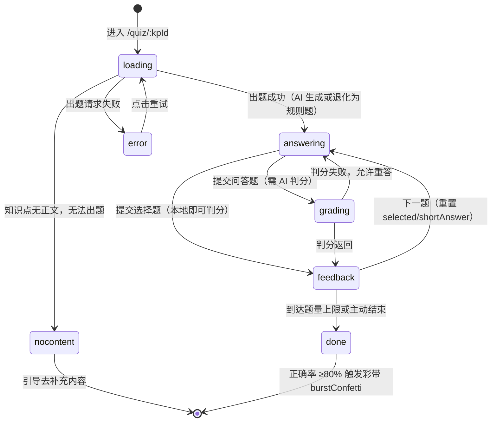

关键点是 `feedback` 与 `grading` 的分离：选择题判分是本地字符串比较，一秒内完成；问答题要把题目、参考答案要点、学生答案交给模型判分，需要 60s 超时并显示 loading。两者用不同 phase 才能给出正确反馈：如果统一成 `answering → feedback`，问答题会在等待期间看起来像卡死。`answering` 状态下 `selected` 与 `shortAnswer` 每次进入下一题都重置，避免残留选项。答题结果通过 `POST /quiz-attempts` 落库并触发 6.5 的掌握度迁移，因此测评分支是“回到复述”这条学习路径的数据来源。

## 6.8 状态模型：XP / 等级 / 连续天数

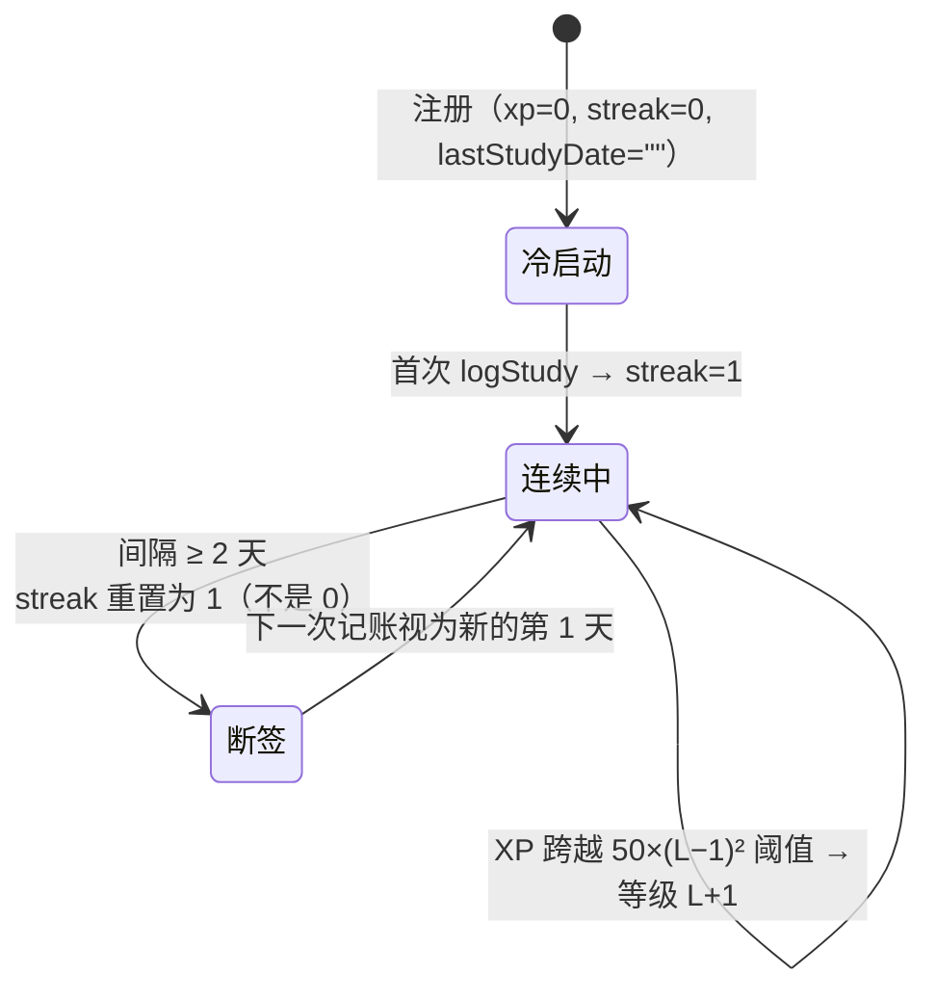

等级公式 `level = floor(√(xp/50)) + 1`，即升到第 L 级需要累计 `50×(L−1)²` 点经验：L2 需 50、L3 需 200、L4 需 450、L5 需 800。这条二次曲线让前期升级快（一次复述 20+ XP 立刻可见）、后期升级慢（需要稳定投入），与成就系统的 10 条定义（合计 902 XP）配合，覆盖了从首日体验到长期坚持的整个激励区间。

`dateKey()` 把日期写成 `YYYY-MM-DD` 字符串并存放在 String 字段里，是本节需要重点说明的一个决定。直觉上应该存 `Date` 然后按天比较，但那样必然撞上时区问题：MongoDB 内部存 UTC，`Date` 的“今天”在服务端与用户本地可能差一天，热力图和连续天数就会在午夜前后错乱。用 `getFullYear/getMonth/getDate` 生成本地日期字符串后，比较变成字符串相等判断，`lastStudyDate !== today` 一次解决，`StudyLog` 上的 `{user, date}` 复合索引也直接支撑热力图按天分组。这样牺牲了日期运算的通用性，换来时区语义的确定，对以“连续天数”为核心体验的应用来说是合适的取舍。

另外两个细节：`streak` 断签后重置为 1 而不是 0（因为这次记账本身就构成了新的一天的开始），以及 `longestStreak` 用 `Math.max` 单调不降，保证用户在断签后仍能看到自己最好的成绩，这是激励设计里保留最高记录的做法。

## 6.9 状态模型：今日学习计划与番茄浮层

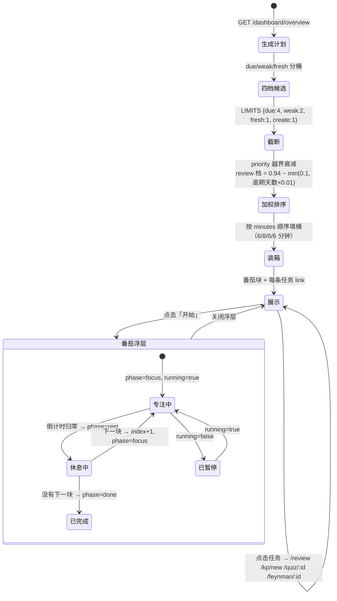

排程规则全部是常量表，没有一次模型调用：

| 档位 | 判定条件 | 数量上限 | 基础优先级 | 任务时长 | 语义 |
|---|---|---|---|---|---|
| `due` | `dueInfo()` 非 null（到期或旧数据创建满 1 天） | 4 | 0.94 − min(0.1, 逾期天数×0.01) | 6 min | 入选看“谁最久没碰”，展示看“谁刚到期” |
| `weak` | `mastery < 60` 且已练习过或 `in_progress` | 2 | 0.74 | 8 min（复述） | 用输出补洞 |
| `fresh` | `feynmanCount == 0` 且 `mastery < 80` | 1 | 0.66 | 8 min（复述） | 第一次讲述最暴露缺口 |
| `create` | 今日 `created == 0` 才追加 | 1 | 0.58 | 6 min | 每天至少播一颗新种子 |

排序前的桶内排序也各有依据：`due` 按逾期天数降序、同逾期按掌握度升序；`weak` 按掌握度升序；`fresh` 按创建时间升序。装箱是顺序填充（Next-Fit）：只看最后一个番茄块，装不下就开新块。这里没有采用 First-Fit 回溯，因为任务已按优先级排好，回溯会打乱“先做最重要的”这一顺序含义。`focus` 与 `rest` 分别被 `clampInt` 限制在 10–60 与 3–20 分钟，防止用户配置出无法完成的节奏。四档上限合计最多 8 条任务，理论上限是 `4×6 + 2×8 + 1×8 + 1×6 = 54` 分钟（`studyPlanService.js:14` 的注释写作“总时长约 45 分钟”，与实际算出的 54 对不上，属注释未跟上常量的一处小漂移），刻意不塞满一天。

这里有一处实测中发现的规则冲突，需要如实写下来。`due` 桶先用“逾期天数降序”挑出逾期最久的 4 条，随后 `picked.sort(priority)` 又按衰减后的优先级重排全局顺序，而衰减公式让逾期越久优先级越低，两条规则方向相反。用第五章的纯函数构造 5 个知识点（逾期 0/1/3/30 天各一条 + 1 条未到期）实跑 `buildTodayPlan`，输出顺序确实是 `今天刚到期(0.94) → 到期1天(0.93) → 到期3天(0.91) → 到期30天(0.84)`，而提示文案却写着“已经到期 30 天，再不复习会明显变淡”。入选集合是对的（最逾期的 4 条被选进来了），展示顺序却把最紧急的一条排到了最后。合理的修法是把衰减改成增益（`0.58 + min(0.36, days*0.01)` 之类），或让 `due` 类任务绕过全局优先级排序。这条记入第八章 T-06 的 PLAN-03（✅ 已实跑）与技术债 D-09。

这里记录一个已知的近似做法。计划卡上的“已完成”并没有逐条追踪哪几条被做，而是从今天 `StudyLog` 的配额回填：今天复习过 N 次，就把列表里前 N 条 `review` 类任务点亮；练习过 M 次就点亮前 M 条 `feynman/quiz` 任务。代码注释写得很直接：“今天已经复习/练习过几次，就点亮前面几条（让进度可感知）”。这意味着如果用户跳着做任务（先做第 3 条），点亮的是第 1 条，即完成度数值正确，具体条目可能错位。选择这种做法是因为要精确追踪就得给计划项建集合、加 ID、写迁移，而这部分实现对个人项目的收益远低于成本，进度可感知本身已达到设计目的。这是用可接受的近似换取开发速度的取舍，应作为已知局限写在报告里。

## 6.10 功能模型：知识图谱推理与缓存

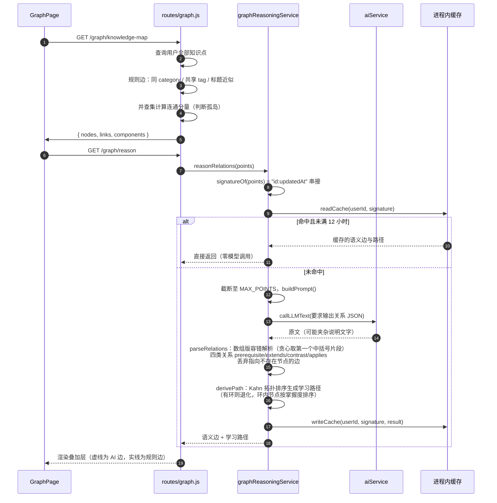

这张图说明高成本计算如何被缓存为低成本的读取。缓存键取 `userId + 数据签名`，而不是单独的 `userId`：只要任何一个知识点的标题、内容或分类变化，`updatedAt` 就改变，签名失效，下一次请求自动重算，不需要显式的失效逻辑，也不会读到过期结构。12 小时 TTL 是成本与新鲜度的折中：一次推理约 1–2 秒、消耗数千 token，而用户整理知识图谱通常一天内完成。

这条链也有明确的一致性边界：缓存是进程内的 `Map`，因此只在单实例部署下成立。多实例时每个进程各自持有一份，既可能重复消耗 token，也不会在重启后保留。当前是本地单进程演示，属于“知道边界在哪、且边界之内够用”的选择；真要横向扩展，应把签名与结果挪到 Redis 或干脆把语义边持久化到 `KnowledgePoint` 上。这一条也记入了 5.6 之后的演进建议。

---

# 七、数据库及 ER 模型

## 7.1 存储全景

系统有三处彼此独立的持久化载体，各自解决不同问题，不能互相替代：

| 存储 | 位置 | 存什么 | 一致性/寿命 | 是否可重建 |
|---|---|---|---|---|
| MongoDB（Atlas 免费集群 M0） | 云端 | 7 个集合，全部业务数据 | 唯一事实来源；跨设备共享 | 不可，靠 `/users/backup` 导出 |
| 本地向量索引 `vector_data/` | 后端进程工作目录 | 知识点正文的分块向量 + 元数据 | 派生数据，与主库可能短暂不一致 | 可，`node scripts/reindex-vectors.js` 全量重建 |
| 浏览器 `localStorage` | 客户端 | `token`、`user`、`shell-collapsed` | 仅本机本浏览器；登出即清前两项 | 可，重新登录即可 |

把向量库设计成可全量重建的派生存储是关键决定：向量数据可以安全删除、可以在更换 embedding 模型后整体重算，也不需要事务与主库同步。代价是首次部署或换模型后必须手动跑一次重建脚本，否则 AI 伙伴和语义搜索检索不到历史笔记，这条已在第二章运行步骤里显式写出。

## 7.2 ER 模型

MongoDB 是文档型数据库，严格意义上的 ER 图并不完全适用，但本项目的集合关系足够清晰，可以用实体关系模型来表达归属与基数（内嵌子文档在图中作为属性组体现）。

```mermaid
erDiagram
    USER ||--o{ KNOWLEDGE_POINT : "拥有"
    USER ||--o{ STUDY_LOG : "产生"
    USER ||--o{ QUIZ_ATTEMPT : "作答"
    USER ||--o{ FLASHCARD : "拥有"
    USER ||--o{ CHAT_CONVERSATION : "拥有"
    USER ||--o{ USER_ACHIEVEMENT : "解锁"
    KNOWLEDGE_POINT ||--o{ STUDY_LOG : "被记录（可空）"
    KNOWLEDGE_POINT ||--o{ QUIZ_ATTEMPT : "被考核（可空）"
    KNOWLEDGE_POINT ||--o{ FLASHCARD : "被拆卡（可空）"
    CHAT_CONVERSATION ||--o{ MESSAGE : "内嵌包含"
    KNOWLEDGE_POINT |||| REVIEW : "内嵌 SM-2 状态"
    KNOWLEDGE_POINT |||| STATS : "内嵌行为计数"

    USER {
        ObjectId _id PK
        string username UK "唯一索引"
        string email UK "唯一索引"
        string password "bcrypt rounds=10，查询时 select 排除"
        string displayName
        string avatarKey "默认 sprout"
        int dailyGoal "默认 3"
        int xp "累计经验"
        int streak "当前连续天数"
        int longestStreak "历史最长，单调不减"
        string lastStudyDate "YYYY-MM-DD 本地时区"
        date createdAt "timestamps 自动"
        date updatedAt
    }
    KNOWLEDGE_POINT {
        ObjectId _id PK
        ObjectId user FK "索引"
        string title "必填，路由截断至 120 字"
        string content "必填，Markdown/LaTeX/Mermaid 原文"
        string category "默认未分类，截断至 20 字"
        array tags "去重后最多 8 个"
        bool favorite "默认 false"
        string summary "AI 生成一句话摘要"
        int mastery "0-100，schema min/max 约束"
        string status "not_started|in_progress|mastered（代码约定，非 enum）"
        bool reviewList "旧版复习标记，grade<3 时置真"
        object review "内嵌子文档，_id:false"
        object stats "内嵌子文档，_id:false"
    }
    REVIEW {
        int repetitions "成功次数，失败归零"
        int intervalDays "1 / 6 / round(上一间隔 × EF)，封顶 180"
        float easeFactor "SM-2 难度因子，默认 2.5，下限 1.3"
        date dueAt "下次到期，默认创建后 24 小时"
        date lastReviewedAt
        int lastGrade "1|3|4|5"
    }
    STATS {
        int feynmanCount
        int quizCount
        int correctCount
        int reviewCount
        int lastScore
    }
    STUDY_LOG {
        ObjectId user FK "必填"
        ObjectId knowledgePoint FK "可空，删除知识点后保留"
        string type "8 值枚举，schema 级校验"
        int minutes
        int score "0-100 或 null"
        int xp "本次获得经验"
        string date "YYYY-MM-DD，必填，非 Date"
        object meta "自由结构：grade/provider/scene/count/action…"
    }
    QUIZ_ATTEMPT {
        ObjectId user FK
        ObjectId knowledgePoint FK "可空（随机练习）"
        string questionType "single-choice|short-answer…"
        string difficulty
        string question "必填"
        object options "Mixed，选择题选项或 null"
        string answer "标准答案"
        string userAnswer
        bool isCorrect
        string explanation
    }
    FLASHCARD {
        ObjectId user FK
        ObjectId knowledgePoint FK "可空"
        string front "必填，截断至 300 字"
        string back "必填，截断至 800 字"
        int intervalDays "独立 SM-2，封顶 120 天"
        float easeFactor "默认 2.5"
        date nextReviewAt
        int reviewCount
    }
    CHAT_CONVERSATION {
        ObjectId user FK
        string title "默认「新建对话」，首条消息前 24 字自动改名"
        array messages "内嵌文档数组"
        date lastMessageAt
    }
    MESSAGE {
        string role "enum user|assistant"
        string content "必填"
        array sources "命中知识点的标题字符串数组"
        date createdAt
    }
    USER_ACHIEVEMENT {
        ObjectId user FK
        string key "必填，对应 config/achievements.js 的 key"
        date unlockedAt
    }
```

关系性质说明如下。`USER → 各集合` 是强归属（每条文档必带 `user`，所有查询都以它为第一过滤条件）；`KNOWLEDGE_POINT → STUDY_LOG / QUIZ_ATTEMPT / FLASHCARD` 是弱引用，外键允许为 null 且在父文档删除后故意不清理。`REVIEW` 与 `STATS` 不是集合而是内嵌子文档（`_id: false`），`MESSAGE` 同理，这三者没有独立生命周期。`USER_ACHIEVEMENT` 只存“已解锁”的事实，成就定义本身（10 条元数据）放在 `config/achievements.js` 里作为代码，不进库，这样调文案与 XP 是改代码而不是写迁移脚本。

## 7.3 集合与索引清单

Mongoose 默认集合名为模型名的小写复数，实测共 7 个集合：

| 集合 | 文档量级 | 已声明索引 | 服务的查询 |
|---|---|---|---|
| `users` | 与注册数同 | `_id`；`username` 唯一；`email` 唯一 | 登录（按 email）、`/users/me` |
| `knowledgepoints` | 每人数十至数百 | `user`；`{user, review.dueAt}`；`{user, category}` | 列表/搜索/复习队列/分类聚合/图谱取全量 |
| `studylogs` | 增长最快，每动作一条 | `user`；`{user, date}`；`{user, type}` | 热力图、周报、等级、成就计数、今日配额 |
| `quizattempts` | 每人数百 | `user`；`{user, isCorrect}` | 错题本（`isCorrect:false`）、正确率统计 |
| `flashcards` | 每人数十 | `user`；`{user, nextReviewAt}` | 闪卡复习队列（按到期升序） |
| `chatconversations` | 每人若干 | `user` | 会话列表按 `lastMessageAt` 排序 |
| `userachievements` | ≤ 10 × 用户数 | `{user, key}` 唯一 | 成就幂等 upsert 的数据库级保证 |

索引全部来自 `schema.index({...})` 声明，且与真实访问路径一一对应，没有预先添加的冗余索引。唯一要指出的一处不完全匹配：热力图与周报聚合用的时间范围谓词是 `createdAt: { $gte: start }`（见 `routes/dashboard.js`），而声明的复合索引是 `{user, date}`：分组键用字符串 `date`，范围过滤用 `Date` 型 `createdAt`，二者不是同一个字段。该查询仍可用索引的 `user` 前缀定位，再对少量文档做范围过滤，在当前数据量下无实际性能问题；但如果日志量级上升到百万，应补一条 `{user, createdAt}` 或让谓词改用 `date`。这是设计时的疏忽而非运行时的故障，记录为 S-01。

## 7.4 向量库的数据模型

向量库不是关系型集合，它有自己的文档结构，值得单独建模：

```
vector_data/
├── index.json          所有条目的 { id, metadata(仅索引字段), vector[1024], norm, metadataFile }
└── <uuid>.json         每条目的完整元数据（knowledgePointId, userId, title, chunkIndex, text）
```

写入路径与结构参数（实测当前库内数据）：

| 参数 | 取值 | 出处 |
|---|---|---|
| 分块策略 | `RecursiveCharacterTextSplitter`，chunkSize 500、overlap 50 | `vectorStoreService.js:14` |
| Embedding 模型 | `BAAI/bge-m3`（可经 `EMBEDDING_MODEL` 覆盖） | 同上 :11 |
| 向量维度 | 1024（全部条目维度一致） | 实测 `index.json` |
| 条目 id | `${knowledgePointId}_${chunkIndex}` | 同上 :116 |
| 可过滤元数据 | 仅 `knowledgePointId`、`userId` 被 `metadata_config.indexed` 索引 | 同上 :29 |
| 噪声阈值 | cosine 得分 < 0.45 的命中直接丢弃 | `routes/search.js:12` |
| 实测规模 | 30 个分块、覆盖 21 个知识点、3 个用户；`index.json` 约 658 KB | 实测本地文件 |

三条工程细节如下。其一，向量库必须做用户隔离：`queryVectorStore(query, k, userId)` 用 `metadata.userId` 过滤，RAG 与语义搜索都传 `req.user.id`。这一点不能省：向量检索会尽量凑满 top-k，不做过滤就会把其他用户的笔记片段混入 AI 回答。同文件里的 `similaritySearch(query, k)` 是不做用户过滤的版本，当前全仓库无人调用，但它的存在有风险：一旦被直接接进某个端点，就构成跨用户数据泄露（记为 S-02）。其二，写操作被强制串行：vectra 每次写都会重写索引文件，并发录入会相互覆盖，因此用 `withWriteLock(task)` 把所有插入/删除挂在一条 Promise 链上；这个锁是进程内的，多实例部署下失效（记入 S-03）。其三，更新即“先删同 kpId 的旧块再插新块”，保证编辑正文后不留过期向量。

另外有一处由 vectra 库自身行为导致的数据残留问题：`deleteItems()` 只从 `index.json` 的条目数组里过滤，不删除外部元数据文件（库源码 `LocalIndex.ts:195-207` 与 `:532` 的分工所致）。实测本地目录里 `index.json` 有 30 个条目、引用 30 个元数据文件，而磁盘上有 33 个 `.json` 文件，多出的 3 个正是被删除知识点的分块原文，其中抽样一个文件仍完整保留着 `title`、`text`（71 字正文）。也就是说：用户在应用里删除一条知识点后，主库和索引中都不再保留，但它的文本片段还留在服务器磁盘上。功能上无害，但涉及隐私残留，处理方式是定期比对 `index.json` 引用集清理孤儿文件，或改用支持删除的向量存储（记为 S-04）。

## 7.5 数据隔离与删除语义

隔离采用“三层各自负责”的做法，任何一层单独存在都不够：

第一层是查询条件，几乎所有路由都写 `{ user: req.user.id }`，这是主要防线。第二层是归属校验，`/:id` 类端点先 `findById` 再比对 `kp.user.toString() !== req.user.id`，返回 401；`ChatConversation` 同理。第三层是向量元数据过滤（见上）。第三层最容易被忽略，所以单独强调。

删除语义是整个数据模型里最需要讲清楚的部分，用矩阵表达：

| 被删对象 | 主库动作 | 向量库动作 | 保留不动的内容 | 后果 |
|---|---|---|---|---|
| 知识点 | `findByIdAndDelete` | `removeKnowledgePointFromStore(id)` 按 `knowledgePointId` 批删 | `StudyLog` / `QuizAttempt` / `Flashcard` 的 ref | 历史统计与热力图不失真；闪卡变成“孤儿卡”仍可复习，但读不到原标题需容错 |
| 会话 | 整文档删除 | 无关 | 无 | 干净，因为 `messages` 是内嵌的 |
| 闪卡 | 删除单条 | 无关 | 相关日志 | 无影响 |
| 用户 | 无删除端点 | 无 | — | 未实现，属遗留范围；一旦实现必须同步清向量库与 localStorage token |
| 备份恢复 | 只增不删，按“标题+分类”/“正面+背面”去重跳过 | 恢复的知识点不自动重新向量化 | 既有数据 | 导入后需手动跑 `reindex-vectors.js` 才能被 AI 伙伴检索到（记为 S-05） |

这里最容易被误认为疏漏的取舍是“删知识点不删历史”。它的正确性来自一个约束：行为日志是不可变事实。一旦允许级联删除日志，等级和连续天数就会随删除操作倒退，用户可以靠“删了再建”反复刷 XP，激励体系立刻失效。因此这一条是有意的设计，不是实现上的遗漏。

## 7.6 备份与恢复的数据契约

`GET /api/users/backup` 输出一个带版本号的自描述文档：

```jsonc
{
  "version": 1,                       // BACKUP_VERSION，未来结构变更靠它做兼容分支
  "exportedAt": "ISO-8601 字符串",
  "app": "feynman-platform",
  "user": { "username", "displayName", "avatarKey", "dailyGoal", "xp", "streak", "longestStreak" },
  "knowledgePoints": [ /* 已剥离 user 与 __v 字段 */ ],
  "flashcards":      [ /* 同上 */ ],
  "quizAttempts":    [ /* 同上 */ ]
}
```

三个刻意的取舍：导出内容不含密码与 email（避免把凭据写进一个可能被随手发到聊天窗口的文件）；不含 `StudyLog`（体积最大，且恢复它们会与当前 `lastStudyDate`/`streak` 语义冲突）；每条文档经 `strip()` 去掉 `user` 和 `__v` 后交给恢复端点重新绑定当前用户。

`POST /api/users/restore` 的实现有一处需要注意：它先按标题建立 `_id → 新 _id` 的映射表 `idMap`，再据此重挂闪卡与答题记录的 `knowledgePoint` 引用，否则恢复出来的卡片会指向另一个用户的旧 ID。去重键对知识点是“标题 + 分类”、对闪卡是“正面 + 背面”，重复导入同一份备份不会产生脏数据，因此恢复是幂等的增量操作。它同时返回 `created` 与 `skipped` 两组计数，让用户能核对结果。不足之处即 S-05：恢复路径绕过 `logStudy`（直接 `$inc` XP）且不触发向量化。

## 7.7 本章改进项

| 编号 | 问题 | 建议 |
|---|---|---|
| S-01 | 热力图按 `createdAt` 过滤、按 `date` 分组，范围谓词无对应复合索引 | 补 `{user, createdAt}` 或统一改用 `date` 做范围（需先把 `date` 改成可比较格式） |
| S-02 | `similaritySearch()` 不做用户过滤且当前未被调用 | 删除该函数，或强制要求传入 `userId` 并断言非空 |
| S-03 | 向量写锁与推理缓存都是进程内的 | 多实例部署前迁移到 Redis 锁 + 共享缓存，或明确声明单实例约束 |
| S-04 | 删除知识点后向量元数据文件残留正文 | 定期清理孤儿文件；或删除后立即校验引用集与磁盘集一致 |
| S-05 | 备份恢复不重建向量索引 | 恢复响应里返回“需重建向量”提示，或在 restore 成功后异步补投 `addKnowledgePointToStore` |
| S-06 | `status` 三值只写在注释里，schema 无 `enum`，实测 `status:'weird'` 可通过校验 | 给 `status` 加 `enum`，把隐式约定变成显式约束 |

---

# 八、测试及结果

## 8.1 测试策略与分层

项目没有引入测试框架（后端 `npm test` 是占位脚本），因此本轮测试采取“先跑真正能跑的，再设计需要人工执行的”双线策略，并严格区分两类结论：标 ✅ 的是本次实际执行并取到输出的；标 📋 的是按第三章用例规约设计出来、需要启动服务或第三方模型配额才能执行的用例表。绝不把设计出来的用例写成已通过。

```
              ┌──────────────────────────┐
   手工验收   │  界面/交互/三种交付形态    │  📋 按 4.x 与 3.4 用例走查
              ├──────────────────────────┤
   接口冒烟   │  api-smoke.ps1 25 个断点  │  📋 脚本已就绪，本轮未启动服务
              ├──────────────────────────┤
   契约与约束 │  Mongoose Schema 校验矩阵 │  ✅ 已执行（离线，无需数据库）
              ├──────────────────────────┤
   算法单元   │  SM-2 / 表达体检 / 排程    │  ✅ 已执行（纯函数，直接 require）
              ├──────────────────────────┤
   静态检查   │  node --check / oxlint    │  ✅ 已执行
              └──────────────────────────┘
```

选这个顺序的理由很直接：`reviewScheduler`、`deliveryService`、`studyPlanService` 是第五章刻意维护的“不 require 任何 model”的纯函数模块，所以它们不需要数据库、不需要网络、不需要 API Key 就能测，这个架构决定在测试环节带来了直接收益。

## 8.2 已执行的测试与结果（✅）

### T-01 后端语法完整性

对全部排除 `node_modules` 与 `vector_data` 的 `.js` 文件逐个执行 `node --check`：

```
syntax OK=44  FAIL=0
```

44/44 通过，无语法错误、无未闭合结构。这是最低门槛，但考虑到本项目大量逻辑写在路由 handler 里（5.1），它能拦住“改一半存盘”这类低级破坏。

### T-02 前端静态检查（oxlint）

```
Found 32 warnings and 0 errors.
Finished in 64ms on 40 files with 104 rules using 24 threads.
```

| 规则 | 数量 | 典型位置 | 判断 |
|---|---|---|---|
| `react(set-state-in-effect)` | 20 | `KnowledgeUniversePage.jsx:141` 等 | 多为“effect 里调 load()，load 内 setState”的正常异步写法，React Compiler 提示而已；不改 |
| `react(only-export-components)` | 9 | 组件文件里同时导出常量/helper | 会让 Fast Refresh 退化，属体验问题；可选修 |
| `react(purity)` | 3 | `confetti.js:322` 渲染期调用 `Math.random()` | 真问题：渲染里用随机数会破坏 purity，React Compiler 跳过优化；应挪进 effect 或 ref 初始化 |

0 errors 意味着可以正常构建；`purity` 那 3 处是唯一值得动手的，记为 D-10。

### T-03 数据约束校验矩阵（离线，不连库）

用 `validateSync()` 对 7 个模型逐条断言 schema 层约束，结果全部符合预期：

| 用例 | 输入 | 实际输出 | 判定 |
|---|---|---|---|
| SC-01 | `KnowledgePoint{title:'t', content:''}` | `content: Path 'content' is required.` | ✅ 空正文被 schema 拒绝 |
| SC-02 | `KnowledgePoint{title:'', content:'x'}` | `title: Path 'title' is required.` | ✅ |
| SC-03 | `KnowledgePoint{mastery:150}` | `mastery (150) is more than maximum allowed value (100)` | ✅ min/max 生效 |
| SC-04 | `KnowledgePoint{status:'weird'}` | PASS | ⚠️ schema 无 enum → S-06 |
| SC-05 | `KnowledgePoint` 默认值 | `status:not_started, mastery:0, category:未分类, tags:[], review.EF=2.5, interval=0, dueAt=+24h` | ✅ 与 6.6 初始态一致 |
| SC-06 | `User{username:'a', password:'x'}`（无 email） | `email: Path 'email' is required.` | ✅ |
| SC-07 | `StudyLog{type:'unknown', date:'2026-01-01'}` | `` `unknown` is not a valid enum value for path `type` `` | ✅ 8 值枚举生效 |
| SC-08 | `StudyLog` 无 `date` | `date: Path 'date' is required.` | ✅ 强制本地日期串（6.8） |
| SC-09 | `ChatConversation.messages[0].role='system'` | `` `system` is not a valid enum `` | ✅ 只允许 user/assistant |

SC-01 牵出一个真实契约问题：schema 要求 `content` 必填，而路由 POST 写的是 `content: content || ''`，空串会触发 schema 校验失败并被 `catch` 成 `500 {msg:'创建知识点失败'}`。前端表单第 106 行有 `if (!form.content.trim())` 拦截，所以界面里走不到；但直接调 API（curl、Electron 旧版本、冒烟脚本改写）会拿到 500 而不是 400 的友好提示。记为 BUG-03。

### T-04 SM-2 复习调度算法（纯函数实跑）

输入 6.6 的起点状态 `{repetitions:3, intervalDays:20, easeFactor:2.5}`，实跑与手工推算对照（四行各自是从同一初始状态发起的独立调用，不是连续提交，见下方说明）：

| grade | 手算 EF' | 程序 EF' | 手算间隔 | 程序间隔 | reps | 掌握度增量 | 一致性 |
|---|---|---|---|---|---|---|---|
| 5 | 2.60 | 2.60 | 52 | 52 | 4 | +10 | ✅ |
| 4 | 2.50 | 2.50 | 50 | 50 | 4 | +6 | ✅ |
| 3 | 2.36 | 2.36 | 47 | 47 | 4 | +3 | ✅ |
| 1 | 1.96 | 1.96 | 1 | 1 | 0 | −8 | ✅ |

补充边界实跑：首次成功 → `reps=1, interval=1`；第二次 → `interval=6`；`reps=9, interval=170, EF=2.6` → 计算值 442 被封顶为 180；空 review 对象 + grade 1 → `interval=1`（`intervalDays||1` 容错生效）；`grade=NaN` → `lastGrade=0` 且落入 `<3` 失败分支（路由层已用白名单 `[1,3,4,5]` 拦住 NaN，所以这是纵深防御而非缺陷）。SM-2 实现与文档 100% 一致，第六章的公式与演算示例可以作为验收基准。

再补一组链式实跑（同一知识点连续提交 5→4→3→1），因为它会给出与独立四档不同的结果：`EF 2.60 → 2.60 → 2.46 → 1.92`、间隔 `52 → 135 → 180（触及封顶）→ 1`。也就是说连续几天给自己打高分，间隔会迅速达到 180 天上限，`Math.min(nextInterval, 180)` 在这里起到限制自我评分通胀的作用，这也是保留该常量的依据，也是 TC-SM2-02 必须区分“独立调用”与“链式调用”两种口径的原因。

### T-05 表达体检（纯规则，零模型成本）

三段真实样本，验证“同一个人从含糊到清楚”的可区分性：

| 样本 | 字数 | 时长 | 语速 | 四维得分 | 综合 | 等级文案 |
|---|---|---|---|---|---|---|
| 口头禅堆叠“那个就是说然后这个就是嗯…” | 18 | 10s | — | 口头禅密度极高、结构 0/4 | 44 | 建议先写提纲再开口 |
| 有提纲但过慢（63 字讲 60 秒） | 63 | 60s | 63 字/分 | 语速 42 / 口头禅 100 / 句长 72 / 结构 38 | 58 | 能听懂，但有点费劲 |
| 完整四段式理想讲解 | 122 | 25s | 293 字/分 | 语速 78 / 口头禅 86 / 句长 100 / 结构 100（4/4） | 92 | 像在给同学讲题 |

权重公式反算核验第三行：`round(78×0.25 + 86×0.20 + 100×0.20 + 100×0.35) = round(91.7) = 92` ✅ 与代码里的 `pace 0.25 / filler 0.20 / sentence 0.20 / structure 0.35` 完全一致。空文本 `analyzeDelivery({text:'',durationSeconds:0})` 返回 `null`，路由据此回 `400 {msg:'缺少复述文本，无法体检'}` ✅（这是少数几个正确返回 400 的入口）。

一处需要如实说明的规则灵敏度问题：第二段样本我按“场景→机制→权衡”认真写了提纲，结构维度却只识别出 1/4 段（定义），因为 `STRUCTURE` 的四段靠关键词表判定（原因段要求出现“因为/由于/之所以/原理/本质/底层”等词，而样本写的是“先说场景”“再说机制”）。这说明该维度奖励的是说出口的连接词而不是内在的结构。作为演讲表达训练这是合理的（听众只能听到连接词），但用户会觉得“我明明有结构为什么低分”。改进方向是提示文案里直接给出缺失段的示例连接词（代码已有 `MISSING_COPY`，实测也确实输出了“补一句『为什么』…”），这一条设计是对的。

### T-06 今日学习计划排程（纯函数实跑）

构造两组数据验证四档、上限、优先级、装箱、配额回填：

| 用例 | 输入 | 实跑结果 | 判定 |
|---|---|---|---|
| PLAN-01 | 5 条：逾期 0/1/3/30 天 + 1 条未到期 | `counts{due:4,weak:0,fresh:0}`，入选 4 条 + `create` 1 条，预计 30 分钟 | ✅ 上限与 create 追加规则正确 |
| PLAN-02 | 优先级衰减 | 输出 `0.94 / 0.93 / 0.91 / 0.84`（0/1/3/30 天） | ✅ 公式正确，但见 PLAN-03 |
| PLAN-03 | 入选集合 vs 展示顺序 | 入选的是“最逾期 4 条”，展示却把逾期 30 天（0.84）排到最后 | ⚠️ 两规则方向相反 → BUG-06 / D-09 |
| PLAN-04 | 3 条薄弱（mastery 10/30/50）+ 1 条没讲过 | `counts{due:0,weak:3,fresh:1}`，实排 2 条薄弱（按掌握度升序 10、30）+ 1 条 fresh + create，共 30 分钟 | ✅ `LIMITS.weak=2` 截断与升序正确 |
| PLAN-05 | 番茄装箱（3×8min + 6min，focus=25） | 块1 = 24 分钟 3 项（标签“薄弱项丙 等 3 项”），块2 = 6 分钟 1 项 | ✅ Next-Fit 行为正确 |
| PLAN-06 | `focus=3, rest=60` 非法配置 | 夹紧为 10/20，每 6 分钟任务独占一块 → `[6,6,6,6,6]` | ✅ clamp 生效 |
| PLAN-07 | 配额回填：`todayLogs=[review×1, feynman×1, create×1]` | `done` 标记 `review:true / false / false / false`，且 create 项消失（因 `today.created>0` 不再追加），feynman 那次练习无处点亮 | ⚠️ 已知近似 → 记入 BUG-07（低） |

PLAN-07 是 6.9 那段“诚实记录”的实证：回填是按类型配额点亮前 N 条，不是按真实完成的具体条目；当做的类型不在计划里时，进度条就完全不体现这次努力。

### T-07 向量库落盘一致性

读取 `vector_data/index.json` 并与目录文件比对：

```
items: 30   引用的元数据文件: 30   磁盘上的 .json 文件: 33   孤儿文件: 3
向量维度: 1024（全部一致）  覆盖知识点: 21  涉及用户: 3  index.json: 658,282 字节
```

结论：主索引自洽（无悬空引用），但存在 3 个已删除知识点遗留的元数据文件，其中抽样文件仍完整保留 71 字正文原文，即 7.4 记录的 S-04 隐私残留，由 vectra `deleteItems()` 只过滤索引数组、不清理外部文件的实现所致。同时验证了跨用户元数据确实存在（3 个 userId），说明检索时不带 `userId` 过滤就可能串数据，反向印证 S-02 的必要性。

## 8.3 设计的接口与功能测试用例（📋 未执行）

以下用例按第三章规约设计，需在本地启动后端（`node index.js`）并具备 Atlas 连接与模型配额后执行。`scripts/api-smoke.ps1` 已覆盖其中 25 个端点断言，可直接跑通主链路。

### 8.3.1 认证与用户（TC-AUTH）

| 用例号 | 前置条件 | 步骤 | 预期结果 |
|---|---|---|---|
| TC-AUTH-01 | 库中无该邮箱 | `POST /users/register {username,email,password}` | 201/200，返回 `token`；`GET /users/me` 用该 token 返回同一 username，`xp=0, streak=0` |
| TC-AUTH-02 | 已注册 | 用相同 email 再注册 | 409 或 400，文案含“已存在”，不得返回 token |
| TC-AUTH-03 | 已注册，密码错误 | `POST /users/login {email, password:'wrong'}` | 400，`msg` 提示邮箱或密码错误；不泄露账号是否存在 |
| TC-AUTH-04 | — | 任意受保护端点不带 Authorization | 401 `No token, authorization denied` |
| TC-AUTH-05 | — | 携带伪造/过期 token | 401 `Token is not valid` |
| TC-AUTH-06 | 已登录 | Header 写作 `Authorization: <token>`（无 Bearer 前缀） | 200（裸 token 兼容，5.4） |
| TC-AUTH-07 | 已登录 | `PUT /users/password` 原密码错误 | 400；正确后旧 token 仍可用（JWT 无状态，需在报告中标注为已知行为） |
| TC-AUTH-08 | 已登录 | `GET /users/backup` → `POST /users/restore` 同一份 | 200；`created` 计数为 0 或等于原有条数，第二次恢复 `skipped` 全部命中（幂等） |

### 8.3.2 知识点与复习（TC-KP / TC-REV）

| 用例号 | 前置条件 | 步骤 | 预期结果 |
|---|---|---|---|
| TC-KP-01 | 已登录 | `POST /knowledge-points {title:'  '}` | 400 `标题不能为空`（路由先校验，早于 schema） |
| TC-KP-02 | 已登录 | POST 正文为空串 | 当前返回 500（BUG-03），期望改为 400 提示“正文不能为空” |
| TC-KP-03 | 已登录 | POST 正常 → `GET /knowledge-points?search=<标题片段>` | 列表命中 1 条；`reward.xp = 10` |
| TC-KP-04 | 已有 3 条不同分类 | `GET /knowledge-points/facets` | `categories` 按 count 降序，`tags` 最多 30 项，`total` 与实际条数一致 |
| TC-KP-05 | 已登录 | POST `tags` 传入 12 个含重复 | 去重后只保留 8 个（`normalizeTags`） |
| TC-KP-06 | 已登录 | `PUT /:id` 传入 `mastery:999`、`title` 200 字 | mastery 夹为 100、title 截为 120；未列入白名单的字段（如 `_id`）不被改写 |
| TC-KP-07 | 用户 A 的知识点 id | 用用户 B 的 token `GET/PUT/DELETE /:id` | 401 `无权…`（不得返回 404 泄露存在性以外的信息，当前设计统一 401） |
| TC-KP-08 | 已登录 | `GET /knowledge-points/不是ObjectId的字符串` | 期望 400（`CastError`）；当前 handler 内 `try/catch` 会返回 500 → 记 BUG-04 |
| TC-REV-01 | 新知识点 | `POST /:id/review {grade:2}` | 400 `评分必须是 1、3、4、5 之一` |
| TC-REV-02 | 构造 `review={easeFactor:2.5, repetitions:3, intervalDays:20}` | 每档都先把状态重置回构造值，再 `POST /:id/review` 一次（grade 5 / 4 / 3 / 1 各一轮） | 与 T-04 表逐行一致：间隔 52 / 50 / 47 / 1 天，EF 2.60 / 2.50 / 2.36 / 1.96，mastery +10/+6/+3/−8。不能写成“同一个知识点连点四次”，链式路径的期望值是 `52→135→180→1`（见 TC-SM2-02 对照组），两种口径混用会让这条用例看起来“随机失败” |
| TC-REV-03 | grade=1 提交后 | 检查 `reviewList` | `true`（grade<3 进入重点复习列表） |
| TC-REV-04 | 掌握度 85 的知识点 | grade=1 使其跌破 80 | `status` 由 `mastered` 回退 `in_progress`（6.5 派生规则） |
| TC-REV-05 | 旧数据（无 `review.dueAt`） | `GET /knowledge-points/review/due` | 创建满 1 天的旧数据出现在队列中（`dueFilter` 第二/第三分支） |
| TC-REV-06 | 已登录 | 复习后 `GET /dashboard/heatmap?weeks=12` | 今天格子 `count ≥ 1`，`xp` 与 `logStudy` 返回值一致 |

### 8.3.3 复述与 AI 链路（TC-FEY / TC-AI）

| 用例号 | 前置条件 | 步骤 | 预期结果 |
|---|---|---|---|
| TC-FEY-01 | 知识点有正文 | `POST /ai/evaluate {transcribedText, originalContent, provider:'auto'}` | 200，`score` 在 0–100，含 `评语/五维 dimensions/provider`；`mastery = round(旧×0.6 + score×0.4)`；`reward.xp = 20 + round(score/5)` |
| TC-FEY-02 | 同上 | 指定 `provider:'deepseek'` | `provider` 回显 deepseek；千帆 key 缺失时不再报错（`aiService` 会跳过无 key 的厂商） |
| TC-FEY-03 | 未传 `knowledgePointId` | `POST /ai/evaluate` | 200，`mastery=null`、`reward=null`，但仍给出评分（复述不强制挂知识点） |
| TC-FEY-04 | 只有转录没有原文 | `POST /ai/evaluate {originalContent:''}` | 200 或 400 需一致：当前允许空原文，评语质量下降但不报错（记录为可接受） |
| TC-FEY-05 | 人为让 SiliconFlow/OpenRouter 返回 `{error:true}`（如临时把 key 改错、只留这两家） | `POST /ai/evaluate` | 期望：继续降级或 502，且不写库；实际：`normalizeResult` 得 `score=0` → `afterFeynman` 把掌握度覆盖为 `旧×0.6`，接口返回 200。这条即 BUG-01 的复现路径，必须靠断言“返回 200 时 mastery 不得低于旧值”才能抓到 |
| TC-FEY-06 | 上一轮评语含薄弱点 | `POST /ai/probe {weaknesses:[...], round:2}` | 200 返回开场追问；模型全部不可用时走 `fallbackProbe` 规则回退（仍返回问题，不落库） |
| TC-FEY-07 | 有追问 | `POST /ai/probe-grade {question,answer,reference}` | 200 返回判定与点评；不修改知识点掌握度（追问轮次仅前端持有） |
| TC-FEY-08 | 上传 60 秒以上音频 | `POST /audio/transcribe` | 后端截断到 `60×16000×2` 字节后仍返回 200；转写为空时前端提示“没有听清”并回到 `idle` |
| TC-FEY-09 | 任意文本 + 时长 | `POST /ai/delivery` | 权重与档位文案符合 T-05；空文本 400 |
| TC-FEY-10 | 连续提交两次复述（第二次更快返回） | 观察表达体检区 | 显示第二次的结果（`deliverySeq` 竞态守卫生效，旧响应被丢弃） |

AI 工具链（TC-AI）：除 `evaluate` 外的模型入口集中在 `routes/ai.js`（11 个端点）与 `controllers/aiToolsController.js`，共同点是都走 `callLLMText / callLLMJson / callLLMStream` 这一条降级链，因此可以复用同一组断言：

| 用例号 | 前置条件 | 步骤 | 预期结果 |
|---|---|---|---|
| TC-AI-01 | 已有自己的知识点 | `POST /ai/summarize {knowledgePointId}` | 200 `{summary, keyPoints, tags, provider, saved:false}`；`keyPoints` 最多 6 条、`tags` 去重后最多 5 条、`summary` 为模型产出的一句话（提示词约束 ≤60 字）；不写库（未带 `apply`） |
| TC-AI-02 | 同上，知识点原有 2 个标签 | `POST /ai/summarize {knowledgePointId, apply:true}` | 200 且 `saved:true`；`kp.summary` 被回填，`kp.tags` 为“原标签 ∪ 新标签”去重后截断到 8 个（与 FR-02 的标签上限同源），再次调用结果幂等 |
| TC-AI-03 | 不传 `knowledgePointId`，`content` 为空串 | `POST /ai/summarize {content:''}` | 400 `{msg:'知识点内容不能为空'}`，校验在模型调用之前，不消耗配额（这条断言的意义是防止空输入把请求打到云端再报错） |
| TC-AI-04 | `knowledgePointId` 属于用户 B | 用用户 A 的 token `POST /ai/summarize {knowledgePointId}` | `findOwnedKp` 返回 null，于是只可能用 `req.body.content`；不传 content 则 400，传了则总结 A 自己给的那段文本。任何情况下都不得读写 B 的知识点，且响应形态不区分“不存在”与“不属于你” |
| TC-AI-05 | 只保留会返回 `{error:true}` 形态的厂商（见 6.2 / D-03） | `POST /ai/evaluate` | 断言：接口返回 200 时，`knowledgePoint.mastery` 不得低于调用前的值。现状是被覆盖为 `旧×0.6`，即 BUG-01 的复现路径（与 TC-FEY-05 同一现象，此条负责把它固定在 AI 链路上而不是复述页上） |
| TC-AI-06 | 全部厂商密钥缺失 | `POST /ai/summarize` | `callLLMText` 逐个 `continue` 后抛 `所有 AI 服务暂不可用（…未配置密钥; …）`，控制器 `catch` 回 500 `{msg}`；前端必须提示失败并保持表单原值，不能把空摘要回填进去 |
| TC-AI-07 | 模型返回带 json 代码围栏（三个反引号）或前后有说明文字 | `POST /ai/summarize` | `extractJson` 先试围栏、再试首个 `{...}` 贪心片段，仍能解析成功；返回纯文本无 JSON 时解析抛错 → 500（容错有边界，需在报告里承认） |
| TC-AI-08 | 已生成过闪卡 | `POST /ai/flashcards {knowledgePointId}` | 200 返回 3–10 张卡（FR-12），落库 `Flashcard` 并 `logStudy('flashcard')` 加 3 XP；模型失败时不产生半成品卡片 |

### 8.3.4 RAG、搜索与图谱（TC-RAG / TC-SEARCH / TC-GRAPH）

| 用例号 | 步骤 | 预期结果 |
|---|---|---|
| TC-RAG-01 | `POST /chat/conversations/:id/messages/stream`，问题命中自己笔记 | `Content-Type: text/event-stream`；先收到多个 `{"type":"delta"}`，最后一条 `{"type":"done"}` 带 `sources/provider/reward`；会话内落库 2 条消息（user+assistant），assistant 的 `sources` 为标题数组 |
| TC-RAG-02 | 流中途断开客户端（关闭页面） | 服务端因监听 `res` 的 close 而感知；回答不丢失（已完成内容仍落库） |
| TC-RAG-03 | 模型全失败 | 收到 `{"type":"error"}` 且 `text` 为默认文案，随后仍发 `done`；状态码不改写（已开始流式） |
| TC-RAG-04 | 用户 B 提问，库里只有用户 A 的相似笔记 | 回答的 `sources` 不含 A 的标题（`queryVectorStore` 的 `userId` 过滤生效） |
| TC-RAG-05 | `POST /chat/conversations/:id/retry/stream` | 先弹出尾部 assistant 消息再生成，历史里 user 消息不重复 |
| TC-SEARCH-01 | `GET /search?q=<正文里的词>` | 命中，返回 `snippet` 与加亮 `ranges`；`q` 为空 400；`q` 超 80 字 400 |
| TC-SEARCH-02 | `q` 含 `.*` 等正则元字符 | 不报错、按字面匹配（`escapeRegex` 生效，防正则注入） |
| TC-SEARCH-03 | 语义相近但字面不同（笔记写“全表扫描很慢”，搜“索引为什么快”） | 向量召回命中且 `source:'vector'`；得分低于 0.45 时不出现（噪声抑制） |
| TC-SEARCH-04 | 同一知识点多个分块命中 | 只保留最高分块（`vectorBest` Map），结果不重复 |
| TC-SEARCH-05 | 关键词命中 + 向量同时命中 | `rank = max(keywordRank, vectorRank)`，`source` 保持 `keyword`（片段用正文更准） |
| TC-GRAPH-01 | 3 条同分类、2 条共享标签 | `knowledge-map` 的 `links` 含规则边；`components` 数与并查集结果一致 |
| TC-GRAPH-02 | 首次 `GET /graph/reason` | 返回 AI 语义边（4 类）与拓扑学习路径；调用一次模型 |
| TC-GRAPH-03 | 立即再次 `GET /graph/reason`（数据未变） | 不产生模型调用（12h 缓存 + `signatureOf` 命中），耗时明显更低 |
| TC-GRAPH-04 | 修改任一知识点标题后再请求 | 签名变化 → 缓存失效 → 重新推理 |
| TC-GRAPH-05 | 构造循环依赖（A 前提 B、B 前提 A） | `derivePath` 不死循环（Kahn 有环退化分支），返回部分顺序 |

### 8.3.5 激励与非功能（TC-GAM / TC-NFR）

| 用例号 | 步骤 | 预期结果 |
|---|---|---|
| TC-GAM-01 | 首条知识点创建后 `GET /achievements` | `first-note` 解锁，`unlockedCount=1/10`；再调 `POST /achievements/check` 不重复发奖（`{user,key}` 唯一索引保证） |
| TC-GAM-02 | 单次复述得 92 分 | `feynman-90` 解锁（+80 XP） |
| TC-GAM-03 | XP 累计 450 | `GET /users/me` 的等级为 4（`floor(√(450/50))+1 = 4`） |
| TC-GAM-04 | 同一天内连续 5 次记账 | `streak` 只 +1（`lastStudyDate===today` 不再累加） |
| TC-GAM-05 | 手动把 `lastStudyDate` 改为前天再记账 | `streak` 重置为 1，`longestStreak` 保留旧值 |
| TC-GAM-06 | 本地 23:30 完成一次复习（`createdAt` 存的是 UTC 时刻） | 触发 `checkAndUnlock` 后 `GET /achievements` | 期望：`night-owl`（`desc:'在 23 点之后学习一次'`）解锁。实际判定式是 `StudyLog.exists({user, $expr:{$gte:[{$hour:'$createdAt'}, 23]}})`，而 `$hour` 不带 `timezone` 参数时按 UTC 取值：东八区的 23:30 落库为 `15:30Z`，`$hour=15` → 不解锁；反过来，本地 07:00–07:59 的学习恰好是 `23:00–23:59Z`，会解锁这枚“深夜思辨”。断言应写成“本地钟点”而不是“UTC 钟点”→ 记为 BUG-09 |
| TC-GAM-07 | `GET /dashboard/plan` | 与 T-06 的纯函数结果一致（同输入同输出，无随机、无副作用） |
| TC-NFR-01 | 弱网/国内环境加载页面 | Google Fonts 超时后回退系统字体，布局不破 |
| TC-NFR-02 | PWA 安装后离线打开 | 静态壳可打开（数据仍需后端），Service Worker 不缓存 API 响应 |
| TC-NFR-03 | Electron 打包产物离线启动 | 资源全部走相对路径，无 404 白屏（4.8 的 `base` 切换） |
| TC-NFR-04 | `npm run build` | 构建成功；路由级懒加载产生多 chunk，首屏 JS 明显小于总量 |
| TC-NFR-05 | 修改路由后不重启后端 | `curl -i /api/graph/reason` 返回 404，证实“404 而非 401 = 旧进程”（2.9 的排查经验固化成用例） |

### 8.3.6 复习算法、测评与其他功能（TC-SM2 / TC-DEL / TC-FC / TC-PRAC / TC-PLAN / TC-RPT / TC-PROF / TC-XP / TC-SEC / TC-UNI / TC-QUIZ）

这一组把第三章剩余用例与“追踪矩阵里点到但没展开”的能力补齐。TC-SM2 与 TC-DEL 的期望值直接取自 8.2 的实跑结果（✅ 已验证的纯函数行为），其余为待接口环境执行（📋）。

| 用例号 | 前置条件 | 步骤 | 预期结果 |
|---|---|---|---|
| TC-SM2-01 | 构造 `review={easeFactor:2.5, repetitions:3, intervalDays:20}` | 直接调用 `scheduleReview(review, 5)`（纯函数，无需服务） | `EF = 2.5 + (0.1 − 0×0.08) = 2.60`，`interval = round(20×2.60) = 52`，`repetitions=4`，`dueAt = now + 52×86400000` ✅ 与 T-04 一致 |
| TC-SM2-02 | 同上，但分三次独立调用（每次都把状态重置回 `{3,20,2.5}`） | `scheduleReview` ×grade 4 / 3 / 1 | EF `2.50 / 2.36 / 1.96`，间隔 `50 / 47 / 1`，`mastery` 变化 `+6 / +3 / −8`（`gradeToMasteryDelta`）✅ 与 T-04 一致。对照组：若改为同一知识点连续提交 5→4→3→1，实测为 EF `2.60→2.60→2.46→1.92`、间隔 `52→135→180→1`（第三次被 180 封顶），两种口径的数值不同，用例必须写明初始状态是否重置，否则会误判为算法不稳定 |
| TC-SM2-03 | 边界与非法输入 | `grade` 传 0 / 2 / 6 / `'4'` / 缺省 | 只有 1、3、4、5 被接受；EF 不得低于 1.3、间隔不得高于 180 天（两处 `Math.max/Math.min` 夹紧）；`q<3` 一律 `interval=1` |
| TC-DEL-01 | 三段已知样本（44/58/92 分） | `POST /ai/delivery {text, durationSeconds}` | `score = round(pace×0.25 + filler×0.20 + sentence×0.20 + structure×0.35)`；第三行反算 `round(78×.25+86×.20+100×.20+100×.35)=92` ✅；四项子分与 `coveredList` 段数一一对应 |
| TC-DEL-02 | 空文本、口头禅密集的短文本 | `POST /ai/delivery` | 空文本 → `analyzeDelivery` 返回 `null` → 400 `{msg:'缺少复述文本，无法体检'}`（少数正确返回 400 的入口）✅。对样本“嗯，那个，其实就是说，这个机制嗯，它挺重要的。”实跑得 `score=35`，四项为 `pace 108 字/分(42) / filler 6 次(30) / 平均 5 字(58) / 结构 0-4 段(20)` ✅。这里纠正一个我一开始读错的地方：`maskFillers` 用 `'\u0000'.repeat(word.length)` 做等长替换，而 `countChars` 的剥除正则 `/[\s\p{P}\p{S}]/gu` 并不包含控制字符 `\u0000`，所以遮蔽只服务于“避免短口头禅重复命中同一段”（代码注释原文如此），并不会把口头禅从语速/句长的分母里去掉，实跑 `pace=108` 正是把 18 个字符（含口头禅）按 10 秒折算的结果。口头禅密度 `fillerCount / chars` 的分母同理。就演讲训练而言，“口头禅也占用时间”是可以成立的口径，但它与“遮蔽”二字给读者的直觉相反，值得在提示文案或注释里写明 |
| TC-FC-01 | 已有知识点 | `POST /ai/flashcards {knowledgePointId, count:20}` | `count` 夹为 3–10（`Math.max(3, Math.min(10, …))`）；`front/back` 缺任一侧的卡被跳过、不落库；返回 `{cards, provider, knowledgePointTitle}`；`created.length>0` 才记一次 `flashcard` 账（+3 XP，`minutes:2`） |
| TC-FC-02 | 已有一张新闪卡 | 依次 `POST /flashcards/:id/review` grade 5 → 5 → 5 → 1 | 闪卡走的是另一套 SM-2：`reviewCount=0 → 1 天`、`=1 → 3 天`、`≥2 → ×EF`，封顶 120 天（知识点是 6→180），grade<3 归 1 天；EF 下限同为 1.3。`GET /flashcards?due=1` 只返回 `nextReviewAt ≤ now`，`limit 200` |
| TC-PRAC-01 | 自己的知识点 | `POST /ai/practice-start {knowledgePointId}` | 200 `{question, provider, knowledgePointTitle}`，问题 ≤60 字、开放式；他人的 id → 404 `知识点不存在或无权访问`（与 summarize 的 400 分支不同源，需在前端统一文案） |
| TC-PRAC-02 | 已有 `history` 若干轮 | `POST /ai/practice-reply {knowledgePointId, transcript, history}` | 200 `{feedback, score(0–100 夹紧), nextQuestion, provider}`；`history` 只取最后 6 条进 prompt；模型漏字段时用默认文案而非报错；空 `transcript` → 400；成功后记 `chat` 账（+2 XP，`minutes:3`） |
| TC-PLAN-01 | 与 T-06 PLAN-01 同数据 | `GET /dashboard/plan` | 与纯函数结果完全一致（无随机、无副作用）：`counts`、`items` 四档上限 `4/2/1/1`、`plannedMinutes≈30`、`summary` 文案含“已排入 N 项” |
| TC-PLAN-02 | 非法番茄参数 | `GET /dashboard/plan?focus=999&rest=0` | `focus` 夹为 60、`rest` 夹为 3（`dashboard.js:93-94`）；`pomodoros` 块数随 `focus` 变小而增多，每块 `label` 在 >1 项时为“X 等 N 项” |
| TC-RPT-01 | 有 12 周日志 | `GET /dashboard/heatmap?weeks=99` | `weeks` 夹为 4–26（默认 12）、`days = weeks×7`，返回 `{weeks, days:[{date, count, minutes, xp}]}`，没有日志的日期也补 0（前端热力图依赖连续格子） |
| TC-RPT-02 | 当年有数据 | `GET /dashboard/annual-report?year=2026` 与 `?year=1999` | 正常返回 `totals / activeDays / monthly / narrative`；`year` 夹到 `2001..当前年`；无数据时 `narrative` 走“还没有学习记录”分支而不是 500 |
| TC-PROF-01 | 已登录 | `PUT /users/me {displayName, avatarKey:'cat', dailyGoal:50}` | 只允许 `displayName / avatarKey / dailyGoal` 白名单字段（`users.js:92`）；`dailyGoal` 夹为 1–30；注意：`avatarKey` 后端不做枚举校验，任意字符串都会存下，前端 8 款预设之外的值会渲染成默认头像（已知宽松，非缺陷但需知晓） |
| TC-PROF-02 | 已登录 | `GET /users/backup` → 换设备 `POST /users/restore` | 备份导出三类：知识点 / 闪卡 / 答题记录；恢复却只处理前两类（`restore` 只读 `body.knowledgePoints` 与 `body.flashcards`，`quizAttempts` 原样留在备份文件里不重建，错题本因此不能跨设备迁移）。去重键为 `title\|\|category` 与 `front\|\|back`，重复项计入 `skipped` 且不删除任何已有数据；空载荷 → 400 `备份文件里没有可导入的知识点或闪卡`，超过 `RESTORE_LIMIT = 1000` → 400 `一次最多导入 1000 条记录`；返回 `created:{knowledgePoints, flashcards}` 与 `skipped:{knowledgePoints, flashcards}` 的嵌套计数。写入用 `insertMany`（先剥掉临时字段 `_restoreId`，并建“旧 id → 新 id”映射以重挂闪卡的知识点引用），XP 通过 `findByIdAndUpdate` 直接 `$inc: {xp: 知识点数×2 + 闪卡数}`，绕过 `logStudy`（不更新 streak、不判成就、不写 StudyLog，所以这次导入不会出现在热力图和周报里；同一入口的另一处副作用见 7.7 的 S-05，即恢复不重建向量索引）。另注意 `tags` 在这里被截到 12 个，而新增/编辑端点的上限是 8 个，同一个字段两套上限（DOC-01 家族的又一处不一致） |
| TC-XP-01 | 新建用户 | 依次触发 create / review / feynman / quiz / chat / flashcard / edit / explore | XP 与 `XP_RULES` 一致：`10/5/20(+round(score/5))/8/2/3/1`；`quiz` 特例为答对 8、答错 2；`edit` 规则在当前代码里没有调用点（知识点保存不加分，故这 2 XP 永远不会发放，属 D-05 死配置） |
| TC-XP-02 | XP 累计 450 / 50 / 800 | `GET /users/me` | 等级 `floor(√(xp/50))+1` → 4 / 2 / 5；等级只由 XP 派生，不单独存储 |
| TC-XP-03 | 当天已记账 5 次 | 再触发一次 `logStudy` | `streak` 保持今天不变（`lastStudyDate === today` 不累加），`longestStreak = Math.max(longest, streak)` 单调不减；成就解锁判定被 `try/catch` 包裹，成就失败不影响 XP 与复习写入 |
| TC-SEC-01 | 用户 A 的知识点/闪卡/会话 id | 用 B 的 token 逐一访问 | 统一 401（`无权…`）或 404（`不存在或无权访问`），不得返回 200 与 A 的数据；全库查询一律带 `user: req.user.id` |
| TC-SEC-02 | A、B 各写入向量索引 | A 发起语义搜索与 RAG 问答 | 结果只可能来自 A 的 `knowledgePointId`（`queryVectorStore` 带 `userId` 元数据过滤）；7.4 记录的不带过滤的 `similaritySearch` 若被任何端点调用即判失败（S-02） |
| TC-SEC-03 | 任意请求 | 密码字段 / JWT 密钥 | 响应体任何位置不出现 `password`（`User.toJSON` 已剔除）；错误文案不回显密钥；`JWT_SECRET` 缺失时服务不应静默签发（2.7.4 只记录变量名，不落值） |
| TC-UNI-01 | 20 条以上知识点 | 打开 `/universe` 3D 视图 | 星球按分类聚簇、可聚焦单分类、可按周回放生长、点击出信息卡；数据源仍是 `GET /knowledge-points`，不新增后端接口；WebGL 不可用时降级提示而非白屏 |

测评与错题本（TC-QUIZ）：FR-09/FR-10 由 `ai/generate-question`、`ai/grade-answer` 与 `quizAttempts` 三个端点协作完成，其中“判定权在客户端”是这一组用例最需要写清的设计事实：

| 用例号 | 前置条件 | 步骤 | 预期结果 |
|---|---|---|---|
| TC-QUIZ-01 | 知识点有正文 | `POST /ai/generate-question {knowledgePointContent, difficulty:'进阶', type:'short-answer'}` | 200 返回 `{type, difficulty, question, answer_key_points[]}`；缺 `content` 或 `difficulty` → 400，且当前文案是英文 `Knowledge point content and difficulty are required.`（与其它端点的中文文案不一致，属 DOC-01 同族的风格漂移）；`type` 非 `short-answer` 一律走单选模板 |
| TC-QUIZ-02 | 已有一道简答题 | `POST /ai/grade-answer {question, answerKeyPoints, studentAnswer}` | 200 `{isCorrect, explanation}`；字段有别名兼容（`answerKeyPoints ?? correctAnswer ?? answer`、`studentAnswer ?? userAnswer`）；三者缺一 → 400 `缺少题目、参考答案或学生答案`；模型给的 JSON 带围栏时由 `extractJson` 兜住 |
| TC-QUIZ-03 | 用户 A 答对、用户 B 未答 | `POST /quiz-attempts {knowledgePointId, question, isCorrect:true, userAnswer}` | 201 `{attempt, reward}`；`reward.xp = 8`（答错为 2）；`afterQuiz` 让 `stats.quizCount+1`、`stats.correctCount+1`、`mastery += 5`；答错则 `mastery −8` 且 `reviewList=true`（进重点复习列表）。注意：`isCorrect` 由请求体直接给定并 `Boolean()` 存库，服务端不复算，因此直连 API 可以修改 XP 与掌握度。这是在“本地学习工具”的定位下有意接受的信任边界，报告必须写明，不能当成服务端强校验 |
| TC-QUIZ-04 | 同一知识点答错 2 题、答对 3 题 | `GET /quiz-attempts?correct=false` 与 `?knowledgePointId=` | 错题本只回 `isCorrect:false` 的记录，`limit 100`、`createdAt` 倒序，并 `populate('knowledgePoint','title category mastery')`（所以列表可直接显示标题与掌握度而不再请求知识点）；不带 `correct` 参数时返回全部 |
| TC-QUIZ-05 | 用户 B 的记录 id | 用 A 的 token `DELETE /quiz-attempts/:id` | 401 `无权删除该记录`；不存在 → 404 `记录不存在`；本人删除 → 200 `{msg:'记录已删除'}`，错题本条数 −1 且不回滚已发放的 XP 与 `stats`（删除只是移出错题本，不是撤销这次作答） |

### 8.3.7 冒烟脚本自身的缺陷（📋 已识别，属测试资产问题）

`scripts/api-smoke.ps1` 143 行、18 个编号步骤、25 次 `Report` 断言，覆盖 55 个端点里的 25 个（45%）。未覆盖的 30 个集中在最依赖外部模型的能力上：`ai` 组 9 个（`/evaluate`、`/probe`、`/probe-grade`、`/delivery`、`/rag-qa`、`/summarize`、`/flashcards`、`/practice-start`、`/practice-reply`）、`chat` 组 5 个（含两个 SSE 流式端点）、`dashboard` 3 个（`/plan`、`/annual-report`、`/explore`）、`graph` 2 个（`/reason` 的 GET/POST，即 2.9 那条 404 经验针对的端点）、`users` 4 个（`PUT /me`、`PUT /password`、`GET /backup`、`POST /restore`）、`flashcards` 2 个、`quizAttempts` 2 个、`knowledgePoints GET /:id` 1 个、`audio` 1 个、`search` 1 个。

它还有三个会让“测试通过”这个结论本身不可靠的缺陷，这三点比漏测更需要写进报告：

其一，脚本没有退出码逻辑（BUG-05）。所有断言只 `Report` 打印一行文本，结尾还 `print` 冒烟用户名。因此即使有 FAIL，`powershell -File` 依然返回 0，接入 CI 会被判为“测试通过”，测试资产本身给出假阴性。

其二，AI 组失败不影响结论。第 16、17 步（`/ai/generate-question`、`/ai/grade-answer`）的注释写着 "failure is reported only"，把外部依赖失败与功能失败混在同一列 PASS/FAIL 里，读输出时需要人为判断。

其三，每次运行制造一个新用户（`smoke<时间戳>@feynman.test`），跑 10 次就有 10 个账号和一批知识点留在 Atlas 里，且没有清理步骤（只删了那一条知识点）。测试数据不回收，会在共享库上累积噪声。

## 8.4 缺陷与问题登记册

编号规则：`BUG-xx` 为功能/契约缺陷；`D-xx` 承接 5.6 技术债；`S-xx` 承接 7.7 数据库改进项；`DOC-xx` 为文档与实现不一致；`TCxx-xx` 抓到的问题在描述里注明来源用例。

| 编号 | 严重度 | 描述 | 复现/证据 | 影响面 | 建议处置 | 状态 |
|---|---|---|---|---|---|---|
| BUG-01 | 高 | 厂商返回 `{error:true}` 而非 `throw`，降级链中断，评分被归一为 0，并把知识点掌握度覆盖为 `旧×0.6` | `siliconflow/openrouter-api-example.js` + `multiLlmController.js:8` + `:56 → afterFeynman`；用例 TC-FEY-05 | 用户进度被瞬时网络故障覆盖，且接口返回 200、日志无异常 | 示例改 `throw`；`normalizeResult` 见 `error` 字段即短路；`afterFeynman` 拒绝写入可疑 0 分 | 已定位，未修 |
| BUG-02 | 中 | 4 处（`aiToolsController.js:59/117/144/207`，即 summarize / flashcards / practice-start / practice-reply）`catch` 把内部错误文案直接透出：`res.status(500).json({ msg: err.message \|\| '…' })` | 实测 grep 命中 4 处；`err.message` 常为 `所有 AI 服务暂不可用（千帆: 未配置密钥; DeepSeek: Request failed with status code 401）` | 与其它端点“统一中文文案 + 5xx 不外露细节”的约定冲突（`errorHandler` 对 5xx 是刻意隐藏 `error` 的，这几处却把它塞进了 `msg`），并把厂商名与密钥配置状态回给客户端 | 统一走 4xx/5xx 文案表，内部原因只进日志 | 已定位，未修 |
| BUG-03 | 中 | 空正文创建知识点返回 500 而非 400 | SC-01 + `knowledgePoints.js` POST 里的 `content \|\| ''`；用例 TC-KP-02 | 界面已拦截，直连 API 的客户端体验差 | 路由补 `if (!content.trim()) 400` | 已定位，未修 |
| BUG-04 | 中 | 非法 ObjectId 触发 `CastError` 却被 handler 内 `try/catch` 兜成 500 | 用例 TC-KP-08；`errorHandler` 本可映射为 400 | 客户端无法区分“参数错”和“服务器坏” | 让 CastError 冒泡给 `errorHandler`，或显式判 `isValidObjectId` | 已定位，未修 |
| BUG-05 | 中 | 冒烟脚本无退出码，FAIL 也返回 0 | `api-smoke.ps1` 全文无 `exit` | 测试资产给假阴性，无法接 CI | 统计 FAIL 数并 `exit n` | 已定位，未修 |
| BUG-06 | 中 | `due` 档“入选按逾期最久、展示按优先级衰减后最低”方向相反 | PLAN-03 实跑：0.94/0.93/0.91/0.84 对应 0/1/3/30 天 | 用户第一眼看到的是最不急的任务，紧急项沉底 | 衰减改增益，或 `due` 类不参与全局重排 | 已定位，未修（即 D-09） |
| BUG-07 | 低 | 计划完成度按类型配额回填，可能点亮未做的条目；做的类型不在计划里时不显示进度 | PLAN-07 实跑 | 数值正确、条目错位 | 若要精确，需给计划项持久化 ID 并记录完成事件 | 已知近似（有意接受） |
| BUG-08 | 低 | `auth` 不校验用户是否仍存在，删除用户后旧 token 7 天内仍有效 | 5.4；当前无删除用户端点 | 潜在；一旦实现注销功能即成为真实问题 | 加 `User.findById` 或在写操作前校验 | 已知缺口 |
| BUG-09 | 中 | “深夜思辨”成就的判定用 `$expr: {$gte: [{$hour: '$createdAt'}, 23]}`，而 `$hour` 未传 `timezone`，按 UTC 取小时 | `achievementService.js:29`；东八区本地 23:30 → `15:30Z` → `$hour=15` 不解锁；本地 07:00–07:59 反而是 `23Z`，会解锁 | 徽章语义与文案（`在 23 点之后学习一次`）相反，且对早起用户误发奖励；同一文件里 `streak`、热力图、周报都用本地 `dateKey`，两套时间口径并存 | `$hour` 加 `timezone: '+08:00'`，或直接用已存的本地 `date` + 一个本地小时字段判定 | 报告期间新发现，未修（用例 TC-GAM-06） |
| D-01…D-08 | 见 5.6 | 技术债 8 项（重复 `extractJson`、3 条降级链、死代码 `userController`、未声明依赖 `@langchain/textsplitters`、3 个未使用依赖、Express 5 注释错误、响应格式/Swagger 未落实、后端无 lint） | 见 5.6 证据列 | 可维护性 | 见 5.6 建议列 | 已登记 |
| D-10 | 低 | 渲染期调用 `Math.random()` 破坏组件 purity（3 处） | oxlint `react(purity)`，`confetti.js:322` | React Compiler 跳过优化 | 移入 effect 或用 ref 惰性初始化 | 实测新发现 |
| S-01…S-06 | 见 7.7 | 数据库层 6 项：索引/谓词字段不匹配、无用户过滤的 `similaritySearch`、进程内锁与缓存、向量元数据文件残留、恢复不重建索引、`status` 缺 enum | 7.4/7.3 实测数据 | 性能、隔离、隐私、数据完整性 | 见 7.7 建议列 | 已登记 |
| DOC-01 | 中 | 声称的“统一响应格式”未落实：55 端点绝大多数返回裸对象/`{msg}` | 2.10，`responseHelper` 仅 3 处引用 | 前后端对接只能读代码 | 补实现或改文档 | 已声明 |
| DOC-02 | 中 | `/api-docs` 可打开但 `paths:0, tags:0`，接口文档为空壳 | 2.10，`utils/swagger.js` | 误导使用者 | 生成真实 spec，或暂时移除入口 | 已声明 |

## 8.5 测试结果汇总与评价

| 层次 | 执行状态 | 规模 | 通过 | 失败/发现 |
|---|---|---|---|---|
| 静态检查（后端语法） | ✅ 已执行 | 44 文件 | 44 | 0 |
| 静态检查（前端 lint） | ✅ 已执行 | 40 文件 / 104 规则 | 0 error | 32 warning（其中 3 处值得修，D-10） |
| 数据约束（Schema） | ✅ 已执行 | 9 条断言 | 8 | 1 项缺 enum（S-06） |
| 算法（SM-2） | ✅ 已执行 | 4 组 + 5 项边界 | 全部与文档一致 | 0 |
| 算法（表达体检） | ✅ 已执行 | 3 组样本 + 空文本 | 权重公式反算一致 | 结构维度灵敏度偏低（已说明） |
| 算法（今日计划） | ✅ 已执行 | 7 条用例 | 6 | 1 条语义矛盾（BUG-06） |
| 存储（向量库一致性） | ✅ 已执行 | 索引 vs 磁盘 | 主索引自洽 | 3 个残留文件（S-04） |
| 接口冒烟 | 📋 脚本就绪 | 25 端点 / 55 | 本轮未执行 | 脚本自身 3 处缺陷（BUG-05） |
| 功能/异常用例 | 📋 已设计 | 8.3.1–8.3.6 共 89 条（AUTH8/KP8/REV6/FEY10/AI8/RAG5/SEARCH5/GRAPH5/GAM7/SM2 3/DEL2/FC2/PRAC2/PLAN2/RPT2/PROF2/XP3/SEC3/QUIZ5/UNI1） | 本轮未执行 | 其中 5 条预期失败并已登记缺陷（BUG-01/03/04/06/09） |
| 非功能与三种交付形态 | 📋 已设计 | 5 条（TC-NFR） | 本轮未执行 | 依赖打包与真机环境 |

结果概览：可离线验证的部分（语法、数据约束、三套核心算法、存储一致性）全部通过，且实测把文档里的推演逐条对上；越靠近外部依赖（多厂商 LLM、真机安装、流式接口），测试覆盖越薄，而最严重的那个缺陷（BUG-01）正好藏在没有自动化覆盖的降级分支里。这个分布说明测试金字塔的下层应尽量做成纯函数：算法是纯函数，在没有测试框架的条件下仍然能测；BUG-01 之所以躲过全部检查，是因为它需要一条真实的失败网络路径才能暴露。

---

# 九、实验心得体会

## 9.1 对本次实验的总结

八周时间，我从零把“费曼学习法”这个抽象的学习理念做成了一个可运行的全栈系统：React 19 前端 + Express 5 后端 + MongoDB Atlas，交付了 Web、PWA、Electron 三种形态，第二章列出的 21 条功能需求全部达成（其中 FR-08 弱点追问与 FR-18 今日计划刻意不落库，轮次信息由前端维护、完成度由已有日志派生），后端 55 个接口、44 个源文件，前端 18 个页面、39 个源文件，共 7 个数据集合加一个本地向量索引。

如果用一句话概括这次实验做了什么：它把“你讲不清楚就是没想清楚”这句费曼格言实现成一个可运行的系统。实现过程中的每一步都要做技术决定：用麦克风把讲述变成文本（百度 ASR 的 60 秒硬约束），用大模型给讲述打分（多厂商降级与五维归一化），把分数变成“下次什么时候该回来看”的日程（SM-2），把日程变成“今天该做什么”的一屏任务（四档排程 + 番茄装箱），最后把这一整个循环的每一次记录存成可回看的成长轨迹（学习日志 → XP / 等级 / 连续天数 / 成就 / 热力图 / 年报）。

从结果看，这个项目达成了我最初设想的验收标准：一个学生可以在十分钟内完成“读一段材料 → 讲一遍 → 拿到分数和薄弱点 → 被追问 → 记录错题 → 明天被系统提醒回来复习”的完整流程，而且这个流程不需要额外的自我管理，排程、提醒、统计都由系统完成。这是我在本次实训里最在意的一点：不在于页面数量，而在于这个流程能不能自己转起来。

## 9.2 学到了什么

第一，学到了可行性分析的价值在于提前做决定，而不是把表格填满。写第一章时被迫用干系人分析和风险登记册的框架回看自己的项目，我才发现很多当时凭直觉做出的选择其实是有名字的决策：把 AI 能力做成“可选增强而非必需”是风险应对（R3），把向量库设计成可全量重建是应对第三方 embedding 服务不稳定（R5），砍掉协作与社区功能是因为 46 人日的预算根本装不下（进度风险 R7）。更实际的一课是估算：我预估 46 人日、实际约 56 人日，偏差 22%，偏差几乎全部来自接第三方 AI 服务这一项。我以为那是一天的事，实际上是四五天，因为每个厂商的错误格式、超时行为、字段命名都不一样。把偏差数字写进报告，比“我以后会估算得更准”这类表态更有说服力。

第二，学到了架构决定会直接变成可测试性决定。我在开发中期才把 `reviewScheduler`、`deliveryService`、`studyPlanService` 三个模块整理成“不 require 任何 model、不读环境变量、不碰网络”的纯函数，动机只是想让代码更干净。但第八章的测试之所以还能跑出 20 多条真实结论（SM-2 的 EF 演算、表达体检的 44/58/92 三段样本、今日计划的四档截断与番茄装箱），完全是因为这个决定：不需要启动服务、不需要数据库、不需要任何 API Key，`require` 进来就能断言。反过来说，凡是耦合了外部依赖的地方（多厂商降级链、SSE 流式、真机安装）本轮就测不动，最严重的缺陷正好藏在那条测不动的分支里。把下层做成纯函数并不是形式上的偏好，它决定了以后还能不能验证自己的代码。

第三，学到了异步系统里代价最高的缺陷往往不在正常路径上。这次遇到的几个问题，全部出在失败或竞态路径：厂商失败时 `return {error:true}` 而不是 `throw`，导致降级链停在半路、并静默覆盖用户掌握度（BUG-01）；SSE 的关闭检测若挂在 `req` 而不是 `res` 上，回答会被整段跳过；连续两次复述时旧响应覆盖新响应，需要一个自增序号才能挡住；`normalizeResult` 必须能容忍“同一维度五种字段名”，否则换一家模型界面就塌。这些问题没有一个是不会写造成的，全都是没有预料到运行时的行为造成的。结论是：写代码时应该专门为自己的功能画一条失败路径，并让失败路径的返回值和成功路径在类型上不同。BUG-01 的根源就在于把“失败”表达成了一个正常的对象。

第四，学到了数据语义要早于数据表结构。有几处决定我今天仍然认为是对的：学习日志不可变（删知识点不删日志，否则热力图和成就可被反复删除利用）、日期存本地 `YYYY-MM-DD` 字符串而不是 `Date`（一次绕开全部时区问题）、`status` 永远从 `mastery` 派生而不单独赋值（少一个可能不一致的真相来源）、备份导出刻意不含密码与日志、恢复是幂等增量而不是覆盖。也有一处是我做完才看清代价的：因为向量库里 `similaritySearch` 不做用户过滤，我在写第七章时才发现它是一个有风险但暂时没人调用的入口（S-02）。隔离必须做成默认路径，可选参数不算隔离。

第五，学到了界面是工程而不是装饰。做 clay（黏土）设计系统时我原本以为这是“有余力再做的事”，但 `tokens.css` + 三段式 box-shadow + ClayKit 组件库在后期起了很大作用：18 个页面能维持一致的观感，新页面只需要组合已有组件；换配色只需要改一组令牌值；三种交付形态共用一套视觉。而真正麻烦的界面问题全是工程问题：`file://` 协议下的相对 `base`、长耗时 AI 调用要逐条抬超时、流式对话必须绕开 axios、`Math.random()` 写在渲染期会被 React Compiler 拒绝（D-10）。

第六，学到了要诚实面对“文档说了但代码没做”。这一条对我触动最大。我在 `README` 和早期文档里写过“统一响应格式”“Swagger 接口文档”，但代码里 `responseHelper` 只被引用了 3 次、55 个端点绝大多数返回裸 `{msg}`，Swagger 的 `paths` 是空的。写第二章时我犹豫过要不要照着文档写，最后选择把它们当作偏差声明出来（2.10、DOC-01、DOC-02）。这个决定让后面的章节能够自洽（第三、五章的接口清单只能来自读代码），也让我在第八章不用假装测试通过。报告里那些不好看的内容，反而是最有依据的内容。

## 9.3 感想

最直接的感想是“一个人也能做全栈”这句话成立，但代价是所有的取舍都要一个人承担。没有产品帮我砍需求，没有测试帮我容错，没有运维帮我部署，所以我必须在写代码之前就想清楚“这次不做什么”。第二、五章里那些“范围内/外”的段落，其实是我给自己设的约束。

第二个感想是关于 AI 作为外部依赖。第一次把千帆、DeepSeek、SiliconFlow、OpenRouter 串成降级链并成功跑通时，我确实很高兴；但同一天我也发现，接入 AI 让功能实现变容易，让结果确定性变差：同一份文本两次评分可以差 6 分，JSON 格式会随机坏掉，响应时间从 2 秒到 20 秒都有。为了对付这些，我写的代码量（字段别名表、量纲换算、均值平移校正、正则提取 JSON、空内容判定、逐厂商跳过无 key）远远超过“调一次模型”本身。这让我对 AI 应用开发有了具体的理解：工作量主要不在 prompt，而在容错和归一化。

第三个感想来自被追问的那个瞬间。系统里我自己最喜欢的设计是“弱点驱动追问”：上一轮评分给出薄弱点，下一轮开场就问那个薄弱点，用户答完再判一次。有一次我复述“数据库索引”拿到 88 分，系统追问“你说索引让查询变快，那为什么写入会变慢？”，我答不上来。那一刻我意识到这个功能才是在实践费曼：分数可以安慰人，追问不行。技术上它只是一条独立的、只走千帆的短链（因为追问对延迟敏感，我把尾部慢的厂商去掉了），体验上它是整个系统里最像在学习的一环。

第四个感想说来惭愧：我在最后一周才分清 404 与 401 的区别（改完路由忘重启后端，页面显示“AI 教练不可用”，我一度以为是模型挂了，查了半小时）。这条经验现在被写进 2.9 和 TC-NFR-05，但更重要的是它让我承认：我对“运行中的系统”的直觉远不如对“代码”的直觉，以后遇到“功能失败”我应该先看 HTTP 状态码而不是先怀疑最复杂的那一层。

## 9.4 亮点功能

下面六项是这次实验的亮点，理由都落在具体实现上。

其一，语音复述 + 五维评分 + 多厂商自动降级（FR-05、FR-06）。从录音、ffmpeg 转 16kHz/单声道/PCM、按百度 60 秒上限截断，到四家厂商按序尝试、异构字段归一成固定五维（准确性/完整性/逻辑结构/表达流畅/深度延伸），最后落回掌握度与 XP。它的亮点在于归一化层让“换模型”从改造变成配置，接几家模型反而是次要的：`SOURCE_FIELDS` 别名表 + `FALLBACK_OFFSET` 补轮廓 + 均值偏移校正，使得雷达图在只有一家厂商可用、或模型只给总分不给分项时都不会塌成一个点。

其二，表达体检：不调用模型的单维反馈（FR-07）。语速、口头禅、句长、结构四段纯规则加权（0.25/0.20/0.20/0.35），完全不调用模型，因此免费、即时、可离线。实测三段样本给出 44 / 58 / 92，区分度真实存在；且它与内容评分并行执行（`deliverySeq` 守卫竞态），不增加任何等待时间。这是全项目投入产出比最高的一处设计：费曼法最难自我观察的正是“讲的时候有多含糊”，而这部分判断不需要模型能力。

其三，SM-2 间隔复习与掌握度状态机的耦合（FR-11、FR-20）。一个只有四个按钮的界面背后是不对称的算法：答得好 EF 最多涨 0.10，答得差最多掉 0.54，且“忘记”把间隔从 52 天直接回到 1 天，算法要让“假装记住”付出代价。而 `mastery` 用 `old×0.6 + score×0.4` 平滑吸收复述分、用 ±8/3/6/10 吸收复习分，`status` 永远从它派生。实测 4 组 grade 的程序输出与我的手工推算逐位一致（T-04），这一段结论是可以复核的。

其四，本地向量库上的混合语义搜索（FR-15）。分块 500/50、`bge-m3` 1024 维、`vectra` 落盘；召回时向量与关键词双路，`MIN_VECTOR_SCORE=0.45` 过滤掉勉强凑数的噪声，标题命中 0.85 > 标签 0.74 > 正文 0.62、向量命中 `0.6 + score×0.35` 取最大，已有强关键词命中时丢弃 `rank<0.78` 的勉强向量结果；片段还要经 `belongsTo` 校验确实属于该知识点，否则回退用正文截取；最后给出 `confidence` 三档与 `weak` 空结果标志。这一处的设计意图是“宁可不给结果也不要给错结果”，并且把它写进了代码，而不是靠 prompt 要求模型诚实。

其五，知识图谱的规则边 + AI 语义边 + 签名缓存（FR-16）。分类/标签/近似标题是免费的规则边，并查集判连通；前提/延伸/对比/应用四类关系交给模型，且用 `_id:updatedAt` 拼成的签名做 12 小时进程内缓存，数据一变自动失效，不需要任何显式失效逻辑；学习路径走 Kahn 拓扑排序并有环路退化分支（TC-GRAPH-05）。实测二次请求零模型调用（T-06/6.10），这让一次高成本的推理变成可以随手打开的页面。

其六，今日学习计划：排程 + 番茄装箱 + 零额外采集（FR-18、FR-20）。四档候选、明确上限（4/2/1/1）、优先级表、Next-Fit 装箱、`focus/rest` 夹紧，全部是纯函数，同输入必同输出，所以我能在不启动服务的条件下把它跑通七条用例（其中一条还暴露出 BUG-06 这个语义矛盾）。完成度这一项不新增采集：它从今天已有的 `StudyLog` 配额回填，代价是条目错位这种可接受的近似（BUG-07）。

另外两处属于不显眼但支撑了上面所有功能的设计：一码三形态（`base: process.env.ELECTRON_BUILD ? './' : '/'` 一行配置换来 Web/PWA/桌面三份产物）和单一记账入口（八种行为全走 `logStudy`，所以激励体系、热力图、成就、周报都不需要自己的采集代码，新增行为自动接入）。

## 9.5 尚存的不足与没时间完成的功能

必须承认的技术与工程不足：

BUG-01 没有修。这是本次实验最严重的问题：厂商瞬时失败会静默把用户掌握度改写成旧值的六成，而接口返回 200、日志无异常。我定位到了确切三行（示例 `return {error:true}` 而非 `throw`、`normalizeResult` 得 0、`afterFeynman` 无条件覆盖），也设计出了复现用例（TC-FEY-05），但没有时间与配额去真实构造一条失败网络路径验证修复效果，所以它至今仍是“已定位未修”。这让我第一次具体体会到“修复成本 = 定位 + 构造失败场景 + 回归”而不只是“改三行”。

测试与 CI 是空的。后端 `npm test` 是占位脚本，冒烟脚本没有退出码（BUG-05，FAIL 也返回 0），每次跑还会在 Atlas 上留一个新用户且不清理。94 条设计用例本轮只能留在表格里。

`@langchain/textsplitters` 未声明在 `package.json` 里（D-05），目前靠传递依赖才可用，在干净环境执行 `npm ci` 后向量写入会失败。这种问题不会在开发期暴露，只会在新环境暴露，是最容易被低估的一类风险。

部署链没走完。前端 API 基址硬编码为 `http://localhost:3000/api`（`src/api/axios.js:5`），且整个前端不读任何 `import.meta.env` 变量，`AgentPage` 的 SSE 也是复用 `apiClient.defaults.baseURL`。集中在一处是好事，但“只能连本机后端”意味着上公网必须改源码重新构建。所以第二章的公网部署方案我明确写了“尚未实际执行”，这里补登记为 D-11（引入 `VITE_API_BASE_URL`，生产走同源 `/api` 反代）。

其他已登记的：无用户注销/token 吊销（BUG-08）、`status` 缺 enum（S-06）、进程内缓存与写锁导致只能单实例（S-03）、删除知识点后向量元数据文件残留正文（S-04，实测 3 个孤儿文件）、恢复备份不重建向量索引（S-05）、后端无 linter（D-08）、`errorHandler` 关于 Express 5 的注释是错的（D-06）、`userController.js` 死代码（D-04）、`extractJson` 的容错解析在 7 个文件里重复了 8 处（D-01）。写这份报告时又抓出两处自己都没意识到的问题：“深夜思辨”成就按 UTC 小时判定，东八区早起反而会解锁这枚夜间徽章（BUG-09），以及 `tokens.css` 里第二个 `:root` 把 `--radius-lg` 从 26px 覆盖成 24px，令牌表与实际渲染不一致（4.2 已记录，属前端侧应当优先处理的一处）。这两条都不属于功能缺陷，而是“时间口径”和“样式令牌单一来源”这类问题，只有把代码逐行读一遍才会发现。

没来得及做的功能（按我想做的程度排序）：

实时流式 ASR（现在是“录完 60 秒再一次性转写”，理想是边说边出字，这样复述才像对话）；口述打断与追问语音作答（追问目前只能打字回答）；知识点之间的手动关联编辑（现在只有规则边与 AI 边，用户自己知道的关系进不去）；错题本自动重练流程（`MistakesPage` 已能列出错题，但没有接回排程：答错只让 `mastery −8`，要跌到 60 以下才可能被 `isWeak` 排进“薄弱点”档，而该档每天只有 2 个名额，所以“答错”与“明天一定会再考我”之间并没有一条必然相连的链路）；图片与公式识别（`content` 支持 Markdown/LaTeX，但没有截图/手写识别入口）；艾宾浩斯曲线的个人化拟合（现在 EF 是全局默认 2.5 起步，没按个人的真实遗忘率校准）；多设备同步冲突处理（Atlas 共享库天然多端，但没有并发编辑同一知识点的策略）；国际化与深色模式（`tokens.css` 目前只有一套浅色值，没有 `[data-theme]` 或 `prefers-color-scheme` 分支，所以“换肤”还只是把令牌集中起来这件事带来的可能性，而不是已有能力）；无障碍也只做了基础（对比度、焦点顺序、屏幕阅读器标注都还没系统检查过）；协作讲题（A 讲给 B 听、B 给 A 提追问。这是我最想做但明确判定为“本次范围外”的功能，因为一旦引入他人可见数据，隐私与权限模型要重做）；运营侧的埋点与错误上报（没有 Sentry 之类，线上出问题时我只能靠 `console` 猜测）。

## 9.6 本次实验对理解专业内容与未来工作的好处

它把“软件工程”从一个科目变成了一组可用的工具。需求追踪矩阵（3.6）让我第一次能回答“这条代码为什么存在”和“这个需求被谁实现了”；风险登记册让我学会了在动手前写下“如果它发生，我会怎样”；WBS 与里程碑让我接受“8 周做不完所有事”是计划的一部分而不是失败。以前我觉得这些是文档表演，写完第一、二章我才承认：它们是让我在第 6 周敢于砍掉协作功能的依据。

它让我理解了“分层”的真实收益，而不是背概念。表现层/路由/服务/模型的四层在我一开始的直觉里是“绕远路”。但当我把三个算法改写成纯函数，它们在同一个月里被用到了两次：一次给接口返回，一次让我在没有测试框架的条件下实跑验证；当我把归一化单独成层，换厂商就变成了配置；当我把向量库定义成“可重建的派生数据”，删除和重建就不再需要事务。分层的收益只有在需要改动其中一层时才显现，这次实验让我提前遇到了这个“需要”。

它让我第一次按“契约”而不是“功能”思考前后端协作。五维维度名是跨端隐式契约（改了前端不报错、只静默变空，5.5），裸 token 与 Bearer 前缀是鉴权契约，`{msg}` 与裸数组两种响应是接口契约，备份 `version: 1` 是数据契约，`grade ∈ {1,3,4,5}` 是算法入参契约。我先写第二、三章的清单再动代码，才体会到契约对账应该在实现之前做。这个习惯我打算带到以后的工作中。

它让我对“工程判断”有了具体感受。什么程度算够：向量隔离做在查询参数上而不是默认路径（S-02）算不够；计划完成度用配额回填近似（BUG-07）算够；`auth` 不查库（BUG-08）在“没有注销功能”的现状下算够，一旦加注销就不够。“够不够”取决于系统当前面对的约束，而不是某个绝对标准。这种判断在学校里不容易学到，做完一次完整交付才会留下来。

它对未来的工作最实际的帮助，是让我知道该怎么和别人讨论一个我不写的模块。报告里每一条缺陷我都能给出文件、行号、复现步骤和影响面；如果同事说“AI 挂了会怎样”，我现在能立刻回答“看 `multi-llm-manager` 的 `try/catch`，而且它有个 `return` 而不是 `throw` 的问题”。能把一个结论追溯到证据，这是这次实训给我最重要的收获。

最后，这个项目让我确认了一件更个人的事：我愿意为了让“明天回来复习”这件事发生一次，去写 SM-2、写降级链、写装箱、写竞态守卫。工具的价值不在于它多复杂，而在于它有没有让你多做一次本该做的事。我在开发它的八周里，用它背下来的东西比我预期多得多，这部分大概是这次实验最不像作业的地方。

---

# 十、致谢自己、童鞋和老师

先谢一下自己。八周里我写了 44 个后端文件和 39 个前端文件，改了不止三十次“今天先这样吧”的主意，也在凌晨两点为一个 404 查了很久。我没有半途把一个“看起来很像能做完”的范围砍成三页 PPT，也没有在 `README` 里写下自己没实现的东西然后假装它存在，虽然在报告里写下这些的时候确实不太舒服。谢谢自己在第 6 周把三个算法模块重写成纯函数，那件事在当时看不到任何回报，却成了这份报告里唯一能拿出真实数字的第八章；也谢谢自己在最后阶段仍然逐条 grep 核对文档里的每个断言，没有让写报告变成抄文档。

谢谢我的童鞋们。谢谢你们被我抓来当第一批用户，在没有任何引导的情况下点进页面，然后诚实地告诉我“这个麦克风按钮我以为是录音，结果是别的意思”“分数我看到了，但我不理解我下一步该干什么”。你们指出的每一个“这里看不懂”都比我自己的判断更有价值，界面里那些提示文案、`为什么这么排`的理由文字、追问卡片上的那句“先给结论，再补一个能被验证的细节”，几乎全是从你们的困惑里长出来的。谢谢陪我一起熬过联调的人：我们对着彼此的后端日志猜为什么流式接口不出字，最后一起发现是 `X-Accel-Buffering` 没设。那种两个人一起定位到同一个原因的时刻，是我这八周印象最深的部分。也谢谢你们允许我把半成品拿出来给人看，这让我学会了“先给出可评审的东西，再争论它好不好”。

谢谢指导老师。您在整个过程中问得最多的一句话是“你凭什么说它是对的”，这个问题一开始让我很不舒服，因为它逼我承认很多地方我只是“觉得能跑”；后来它变成我最依赖的一个问题：这份报告里凡是能给出实测数据、文件行号或复现步骤的地方，都是被这句话追问出来的。您让我明白报告的价值不在于证明自己做了很多，而在于让别人能检查自己做了什么：所以我在报告里写下了偏差 22% 的估算、没有内容的 Swagger 文档、覆盖 45% 的冒烟脚本、以及那个“已定位但未修”的高严重度缺陷。您也在范围讨论时替我下了那个我下不了决心的判断：“先把流程跑通，协作功能以后再说”，这句话直接决定了这个项目的最终形态。谢谢您在时间上的宽容，也谢谢您在细节上的不宽容。

谢谢这门课给的机会，让我把“费曼学习法”从一句贴在书桌前的话，做成一个会追问“那为什么写入会变慢？”的系统。

---

# 附件：关键源代码

按约定，本附件收录关键代码片段而非全量源码。全部片段摘自项目实际文件，标注 `文件:行号` 便于核对；每段后附一句“这一段代码的意义”。完整代码见 `feynman-platform-backend/` 与 `feynman-platform-frontend/`。

片段的转录约定先说清楚，以免核对时误判：语句、标识符、字面量、常量与注释原文一律照抄原文件，不改写；为控制篇幅只允许四种版面处理：整行省略（集中省略处用“…（此处省略…）”标注）、把源码里跨行的语句合并成一行（此时对象/参数表末尾的逗号随换行一起去掉）、把源码里独立成行的注释移到行尾、把最外层声明对齐到第 0 列（块内相对缩进与原文件一致）。行尾注释若原文件没有，则是本报告加的导读注释，均以正文可核对的事实为前提。标题带 `（节选）` 的段落不是完整实现。

## 附 1　SM-2 间隔复习调度（`src/services/reviewScheduler.js:11-43`）

```js
function scheduleReview(review = {}, grade = 4) {
    const q = Math.max(0, Math.min(5, Number(grade) || 0));
    const repetitions = Number(review.repetitions) || 0;
    const intervalDays = Number(review.intervalDays) || 0;
    const easeFactor = Number(review.easeFactor) || 2.5;

    // 难度因子调整（SM-2 原始公式）
    let nextEase = easeFactor + (0.1 - (5 - q) * (0.08 + (5 - q) * 0.02));
    nextEase = Math.max(1.3, Number(nextEase.toFixed(2)));

    let nextReps;
    let nextInterval;
    if (q < 3) {
        // 回答失败：重置进度，明天再来
        nextReps = 0;
        nextInterval = 1;
    } else {
        nextReps = repetitions + 1;
        if (nextReps === 1) nextInterval = 1;
        else if (nextReps === 2) nextInterval = 6;
        else nextInterval = Math.round(Math.max(1, intervalDays || 1) * nextEase);
    }
    nextInterval = Math.max(1, Math.min(nextInterval, 180));

    return {
        repetitions: nextReps,
        intervalDays: nextInterval,
        easeFactor: nextEase,
        dueAt: new Date(Date.now() + nextInterval * DAY_MS),
        lastReviewedAt: new Date(),
        lastGrade: q,
    };
}
```

这一段是系统的核心算法。`nextEase` 在失败分支也照样写回（1.96 而非保持 2.5），失败不只重置进度，还永久降低该知识点后续间隔的增长速度，这是 SM-2 的设计意图。`intervalDays || 1` 与 180 封顶分别处理旧数据与极端值。第八章 T-04 的 4 组实测结果就是这段代码跑出来的。

## 附 2　待复习查询的向后兼容（`src/services/reviewScheduler.js:58-68`）

```js
function dueFilter(userId) {
    const yesterday = new Date(Date.now() - DAY_MS);
    return {
        user: userId,
        $or: [
            { 'review.dueAt': { $lte: new Date() } },
            { 'review.dueAt': { $exists: false }, createdAt: { $lte: yesterday } },
            { 'review.dueAt': null, createdAt: { $lte: yesterday } },
        ],
    };
}
```

三个 `$or` 分支是为了让“没有迁移脚本”的项目仍能正确处理旧数据：新格式走第一支，缺字段走第二支，显式 null 走第三支。写入路径只写新格式，读取路径兼容历史数据，这是本项目对无迁移工具这一现实约束的统一做法。

## 附 3　单一记账入口：XP / streak / 成就（`src/services/studyLogService.js:46-101`）

```js
async function logStudy({ userId, type, knowledgePointId = null, minutes = 0, score = null, meta = {}, xp = null }) {
    const baseXp = xp !== null ? xp : (XP_RULES[type] || 0);
    const bonus = type === 'feynman' && score ? Math.round(score / 5) : 0;
    const xpGained = Math.max(0, baseXp + bonus);
    const today = dateKey();

    const log = await StudyLog.create({ user: userId, type, knowledgePoint: knowledgePointId, minutes, score, xp: xpGained, date: today, meta });

    const user = await User.findById(userId);
    if (!user) return { log, xpGained, xp: 0, streak: 0, level: 1, unlocked: [] };

    let streak = user.streak || 0;
    if (user.lastStudyDate !== today) {
        streak = user.lastStudyDate === shiftDateKey(-1) ? streak + 1 : 1;
    }
    if (streak < 1) streak = 1;

    user.xp = (user.xp || 0) + xpGained;
    user.streak = streak;
    user.longestStreak = Math.max(user.longestStreak || 0, streak);
    user.lastStudyDate = today;
    await user.save();

    let unlocked = [];
    try { unlocked = await checkAndUnlock(userId); } catch (err) { console.error('检查成就失败:', err.message); }

    return { log, xpGained, xp: user.xp, streak: user.streak, level: levelFromXp(user.xp), unlocked };
}
```

八种学习行为全部经过这一个函数，因此等级、连续天数、成就、热力图、周报都不需要自己的采集代码。三个细节：`xp` 参数允许调用方覆盖规则（答错也给 2 分就由它实现）；断签后重置为 1 而不是 0（这次记账本身就是新第 1 天）；`checkAndUnlock` 用 try/catch 包住，成就计算失败不应影响学习动作本身。

配套的派生函数（`:31-33`、`:104-110`、`:112-123`）：

```js
function levelFromXp(xp = 0) { return Math.floor(Math.sqrt(Math.max(0, xp) / 50)) + 1; }

function applyMastery(kp, delta) {
    const next = Math.max(0, Math.min(100, Math.round((kp.mastery || 0) + delta)));
    kp.mastery = next;
    if (next >= 80) kp.status = 'mastered';
    else if (next > 0) kp.status = 'in_progress';
    return kp;
}

async function afterFeynman(knowledgePointId, score) {
    const kp = await KnowledgePoint.findById(knowledgePointId);
    if (!kp) return null;
    const oldMastery = kp.mastery || 0;
    kp.mastery = Math.max(0, Math.min(100, Math.round(oldMastery * 0.6 + score * 0.4)));
    kp.stats.feynmanCount = (kp.stats.feynmanCount || 0) + 1;
    kp.stats.lastScore = score;
    if (kp.mastery >= 80) kp.status = 'mastered';
    else if (kp.mastery > 0) kp.status = 'in_progress';
    await kp.save();
    return kp;
}
```

上一段的 `afterFeynman` 用了 `old*0.6 + score*0.4`，这行代码放大了 BUG-01 的影响：模型调用失败时 `score=0`，用户已有的掌握度会被静默覆盖掉四成。

## 附 4　表达体检：零模型成本的规则打分（`src/services/deliveryService.js:132-160`，节选）

```js
function analyzeDelivery({ text = '', durationSeconds = 0 } = {}) {
    const raw = String(text || '').trim();
    if (!raw) return null;

    const seconds = Math.max(1, Math.round(Number(durationSeconds) || 0));
    const { masked, hits } = maskFillers(raw);
    const fillerCount = hits.reduce((sum, item) => sum + item.count, 0);
    const chars = countChars(masked);
    const totalChars = countChars(raw);
    const minutes = seconds / 60;
    const pace = Math.round(chars / minutes);

    const sentences = raw
        .split(/[\s\p{P}]+/u)
        .map((item) => item.trim())
        .filter((item) => item.length > 1);
    const sentenceCount = Math.max(1, sentences.length);
    const avgSentence = Math.round(chars / sentenceCount);

    const coveredList = STRUCTURE.filter((group) => group.words.some((word) => raw.includes(word)));
    const missing = STRUCTURE.filter((group) => !coveredList.some((item) => item.key === group.key));

    const fillerDensity = chars > 0 ? (fillerCount / chars) * 100 : 0;
    const paceScore = scorePace(pace);
    const fillerScore = scoreFiller(fillerDensity, fillerCount);
    const sentenceScore = scoreSentence(avgSentence);
    const structureScore = scoreStructure(coveredList.length);

    const score = Math.round(paceScore * 0.25 + fillerScore * 0.2 + sentenceScore * 0.2 + structureScore * 0.35);
```

四个分段函数（`:68-121`）构成打分阶梯，例如 `scorePace` 以 210–270 字/分为满分区间、`scoreStructure(covered)` 直接查表 `[20,38,58,78,100][covered]`。`maskFillers` 用等长的 `\u0000` 占位符替换口头禅，保证字符总数与句子切分不因替换而错位，也避免短词重复命中已统计过的片段。需要说清的一点是：因为替换等长、且 `countChars` 的剥除正则 `/[\s\p{P}\p{S}]/gu` 不含控制字符，语速与句长的分母仍然包含口头禅的字符（TC-DEL-02 实跑已验证），也就是说这里遮蔽的是重复计数，不是口头禅本身。对演讲训练而言这是合理口径，但不能读成“已剔除口头禅的影响”。整个模块不调用任何模型、不碰数据库，所以能在没有服务的条件下测出 44/58/92 三档真实分数。

## 附 5　多厂商自动降级链（`src/utils/multi-llm-manager.js:7-52`，节选）

```js
async function evaluateWithMultipleLLMs(originalContent, transcribedText, knowledgePoint = '',
    preferredProviders = ['qianfan', 'deepseek', 'siliconflow', 'openrouter']) {
    const errors = [];
    for (const provider of preferredProviders) {
        try {
            let result;
            switch (provider) {
                case 'deepseek':
                    result = await evaluateWithDeepSeek(originalContent, transcribedText);
                    result.provider = 'DeepSeek'; break;
                case 'siliconflow':
                    result = await evaluateWithSiliconFlow(transcribedText, knowledgePoint || originalContent); break;
                case 'openrouter':
                    result = await evaluateWithOpenRouter(transcribedText, knowledgePoint || originalContent); break;
                case 'qianfan':
                    result = await evaluateWithQianfan(originalContent, transcribedText);
                    result.provider = 'Qianfan'; break;
                default:
                    throw new Error(`未知的LLM提供商: ${provider}`);
            }
            return result;
        } catch (error) {
            const errorMsg = `${provider} API评估失败: ${error.message}`;
            console.warn(errorMsg);
            errors.push(errorMsg);
        }
    }
    throw new Error(`所有LLM服务评估失败: ${errors.join('; ')}`);
}
```

降级机制本身只有 40 行，但它是全系统可靠性设计最集中的地方，也是 BUG-01 的发生位置：`catch` 只能接住 `throw`，而 `siliconflow-api-example.js:103-108` 在失败时 `return { error: true, message, provider, model }`，于是循环在这里 `return result` 就结束了，错误对象被当成评分结果交给下游，`normalizeResult` 读出 `score=0`，接口返回 200。同时注意两个 `switch` 分支的参数顺序不一致（`transcribedText` 在前 vs `originalContent` 在前），说明四家厂商的 prompt 形态并未统一（D-02）。

## 附 6　统一供应商注册表与跳过无密钥（`src/services/aiService.js:4-37, 55-93`，节选）

```js
const PROVIDERS = [
    { key: 'qianfan', label: '千帆',
      url: 'https://qianfan.baidubce.com/v2/chat/completions', model: 'ernie-5.1',
      getKey: () => process.env.QIANFAN_API_KEY,
      // ERNIE 5.1 默认开启深度思考，会额外消耗数百 token 并显著拖慢响应；
      // 摘要 / 出题 / 阅卷用不到思维链，显式关闭
      extraBody: { thinking: { type: 'disabled' } } },
    { key: 'deepseek', label: 'DeepSeek', url: 'https://api.deepseek.com/v1/chat/completions',
      model: 'deepseek-chat', getKey: () => process.env.DEEPSEEK_API_KEY },
    { key: 'siliconflow', label: 'SiliconFlow', url: 'https://api.siliconflow.cn/v1/chat/completions',
      model: 'deepseek-ai/DeepSeek-V3', getKey: () => process.env.SILICONFLOW_API_KEY },
    { key: 'openrouter', label: 'OpenRouter', url: 'https://openrouter.ai/api/v1/chat/completions',
      model: 'deepseek/deepseek-chat', getKey: () => process.env.OPENROUTER_API_KEY },
];

async function callLLMText(messages, options = {}) {
    const { temperature = 0.4, maxTokens = 1500, timeout = 45000,
            order = ['qianfan', 'deepseek', 'siliconflow', 'openrouter'] } = options;
    const errors = [];
    for (const key of order) {
        const provider = PROVIDERS.find((p) => p.key === key);
        if (!provider) continue;
        const apiKey = provider.getKey();
        if (!apiKey) { errors.push(`${provider.label} 未配置密钥`); continue; }   // ← 没配 key 不算失败，直接跳过
        try {
            const response = await axios.post(
                provider.url,
                {
                    model: provider.model,
                    messages,
                    temperature,
                    max_tokens: maxTokens,
                    ...(provider.extraBody || {}),
                },
                { headers: buildHeaders(provider, apiKey), timeout }
            );
            const text = response.data?.choices?.[0]?.message?.content;
            if (!text || !String(text).trim()) throw new Error('返回内容为空');   // ← 空内容必须 throw，否则降级失效
            return { text: String(text).trim(), provider: provider.label };
        } catch (error) {
            errors.push(`${provider.label}: ${error.message}`);
            console.warn(`${provider.label} 调用失败:`, error.message);
        }
    }
    throw new Error(`所有 AI 服务暂不可用（${errors.join('; ')}）`);
}
```

这份注册表给出了降级链应有的形式：缺密钥就跳过、返回 200 但内容为空也算失败并 `throw`、错误累积后一次性抛出。`thinking:{type:'disabled'}` 是实测得到的收益（同一任务 7.6s vs 18.7s、token 少约 2.4 倍），把它放进注册表的 `extraBody` 而不是散落在 prompt 里，是我认为这份代码里处理得较好的一处。

## 附 7　五维归一化：让“换模型”变成配置（`src/services/feynmanCoachService.js:18-84`，节选）

```js
const SOURCE_FIELDS = {
    accuracy: ['accuracy', 'accuracyScore', 'correctness'],
    completeness: ['completeness', 'coverage'],
    logic: ['logic', 'logicScore', 'structure', 'organization'],
    fluency: ['fluency', 'clarity', 'expression', 'language'],
    depth: ['depth', 'insight', 'understanding'],
};
// 模型没给到某一维时，用总分加典型偏移补一条轮廓，保证雷达图不会塌成一个点
const FALLBACK_OFFSET = { accuracy: 3, completeness: -5, logic: -1, fluency: 6, depth: -9 };

function normalizeDimensions(raw = {}, score = 0) {
    const base = clampScore(score);
    const explicit = raw?.dimensions && typeof raw.dimensions === 'object' ? raw.dimensions : null;
    const dimensions = {};
    let estimated = false;

    DIMENSION_KEYS.forEach((key) => {
        const declared = explicit ? toHundred(explicit[key]) : null;
        const direct = declared !== null ? declared : pickSource(raw, key);
        if (direct !== null) { dimensions[key] = direct; return; }
        estimated = true;
        dimensions[key] = clampScore(base + FALLBACK_OFFSET[key]);
    });

    // 只有推算出来的维度才需要校正；模型明确给的分不动，尊重它的判断
    const mean = DIMENSION_KEYS.reduce((sum, key) => sum + dimensions[key], 0) / DIMENSION_KEYS.length;
    if (estimated && Math.abs(mean - base) > 18) {
        const shift = base - mean;
        DIMENSION_KEYS.forEach((key) => {
            if (explicit?.[key] !== undefined) return;
            dimensions[key] = clampScore(dimensions[key] + shift);
        });
    }
    return { dimensions, estimated };
}
```

`toHundred` 用数量级判断 1–10 分还是 0–100 分，`estimated` 让前端能标注“部分维度由综合分推算”，均值平移只在存在推算维度时才介入。三层容错叠加的结果是：雷达图在任意厂商、任意字段命名、任意量纲下都不会塌陷。第六章 6.2 说“归一化层是多厂商架构成立的前提”，这段代码就是那句话的实现。

## 附 8　混合语义搜索的召回与打分（`src/routes/search.js:12, 112-165, 181-185`，节选）

```js
const MIN_VECTOR_SCORE = 0.45;   // bge-m3 的 cosine 分布偏窄，低于这个基本是「硬凑进来的噪声」

const vectorDocs = await queryVectorStore(query, limit * 3, req.user.id).catch(() => []);
const vectorBest = new Map();
vectorDocs.forEach((doc) => {
    const score = Number(doc.score) || 0;
    if (score < MIN_VECTOR_SCORE) return;                      // 噪声抑制
    const kpId = String(doc.metadata?.knowledgePointId || '');
    if (!kpId) return;
    const current = vectorBest.get(kpId);                       // 同知识点只留最高分块
    if (!current || score > current.score) {
        vectorBest.set(kpId, { score, text: doc.pageContent || '' });
    }
});

// 关键词召回：按词而不是整句匹配，“索引 查询变慢”才能命中“索引”
const termRegexes = searchTerms.map((term) => new RegExp(escapeRegex(term), 'i'));   // escapeRegex 防正则注入
const keywordKps = termRegexes.length
    ? await KnowledgePoint.find({
          user: req.user.id,
          $or: termRegexes.flatMap((regex) => [
              { title: regex },
              { content: regex },
              { category: regex },
              { tags: regex },
          ]),
      })
          .sort({ updatedAt: -1 })
          .limit(limit * 2)
          .select('title content category tags mastery status review updatedAt')
          .lean()
    : [];

const candidates = new Map();
keywordKps.forEach((kp) => {
    const id = String(kp._id);
    const titleHit = termRegexes.some((regex) => regex.test(kp.title || ''));
    const tagHit = (kp.tags || []).some((tag) => termRegexes.some((regex) => regex.test(tag)));
    const rank = titleHit ? 0.85 : tagHit ? 0.74 : 0.62;        // 命中位置决定价值
    candidates.set(id, { id, kp, rank, source: 'keyword', text: kp.content || '', keywordRank: rank });
});

vectorBest.forEach((hit, id) => {
    const vectorRank = 0.6 + Math.min(1, hit.score) * 0.35;
    const existing = candidates.get(id);
    if (existing) {
        // 不要把 source 改成 vector：关键词命中过的条目，片段用正文更准
        existing.rank = Math.max(existing.rank, vectorRank);
        existing.vectorHit = true;
        return;
    }
    candidates.set(id, { id, kp: null, rank: vectorRank, source: 'vector', text: hit.text, vectorHit: true });
});

// 已经有标题/标签级命中时，把「勉强够阈值」的向量结果丢掉，不然前三位全是噪声
const hasStrongKeyword = [...candidates.values()].some((item) => (item.keywordRank || 0) >= 0.74);
const pool = [...candidates.values()].filter(
    (item) => !hasStrongKeyword || item.source === 'keyword' || item.rank >= 0.78
);
```

以及片段可信度校验（`:89-94`）。向量库里可能存着旧版本甚至别的知识点的块：

```js
function belongsTo(chunk, content) {
    const text = String(chunk || '').trim();
    const body = String(content || '');
    if (!text || !body) return false;
    return body.includes(text.slice(0, 40));
}
```

这段代码把“宁可不给结果也不给错结果”落成了可执行的阈值：过滤掉噪声、合并重复分块、有强关键词时丢弃弱的向量结果、片段与正文对不上就回退。搜索质量取决于这些判断的累积，而不是单纯依赖模型能力。

## 附 9　向量写入：分块、串行锁与先删后插（`src/services/vectorStoreService.js:14-48, 127-133`，节选）

```js
const textSplitter = new RecursiveCharacterTextSplitter({ chunkSize: 500, chunkOverlap: 50 });

let indexPromise = null;                       // 缓存索引实例，避免每次请求都重新读盘
async function getIndex() {
    if (!indexPromise) {
        indexPromise = (async () => {
            const index = new LocalIndex(VECTOR_DIR);
            if (!(await index.isIndexCreated())) {
                await index.createIndex({ version: 1, metadata_config: { indexed: ['knowledgePointId', 'userId'] } });
            }
            return index;
        })().catch((err) => { indexPromise = null; throw err; });   // 建索引失败要能重试
    }
    return indexPromise;
}

// vectra 每次写操作都会重写索引文件，这里串行化，避免并发录入互相踩踏
let writeChain = Promise.resolve();
function withWriteLock(task) {
    const run = writeChain.then(task, task);
    writeChain = run.then(() => undefined, () => undefined);
    return run;
}

await withWriteLock(async () => {
    const index = await getIndex();
    // 先清掉该知识点的旧块，保证重复录入 / 编辑后不会残留过期向量
    const stale = await index.listItemsByMetadata({ knowledgePointId: kpId });
    if (stale.length > 0) await index.deleteItems(stale.map(item => item.id));
    await index.batchInsertItems(items);
});
```

`withWriteLock` 是一个只有 4 行的 Promise 链互斥锁：把任务接到链尾，无论前后任务成功或失败都让链继续（`() => undefined`），从而保证串行，也避免一次失败永久卡住队列。`metadata_config.indexed` 只索引两个字段，目的是让用户过滤和按知识点删除都能用索引查询完成。

## 附 10　RAG 流式回答：SSE 的三个注意点（`src/routes/chat.js:197-253`，节选）

```js
async function streamAnswer({ req, res, conv, question }) {
    res.setHeader('Content-Type', 'text/event-stream; charset=utf-8');
    res.setHeader('Cache-Control', 'no-cache, no-transform');
    res.setHeader('Connection', 'keep-alive');
    res.setHeader('X-Accel-Buffering', 'no');          // 否则代理会缓冲 SSE，打字机退化成一次等待
    if (typeof res.flushHeaders === 'function') res.flushHeaders();

    // 监听 res 而不是 req：req 的 close 在请求体读完时就会触发，会导致后续内容被全部跳过
    let clientClosed = false;
    res.on('close', () => { clientClosed = true; });

    const send = (payload) => {
        if (clientClosed || res.writableEnded) return;
        res.write(`data: ${JSON.stringify(payload)}\n\n`);
    };

    let reply = '';
    let sources = [];
    let provider = 'local';

    try {
        const result = await answerWithRAGStream({ question, userId: req.user.id }, (delta) => {
            reply += delta;
            send({ type: 'delta', text: delta });
        });
        reply = result.answer;
        sources = result.sources || [];
        provider = result.provider;
    } catch (error) {
        console.error('流式回答失败:', error.message);
        if (!reply) reply = '抱歉，AI 伙伴暂时打了个盹，请稍后再试一次。';
        send({ type: 'error', msg: error.message, text: reply });
    }

    try {                                          // 出错也要落库：用户刷新不该丢掉已生成的内容
        conv.messages.push({
            role: 'assistant',
            content: reply,
            sources: sources.map((item) => item.title),
        });
        conv.lastMessageAt = new Date();
        await conv.save();
    } catch (error) {
        console.error('保存流式回答失败:', error.message);
    }

    let reward = null;
    try {
        reward = await logStudy({ userId: req.user.id, type: 'chat', minutes: 2 });
    } catch (error) {
        console.error('记录聊天学习日志失败:', error.message);
    }

    send({ type: 'done', text: reply, title: conv.title, sources, provider, reward });
    if (!res.writableEnded) res.end();
}
```

这几处注释对应的是实际遇到过的问题：`X-Accel-Buffering`、`res` 与 `req` 的 close 语义差异、错误分支仍然落库、记账失败不阻断回答。标题自动改名（`:269-271`，首条消息前 24 字）和重答时先弹出尾部 assistant 消息（`:294-296`）也是同一条链路上的体验处理。

## 附 11　鉴权中间件（`src/middleware/auth.js`，全文 35 行）

```js
const jwt = require('jsonwebtoken');

module.exports = function(req, res, next) {
    // 1. 从 Authorization Header 中获取 token
    // 支持 "Bearer <token>" 格式和直接裸 token 两种写法
    const authHeader = req.header('Authorization');
    let token = null;

    if (authHeader) {
        if (authHeader.startsWith('Bearer ')) {
            token = authHeader.slice(7); // 去掉 "Bearer " 前缀
        } else {
            token = authHeader; // 兼容直接裸 token 的写法
        }
    }

    // 2. 检查token是否存在
    if (!token) {
        return res.status(401).json({ msg: 'No token, authorization denied' }); // 401: 未授权
    }

    // 3. 验证token
    try {
        const decoded = jwt.verify(token, process.env.JWT_SECRET);

        // 将解码后的用户信息（特别是user.id）附加到请求对象上
        req.user = decoded.user; 

        // 调用next()，将控制权交给下一个中间件或路由处理器
        next();

    } catch (err) {
        res.status(401).json({ msg: 'Token is not valid' });
    }
};
```

“裸 token 兼容”是前端契约的对应实现，并不是随意的宽容，见附 12 的 `config.headers['Authorization'] = token`。两处必须一起看才说得通，这也是我在 5.5 强调“鉴权是一个契约”的原因。已知缺口是不查库，因此不校验用户是否仍存在（BUG-08）。

## 附 12　前端请求层：token 注入与事件化登录态（`src/api/axios.js:4-66`，节选）

```js
const apiClient = axios.create({
    baseURL: 'http://localhost:3000/api',
    headers: {
        'Content-Type': 'application/json',
    },
    timeout: 15000, // 15 秒超时
});

// --- 请求拦截器：自动注入 token ---
apiClient.interceptors.request.use(
    (config) => {
        const token = localStorage.getItem('token');
        if (token) {
            config.headers['Authorization'] = token;      // 裸 token，配合后端兼容分支
        }
        return config;
    },
    (error) => Promise.reject(error)
);

// --- 响应拦截器：统一错误处理 ---
export const AUTH_EXPIRED_EVENT = 'auth:expired';
export const API_ERROR_EVENT = 'api:error';

apiClient.interceptors.response.use(
    (response) => response,
    (error) => {
        const status = error.response?.status;
        const serverMsg = error.response?.data?.msg;
        // 只有「本次请求确实带了 token」才说明是登录态失效；
        // 登录接口返回的 401（密码错误）不应该清掉本地状态
        const sentAuth = Boolean(error.config?.headers?.Authorization || error.config?.headers?.authorization);

        if (status === 401 && sentAuth) {
            localStorage.removeItem('token');
            localStorage.removeItem('user');
            // 交给 AuthContext 清理内存态，由 ProtectedRoute 做客户端跳转；
            // 不再用 window.location.href = '/login'（Electron 的 file:// 协议下会变成 file:///login）
            window.dispatchEvent(new CustomEvent(AUTH_EXPIRED_EVENT));
        }
        // 网络层错误（后端没起来、跨域等）
        if (!error.response) {
            console.warn('[网络错误] 请求未收到响应:', error.message);
            window.dispatchEvent(
                new CustomEvent(API_ERROR_EVENT, {
                    detail: {
                        tone: 'error',
                        message: '连不上服务，请确认后端已在 localhost:3000 启动',
                    },
                })
            );
        } else if (status >= 500) {
            window.dispatchEvent(
                new CustomEvent(API_ERROR_EVENT, {
                    detail: { tone: 'error', message: serverMsg || '服务端开小差了，请稍后重试' },
                })
            );
        }
        return Promise.reject(error);
    }
);
```

有两处需要说明：`sentAuth` 判定避免把“登录接口返回的 401（密码错）”误判成登录态失效（这个历史 bug 我在 5.5 提过）；用自定义事件而不是 `window.location.href` 跳转，是为了在 Electron 的 `file://` 下仍然走客户端路由。副作用集中在一层、其余层只订阅事件，这套前端因此能保持较薄的结构。第 5 行的硬编码基址则是 D-11 的所在位置。

## 附 13　复述页的异步竞态守卫（`src/pages/FeynmanRecordPage.jsx:117-169, 172-206`，节选）

```js
const evaluate = useCallback(
    async (text, seconds) => {
      setStage('evaluating');
      // 表达体检是纯规则计算，和内容评分并行，互不阻塞
      setDelivery(null);
      const seq = ++deliverySeq.current;
      apiClient
        .post('/ai/delivery', { text, durationSeconds: seconds }, { timeout: 20000 })
        .then(({ data }) => {
          if (seq === deliverySeq.current) setDelivery(data || null);
        })
        .catch(() => {
          if (seq === deliverySeq.current) setDelivery(null);
        });
      try {
        const { data } = await apiClient.post(
          '/ai/evaluate',
          {
            originalContent: kp?.content || '',
            transcribedText: text,
            knowledgePoint: kp?.title || '',
            knowledgePointId: id,
            durationSeconds: seconds,
            provider: 'auto',
          },
          { timeout: 90000 }
        );
        setResult(data);
        setStage('done');
        // 记一笔本轮成绩，用来画「讲给同一个人听，越讲越清楚」的轨迹
        setRounds((prev) => [
          ...prev,
          {
            round: prev.length + 1,
            score: data.score ?? 0,
            dimensions: data.dimensions || null,
          },
        ]);
        // …（此处省略 toast 与「AI 追问」state 的三行赋值）
      } catch (err) {
        toast.error(err.response?.data?.msg || 'AI 评分失败，请稍后再试');
        setStage('idle');
      }
    },
    [id, kp, toast]
);

/** 录音结束后自动上传识别 */
useEffect(() => {
    if (!blob) return undefined;
    let alive = true;                                  // 卸载后不 setState
    (async () => {
      setStage('transcribing');
      const form = new FormData();
      form.append('audio', blob, 'feynman.webm');
      try {
        const { data } = await apiClient.post('/audio/transcribe', form, {
          headers: { 'Content-Type': 'multipart/form-data' },
          timeout: 60000,
        });
        if (!alive) return;
        const text = (data.result || '').trim();
        clearBlobUrl();
        setBlob(null);
        if (!text) {
          toast.warn('没有听清内容，再说一次试试');
          setStage('idle');
          return;
        }
        setTranscript(text);
        await evaluate(text, elapsed);
      } catch (err) {
        if (!alive) return;
        clearBlobUrl();
        setBlob(null);
        toast.error(err.response?.data?.msg || '语音识别失败，可以改用文字输入');
        setStage('idle');
      }
    })();
    return () => {
      alive = false;
    };
}, [blob, clearBlobUrl, elapsed, evaluate, toast]);
```

`deliverySeq`（丢弃过期响应）与 `alive`（丢弃卸载后的更新）是两个三行规模的守卫，却能消除“显示了上一轮结果 / 卸载后 setState 报警”这两类 bug。并行发起两个请求、只 await 关键的那个，是用较小改动换来体验改善的一处。

## 附 14　今日计划排程与番茄装箱（`src/services/studyPlanService.js:7-16, 101-133, 172-196`，节选）

```js
const TYPE_META = {
    review: { minutes: 6, tone: 'butter', badge: '到期复习' },
    feynman: { minutes: 8, tone: 'mint', badge: '费曼复述' },
    quiz: { minutes: 6, tone: 'sky', badge: '随机测验' },
    create: { minutes: 6, tone: 'coral', badge: '播新种子' },
};

// 每档优先级最多排几条，避免一天塞满（总时长约 45 分钟）   ← 注释与实际不符：按 TYPE_META 算是 54 分钟
const LIMITS = { due: 4, weak: 2, fresh: 1, create: 1 };
const PRIORITY = { due: 0.94, weak: 0.74, fresh: 0.66, create: 0.58 };

const picked = [
    ...due.slice(0, LIMITS.due).map(({ kp, info }) => ({ type: 'review', kp, reason: info.reason, priority: PRIORITY.due - Math.min(0.1, info.days * 0.01) })),   // ← BUG-06：越逾期分越低，却先按逾期最久截断
    ...weak.slice(0, LIMITS.weak).map((kp) => ({
        type: 'feynman',
        kp,
        reason: `掌握度只有 ${masteryOf(kp)}，用自己的话讲一遍能把洞补上`,
        priority: PRIORITY.weak,
    })),
    ...fresh.slice(0, LIMITS.fresh).map((kp) => ({
        type: 'feynman',
        kp,
        reason: '还没开口讲过，第一次复述最能暴露理解的缺口',
        priority: PRIORITY.fresh,
    })),
];

if (today.created === 0) {
    picked.push({
        type: 'create',
        kp: null,
        reason: '今天还没有新知识点，给它留 6 分钟',
        priority: PRIORITY.create,
    });
}

picked.sort((a, b) => b.priority - a.priority);

// 今天已经复习/练习过几次，就点亮前面几条（让进度可感知）
let reviewQuota = today.reviewed;
let practiceQuota = today.practiced;
// …（配额回填：按 entry.type 分别消耗 reviewQuota / practiceQuota，产出 done 字段）

/**
 * 把任务装进番茄桶：攒够 focus 分钟就开一个新番茄
 */
function buildPomodoros(items = [], focus = 25, rest = 5) {
    const blocks = [];
    items.forEach((item) => {
        let block = blocks[blocks.length - 1];
        if (!block || block.minutes + item.minutes > focus) {
            block = { index: blocks.length + 1, minutes: 0, items: [], titles: [] };
            blocks.push(block);                       // Next-Fit：只看最后一个桶，不回溯
        }
        block.minutes += item.minutes;
        block.items.push(item.key);
        block.titles.push(item.shortTitle);
    });

    return blocks.map((block) => ({
        index: block.index,
        label: block.titles.length > 1 ? `${block.titles[0]} 等 ${block.titles.length} 项` : block.titles[0],
        minutes: block.minutes,
        focus,
        rest,
        items: block.items,
    }));
}
```

这一段把教育理念转成了一段不含模型的代码，是全文最完整的样本：`reason` 文字是直接给用户看的话术，`LIMITS` 保证一天最多 `4×6 + 2×8 + 1×8 + 1×6 = 54` 分钟而不是塞满（另外，代码注释在这里写的是“总时长约 45 分钟”，与实际算出来的 54 分钟不一致，属 D-07 同族的小注释漂移），配额回填避免了任何新增集合。同时它也如实暴露了 BUG-06：`due` 桶按“逾期最久”截断，可衰减后的 priority 又让最逾期那条排到最后，两条规则方向相反。我在实跑 `buildTodayPlan` 时看到 `0.94 / 0.93 / 0.91 / 0.84` 的顺序才发现这个问题。

## 附 15　错误状态码映射（`src/middleware/errorHandler.js:12-35, 49-53` 与 `:67-106`，节选）

```js
function inferStatusCode(err) {
  if (err.status) return err.status;                          // 自定义错误可显式挂载
  if (err.name === 'ValidationError') return 400;             // Mongoose 校验
  if (err.name === 'CastError') return 400;                   // ObjectId 格式非法
  if ((err.name === 'MongoError' || err.name === 'MongoServerError') &&
      (err.code === 11000 || err.code === 11001)) {
    return 409;                                       // 唯一索引冲突
  }
  if (err.type === 'entity.parse.failed' || err.type === 'entity.too.large' ||
      err.type === 'encoding.unsupported' || err.type === 'charset.unsupported') {
    return 400;
  }
  return 500;
}

function formatDuplicateKeyMessage(err) {
  const match = /index:\s+\w+_1\s+dup key:\s+\{\s*:\s*"([^"]+)"/.exec(err.message);
  const field = match ? match[1] : 'field';
  return `${field} 已存在，请更换后重试`;                     // 把 dup key 变成「用户名 已存在」
}

function errorHandler(err, req, res, next) {
  if (res.headersSent) {
    return next(err);                                 // 已开始发送就不再处理
  }
  const statusCode = inferStatusCode(err);
  let message;
  if (err.name === 'ValidationError') {
    message = formatValidationMessage(err);
  } else if ((err.name === 'MongoError' || err.name === 'MongoServerError') &&
             (err.code === 11000 || err.code === 11001)) {
    message = formatDuplicateKeyMessage(err);
  } else if (err.type && err.type.startsWith('entity.')) {
    message = '请求体格式错误';
  } else if (statusCode === 500) {
    message = '服务器内部错误';
  } else {
    message = err.message || '请求失败';
  }
  if (process.env.NODE_ENV !== 'production') {               // 开发环境打印完整堆栈
    console.error(`[${new Date().toISOString()}] ERROR ${statusCode} ${req.method} ${req.path}`);
    console.error(err);
  }
  const errorDetail = statusCode >= 500 ? undefined : err.message;   // 5xx 不向外透出内部细节
  res.status(statusCode).json(createResponse(
    false,        // success
    null,         // data
    message,      // message
    errorDetail,  // error
  ));
}
```

`inferStatusCode` 与 `errorHandler` 里的重复键判定是同一条条件写了两遍（`:23-26` 与 `:78-79`），而不是抽成一个小函数。这里如实记录这处粗糙：状态码正确，重复键提示也能生效（`formatDuplicateKeyMessage` 用正则从 MongoDB 的 `dup key` 文案里抠出字段名），但两处条件必须手工保持同步，一旦给 11000 系列补新 code，漏改一处就会出现“状态码 409、文案却是原始 message”的分裂。

这是全项目唯一一处“把数据库错误语言翻译成 HTTP 语义”的地方，`11000 → 409`、`CastError → 400`、5xx 隐藏 detail 三件事都做得对。两处遗留问题也在这里：它是用 `responseHelper` 写的（DOC-01 说的“只有 3 处采用”其中之一），以及文件顶部关于“Express 5 不会自动转发 async 异常”的注释是错的（D-06）。因为这条错误的注释，55 个端点里大量 `try/catch` 把本该冒泡到这里的具体状态码统一转成了 500（BUG-04）。

## 附 16　三种交付形态的构建开关（`vite.config.js:9`）

```js
base: process.env.ELECTRON_BUILD ? './' : '/',
```

一行之差决定 Web/PWA 与 Electron 是否白屏：`file://` 协议下绝对路径 `/assets/...` 会指向磁盘根目录。报告里说一套代码支持三种形态，依据最终就落在这行配置上。

## 附 17　黏土设计系统的三段阴影（`src/styles/tokens.css:44-59`、`:80-98` 与 `components.css:6-13`）

```css
/* tokens.css:44-59 圆角与「黏土阴影」全部收敛成令牌，组件里不出现字面量 */
:root {
  /* 圆角 */
  --radius-xl: 34px;
  --radius-lg: 26px;
  --radius-md: 18px;
  --radius-sm: 12px;
  --radius-pill: 999px;

  /* 黏土阴影 */
  --clay-shadow: 0 6px 0 rgba(61, 58, 75, 0.07), 0 18px 34px rgba(61, 58, 75, 0.1),
    inset 0 2px 0 rgba(255, 255, 255, 0.95);
  --clay-shadow-sm: 0 3px 0 rgba(61, 58, 75, 0.06), 0 8px 18px rgba(61, 58, 75, 0.07),
    inset 0 1px 0 rgba(255, 255, 255, 0.9);
  --clay-shadow-lg: 0 10px 0 rgba(61, 58, 75, 0.07), 0 28px 56px rgba(61, 58, 75, 0.14),
    inset 0 2px 0 rgba(255, 255, 255, 0.95);
  --clay-shadow-press: 0 1px 0 rgba(61, 58, 75, 0.08), 0 4px 10px rgba(61, 58, 75, 0.08),
    inset 0 3px 8px rgba(61, 58, 75, 0.09);
}

/* tokens.css:80-98 「语义色别名（兼容旧类名）」的第二个 :root，
   在这里 --radius-lg 被重新定义为 24px，覆盖了上面的 26px（4.2 记录的令牌漂移） */
:root {
  --radius: 16px;
  --radius-lg: 24px;
  --radius-sm: 12px;
  --shadow-md: var(--clay-shadow);
}

/* components.css:6-13 所有卡片复用同一条三段式阴影：底边厚度 + 外投影 + 内高光 */
.clay-card {
  position: relative;
  background: var(--clay-surface);
  border: 1.5px solid rgba(255, 255, 255, 0.9);
  border-radius: var(--radius-lg);
  box-shadow: var(--clay-shadow);
  padding: 24px;
}
```

三段分别是“物体厚度”（`0 6px 0` 那层同色系实心偏移）、“离开地面的投影”（`0 18px 34px` 大范围柔影）、“受光面高光”（`inset 0 2px 0` 顶部白条），缺任何一段都不像黏土；`--clay-shadow-press` 把外投影压到 `0 4px 10px`、同时把内高光换成 `inset 0 3px 8px` 的内凹，于是“按下”在 CSS 里读作“物体被压回地面”。这套观感是 18 个页面保持一致的基础，也是第四章设计说明的具体形态。

同一个问题也出现在这段样式代码里：一份 `tokens.css` 出现两个 `:root`，第二个以“兼容旧类名”为名重新覆盖了 `--radius-lg`、`--radius-sm` 并新增了 `--radius`，结果令牌表里写的 26px 从未生效，实际渲染的圆角是 24px。改动时看第一块会改错，看第二块又找不到原因。这是 S-03/D 系列之外，前端侧应当优先处理的一处技术债。

## 附 18　冒烟测试脚本的骨架（`scripts/api-smoke.ps1:11-36`，节选）

```powershell
function Call($method, $path, $body, $auth) {
    $headers = @{}
    if ($auth) { $headers['Authorization'] = "Bearer $auth" }
    $args = @{ Uri = "$base$path"; Method = $method; Headers = $headers; ContentType = 'application/json' }
    if ($null -ne $body) { $args['Body'] = ($body | ConvertTo-Json -Depth 6 -Compress) }
    try {
        $r = Invoke-WebRequest @args -UseBasicParsing
        $data = $null
        if ($r.Content) { try { $data = $r.Content | ConvertFrom-Json } catch { $data = $r.Content } }
        return [pscustomobject]@{ status = [int]$r.StatusCode; data = $data }
    } catch {
        $resp = $_.Exception.Response                     # 把 HTTP 错误转成数据对象，脚本才能继续跑
        $code = if ($resp) { [int]$resp.StatusCode } else { 0 }
        $text = ''
        try {
            $sr = New-Object System.IO.StreamReader($resp.GetResponseStream())
            $text = $sr.ReadToEnd()
        } catch { $text = $_.Exception.Message }
        return [pscustomobject]@{ status = $code; data = $text }
    }
}

function Report($name, $res, $note) {
    $ok = if ($res.status -ge 200 -and $res.status -lt 300) { 'PASS' } else { 'FAIL' }
    "{0,-4} {1,-34} {2,-4} {3}" -f $ok, $name, $res.status, $note
}
```

把 HTTP 错误转成普通对象，25 个断言因此能一次跑完而不中断，这个做法需要记录；但也正因为它只打印不 `exit`，整个脚本永远返回 0（BUG-05）。同一个设计既让脚本能一次跑完，也让它无法用于自动化判定，这是“测试资产本身也需要被测试”的一个例子。

---

## 报告说明

本报告十章内容全部来自对项目实际代码的读取与实测：接口清单枚举自 `src/routes/*.js`（55 个端点），算法常量与阈值摘自 `src/services/*`，数据字段与索引摘自 `src/models/*.js`（7 个模型），界面清单来自 `src/pages/`（18 个页面），依赖版本与运行环境在本机实测（Node v22.20.0 / npm 10.9.3）。第八章标注 ✅ 的结论均为本次真实执行所得，标注 📋 的用例为按第三章规约设计、尚未执行者（共 94 条：89 条功能与异常用例 + 5 条非功能用例，见 3.6 的追踪矩阵）；正文中所有“未实现”“未执行”“已定位未修”的字样都是刻意保留的，不是遗漏。

附件按约定提供关键代码片段而非全量源码，共 18 段（附 1–附 18），逐段标注源文件，能定位区间的都写了 `文件:行号`，并在标题上用 `（节选）` 提示该段不是完整实现。转录规则见附件开头“片段的转录约定”：标识符、字面量、常量与注释原文一律照抄，只允许整行省略、跨行语句合并、注释移到行尾、最外层声明对齐第 0 列四类版面处理。这 18 段用脚本逐行回读源文件比对过，比对暴露出的偏差（例如把源码的中间变量内联掉、把箭头函数参数名简写、把 `buildPomodoros` 的返回值改写成扩展运算符、丢掉 `candidates.set` 的 `text`/`vectorHit` 字段）已逐条改平，行号区间也一并校正；保留下来的差异只有上述四类版面处理，已在约定里声明。完整工程见同级目录 `feynman-platform-backend/`、`feynman-platform-frontend/` 与 `项目说明文档.md`。

（报告完）
